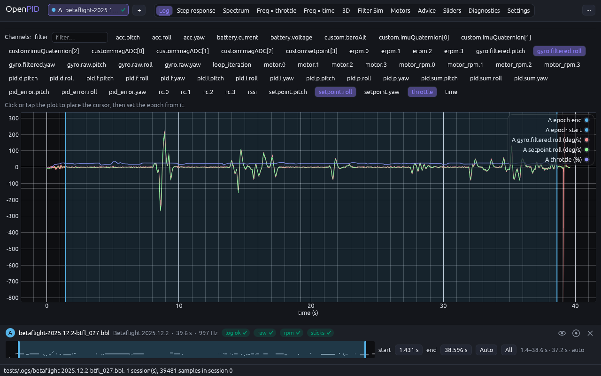
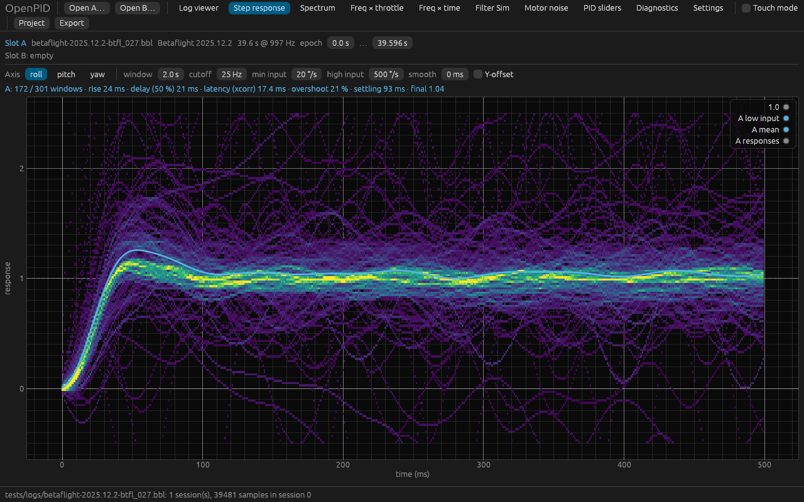
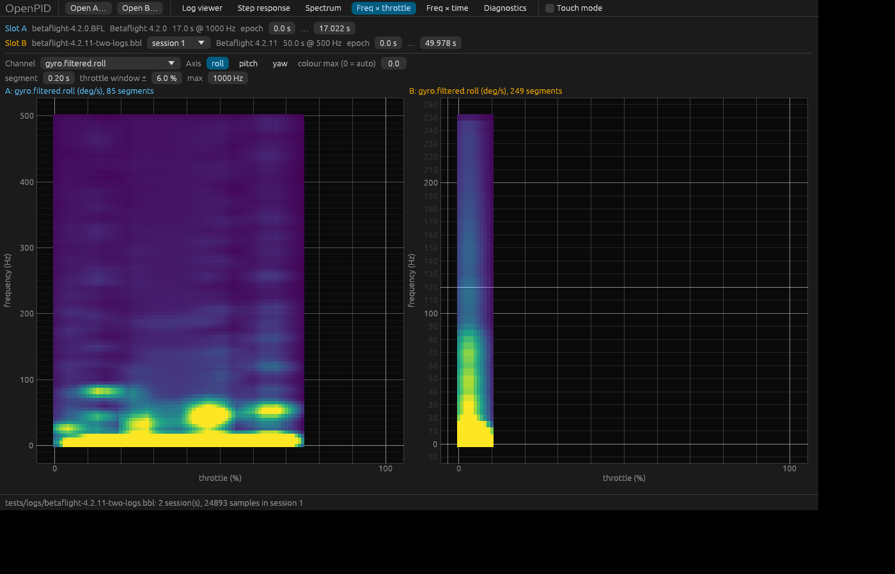
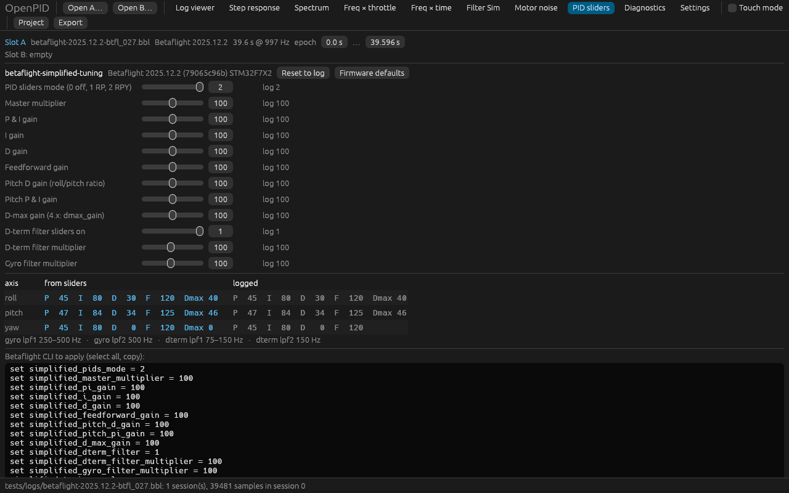

# OpenPID

Кросплатформенний інструмент на Rust для аналізу blackbox‑логів політних контролерів і допомоги в налаштуванні PID та фільтрів (функціональний орієнтир — PIDtoolbox / PIDtoolbox Pro, код — повністю власний). Ліцензія — MIT.

## Стан

[](https://github.com/Rufics/OpenPID/actions/workflows/ci.yml)

Фаза 0 (фундамент) і фаза 1 (математика, аналізи, GUI, PID‑слайдери) реалізовані:

- `openpid-core` — доменна модель (`FlightSession`, `Channel`, `ChannelId`, `Series`, `Timebase`, `Settings`) і trait‑и розширення (`LogFormat`, `FirmwareProfile`, `Analysis`).
- `openpid-fmt-blackbox` — власний декодер бінарного Blackbox (усі кодування та предиктори, I/P/S/G/H/E‑кадри, валідація, ресинхронізація, rollover часу, події) та профілі прошивок Betaflight, EmuFlight, Rotorflight, INAV (базовий) і generic.
- `openpid-fmt-csv` — читання CSV‑експорту `blackbox_decode`.
- `openpid-dsp` — FFT‑обгортка, вікна, Welch PSD, STFT, деконволюція Вінера, ресемплінг; кожна функція звірена з фікстурами NumPy/SciPy (`tests/reference`, генератор `tools/reference/make_fixtures.py`).
- `openpid-analysis` — step response (деконволюція setpoint → gyro), PSD, heatmap freq×throttle та freq×time.
- `openpid-cli` — `openpid info`, `openpid decode`, `openpid run`, `openpid sliders`.
- `openpid-app` — десктопний GUI (`openpid-gui`, egui/eframe): log viewer з вибором епохи, step response, спектр, heatmap‑и freq×throttle і freq×time, PID‑слайдери Betaflight (simplified tuning: позиції з логу → гейни, порівняння з фактичними, готові CLI‑команди), діагностика; два слоти A/B для порівняння; аналізи у фоновому потоці з кешем; touch‑режим (вмикається автоматично при першому дотику).

Подальший план — у [`docs/DESIGN.md`](docs/DESIGN.md) (§12).

## Збірка та використання

```sh
cargo build --release
./target/release/openpid info  path/to/LOG.BFL            # огляд сесій, прошивки, частот, каналів
./target/release/openpid info  path/to/LOG.BFL --json     # те саме у JSON
./target/release/openpid decode path/to/LOG.BBL --session 1 --out log1.csv   # сирі цілі, як blackbox_decode
./target/release/openpid decode path/to/LOG.BBL --scaled                     # канонічні канали у фізичних одиницях
./target/release/openpid run step path/to/LOG.BBL --axis pitch --epoch 5..60   # step response (JSON)
./target/release/openpid run psd  path/to/LOG.BBL --channel gyro.raw.roll      # Welch PSD
./target/release/openpid run thr-heatmap path/to/LOG.BBL                       # freq × throttle
./target/release/openpid run stft path/to/LOG.BBL --channel pid.d.roll         # freq × time
./target/release/openpid sliders path/to/LOG.BBL --set simplified_d_gain=90     # PID-слайдери Betaflight
```

### GUI

```sh
cargo run --release -p openpid-app                # або ./target/release/openpid-gui [logA] [logB]
```






Файли відкриваються кнопками «Open A…/Open B…» або перетягуванням у вікно. У Log viewer клік/тап по графіку ставить курсор, кнопки «start = cursor»/«end = cursor» задають епоху аналізу; масштабування — колесо/pinch, панорамування — перетягування. Усі обчислення виконуються у фоновому потоці, результати кешуються за параметрами.

## Тести

```sh
cargo test --workspace            # unit, golden, конформанс, стійкість до пошкоджень
tools/fetch-community-logs.sh     # додаткові логи спільноти (Rotorflight, EmuFlight 0.4, BF 4.3) у tests/logs/external
OPENPID_UPDATE_GOLDEN=1 cargo test -p openpid-fmt-blackbox --test fixtures   # оновити golden‑файли після свідомої зміни
python3 -I tools/reference/make_fixtures.py   # перегенерувати фікстури NumPy/SciPy (потрібні numpy, scipy)
```

`tools/fetch-community-logs.sh` завантажує по одному логу на кожну лінію релізів Betaflight (4.3, 4.4, 4.5, 2025.12) та інші прошивки; тест `versions.rs` перевіряє кожну наявну версію. Матриця відмінностей формату між версіями — у [`docs/BLACKBOX-VERSIONS.md`](docs/BLACKBOX-VERSIONS.md).

Якщо поруч із логом у `tests/logs/` покласти `<лог>.<сесія>.csv`, згенерований офіційним `blackbox_decode --index <сесія>`, тест `csv_conformance` порівняє наш сирий декод із ним поле в поле.

## Якість і процес

- Стиль коду — адаптований Google Rust Style Guide: [`docs/STYLE.md`](docs/STYLE.md); більшість правил перевіряє clippy (`missing_docs`, `unwrap_used`, `wildcard_imports`, `pedantic`, …) з `-D warnings`.
- Робочий процес, Conventional Commits, релізи: [`CONTRIBUTING.md`](CONTRIBUTING.md) і [`docs/RELEASING.md`](docs/RELEASING.md). `master` захищена ruleset‑ом (`.github/rulesets/master.json`): лише PR зі squash, зелені перевірки, схвалення code owner.
- CI (`.github/workflows/ci.yml`): fmt, clippy, rustdoc, typos, тести на Linux/macOS/Windows, покриття ≥ 90 % рядків (job `coverage`, GUI‑crate виключено), cargo‑deny, артефакти бінарників для трьох ОС, SonarCloud (коли є `SONAR_TOKEN`), перевірка повідомлень комітів і заголовка PR; кеш `Swatinem/rust-cache`. Правило проєкту: CI ніколи не лишається червоним (`CLAUDE.md`).
- Релізи: release‑plz будує CHANGELOG і версії з Conventional Commits, тег `vX.Y.Z` запускає збірку бінарників у GitHub Release.

## Документи

- [`docs/DESIGN.md`](docs/DESIGN.md) — дизайн‑проєкт
- [`docs/adr/`](docs/adr/) — архітектурні рішення
- [`docs/OPEN-QUESTIONS.md`](docs/OPEN-QUESTIONS.md) — питання та ухвалені рішення
- [`docs/BLACKBOX-VERSIONS.md`](docs/BLACKBOX-VERSIONS.md) — відмінності формату між версіями Betaflight і покриття логами
- [`tests/logs/README.md`](tests/logs/README.md) — походження тестових логів
