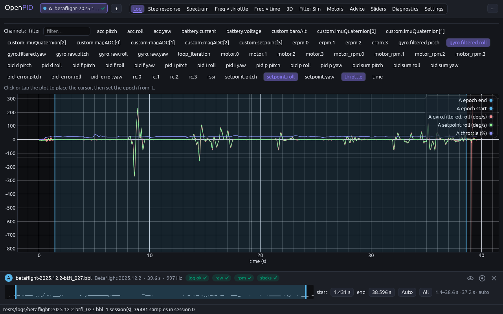
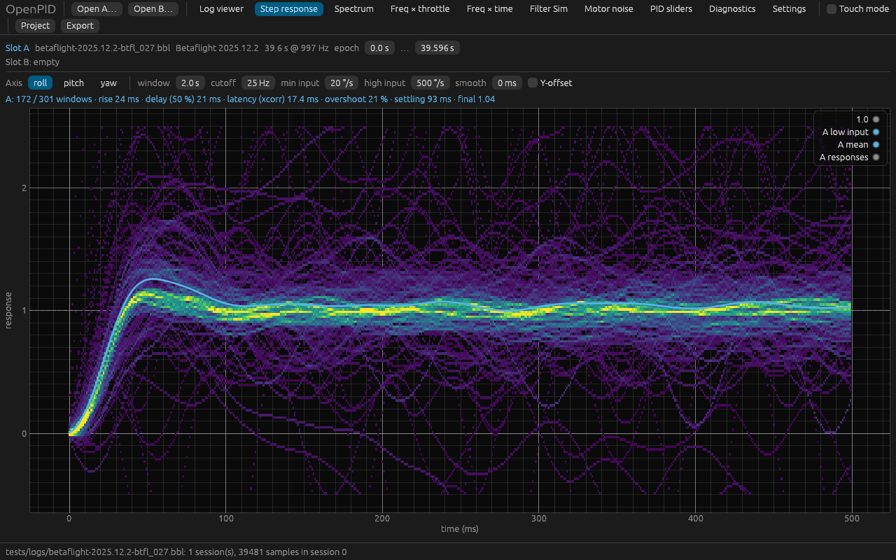
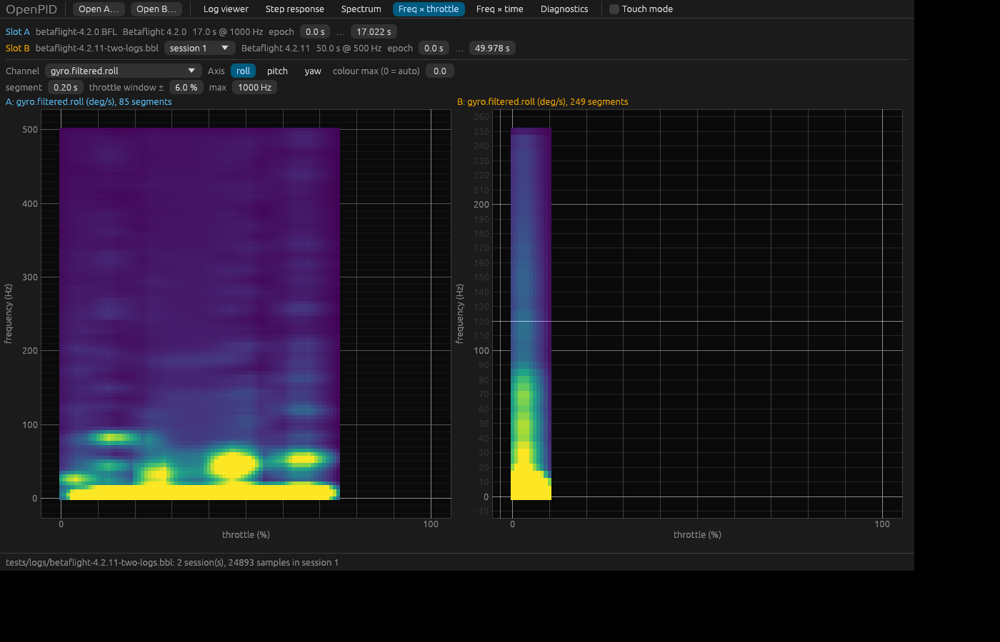
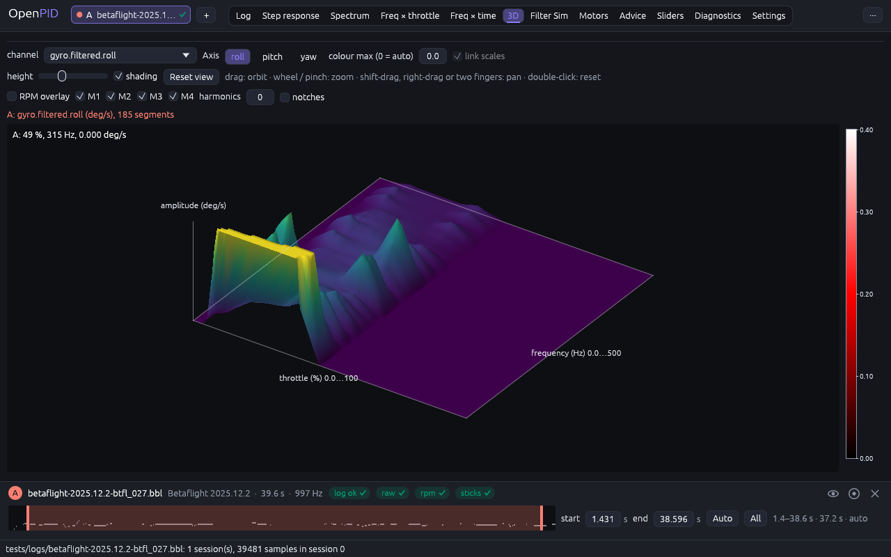
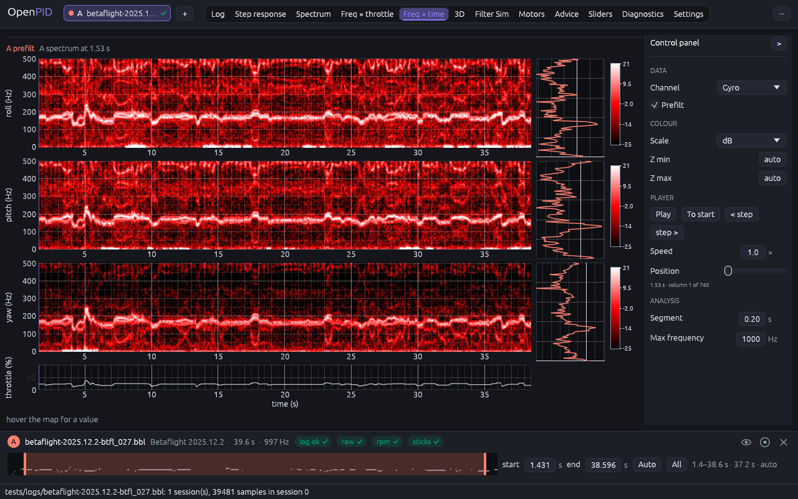
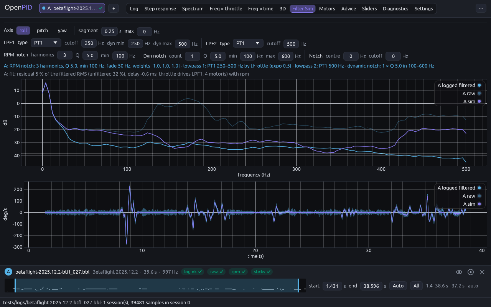
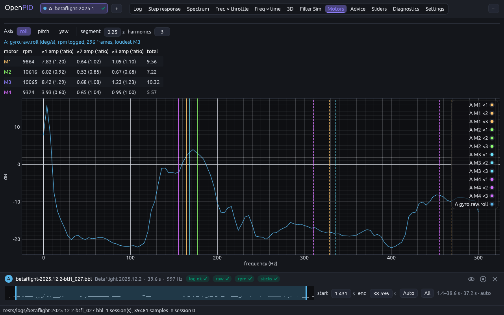
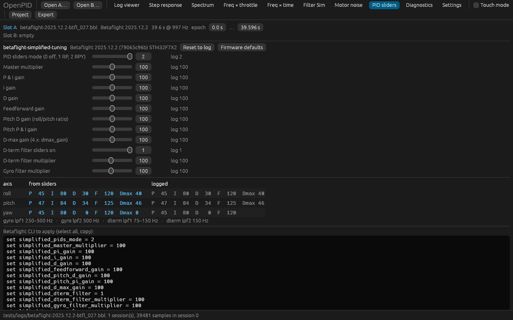
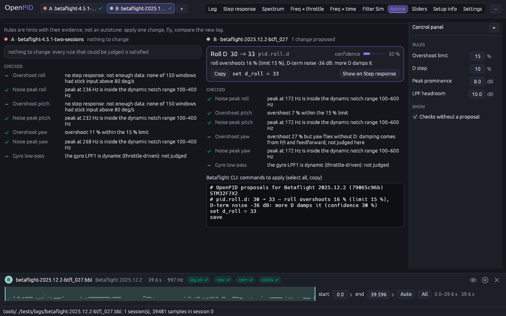

# OpenPID — посібник користувача

OpenPID читає blackbox‑логи (Betaflight, EmuFlight, Rotorflight, INAV, ArduPilot
DataFlash, CSV з `blackbox_decode`) і показує те, що потрібно для тюнінгу PID і
фільтрів: часові графіки, step response, спектри, теплові карти частота×газ і
частота×час, симуляцію фільтрів, шум моторів і PID‑слайдери Betaflight. Усе,
що робить GUI, має еквівалент у CLI (`openpid run …`), тож результати можна
відтворити скриптом.

Робочий процес (DESIGN §7.3): **відкрити лог → вибрати сесію й епоху → подивитися
інструмент → змінити параметри → порівняти з логом B → зберегти проєкт або
експортувати.**

## 1. Запуск і відкриття логів

```sh
cargo run --release -p openpid-app                      # або ./target/release/openpid-gui
./target/release/openpid-gui logA.bbl logB.bbl --tab step   # одразу два логи й вкладка
./target/release/openpid-gui flight.openpid.json          # проєкт (п. 12)
```

- **Open log…** у верхній панелі (`Ctrl+O`) або перетягніть файли у вікно: один
  файл займає вільний слот (спочатку A), два — A і B. Гарячі клавіші — п. 13а.
- Лог із кількома сесіями (кілька армувань) відкривається на найдовшій; інша
  обирається у списку **session** біля назви слота. Епоха при зміні сесії
  скидається.
- Рядок стану внизу показує, що завантажено, скільки сесій і зразків, а також
  результат збереження/експорту.
- **Перевірка логу.** Після тривалості в рядку слота стоять бейджі `raw`, `rpm`,
  `sticks` і загальна оцінка: `[ok]` — усе гаразд, `[!]` — попередження, `[x]` —
  для цієї вкладки/аналізу даних бракує. Наведіть курсор — побачите пояснення і
  команду CLI, яка це виправить (наприклад, `set blackbox_disable_gyrounfilt = OFF`).
  Повний список перевірок — на вкладці Diagnostics (п. 11).
- **Touch mode** (прапорець угорі) збільшує контроли; вмикається сам при першому
  дотику.



## 2. Log viewer — епоха й канали

- **Channels**: прапорці каналів слота A; поле **filter** звужує список
  (`gyro`, `pid.d`, `motor`…). Назви каналів однакові для всіх прошивок:
  `gyro.filtered.roll`, `gyro.raw.pitch`, `setpoint.yaw`, `pid.p.roll`,
  `motor.0`, `motor_rpm.0`, `throttle`, `rc.3`, `debug.0`, `custom:…`.
- **Курсор**: клік або тап по графіку. Кнопки **A start = cursor** /
  **A end = cursor** задають епоху — вікно часу, яке аналізують усі інструменти.
- **Межі епохи** можна перетягувати прямо на графіку (заштрихована область,
  ручки 8 px, 22 px у touch‑режимі); перетягування поза ручками панорамує графік.
- Масштабування — колесо або pinch, панорамування — перетягування, подвійний
  клік скидає масштаб.
- Одиниці кутової швидкості (deg/s або rad/s) і прискорення (g або m/s²)
  обираються у Settings і діють лише на трейси цієї вкладки.

Епоха зберігається у ключі кешу: кожна комбінація «сесія + епоха + параметри»
рахується один раз у фоновому потоці, тож перемикання вкладок миттєве.

## 3. Step response



Відгук на одиничний крок setpoint → gyro за Wiener‑деконволюцією (DESIGN §6.2):
епоха ріжеться на вікна, вікна з малим стіком відкидаються, решта усереднюється
з вагою за амплітудою входу, окремо для **low** (< `high input`) і **high**
входів. Гістограма внизу показує розкид відгуків окремих вікон.

| Параметр | Що робить | Типово |
|---|---|---|
| Axis | roll / pitch / yaw | roll |
| window | довжина вікна, с | 2 |
| cutoff | частота зрізу деконволюції, Гц (вище — шум) | 25 |
| min input | мінімальний пік setpoint у вікні, °/с | 20 |
| high input | межа груп low/high, °/с | 500 |
| smooth | ковзне середнє по кривій, мс (0 = без) | 0 |
| Y‑offset | нормувати кожне вікно на його усталений хвіст | вимк. |

Рядок метрик: `rise` 10–90 %, `delay (50 %)` — перший перетин половини
усталеного значення, `latency (xcorr)` — зсув максимуму крос‑кореляції
setpoint↔gyro (транспортна затримка осі; для плавного стіку включає частину
відставання об'єкта, тому читайте поруч із delay), `overshoot`, `settling` ±5 %,
`final` — усталене значення (≈1; менше означає, що гіро не доходить до setpoint).

Як читати: повільне наростання і `final` < 1 — замало P/FF або завеликі
фільтри; перерегулювання > 10–15 % і коливання — забагато P чи замало D;
`latency` помітно більший за сусідні логи — зайва затримка у фільтрах.

## 4. Spectrum

PSD Велча обраного каналу (DESIGN §6.3). **Channel** — будь‑який канал, кнопки
осі підставляють `gyro.filtered.<вісь>`; **segment** — довжина сегмента (довший
= дрібніша частотна сітка, менше усереднення), **max** обмежує вісь частот,
**dB** перемикає шкалу.

- **peaks** / **prominence** — автоматичні маркери N найпомітніших піків
  (помітність у дБ над оточенням); підпис показує частоту й рівень.
- Клік по графіку ставить ручний маркер (прилипає до найближчого біна); рядок
  під контролами показує частоти маркерів і Δ між двома останніми, **Clear
  markers** прибирає їх. Ручні маркери дублюються горизонтальними лініями на
  обох теплових картах — зручно звіряти пік спектра з гармонікою мотора.

Порівняйте `gyro.raw` і `gyro.filtered` одного логу: різниця — це робота
фільтрів; піки, що лишилися у filtered, і є те, що доходить до PID.

## 5. Freq × throttle



Теплова карта амплітуди спектра залежно від газу (DESIGN §6.4): епоха ріжеться
на сегменти (**segment**, с), кожен отримує спектр і середній газ; для кожного
біна газу 0…100 % усереднюються сегменти в межах **throttle window ±** %.
**max** — верхня частота, **colour max** — стеля шкали кольору (0 = автоматично,
99‑й процентиль без рядків нижче 20 Гц). Праворуч від кожної карти — **колірна
шкала** з поділками й одиницею; під картою — значення клітинки під курсором
(«37 %, 172 Hz: 0.45 deg/s»). З кількома логами **link scales** (увімкнено за
замовчуванням) дає всім панелям одну стелю — найбільшу з автоматичних, тож
однаковий колір означає однакове значення; вимкніть, щоб кожна карта мала свою.
Те саме на Freq × time і Surface 3D.

- Під картою — смуга **сегментів на бін**: скільки сегментів потрапило в кожен
  бін газу. Біни з кількістю меншою за **min segments** затемнені: там даних
  немає, а не тиша.
- **RPM overlay** (коли в логу є eRPM): лінії гармонік `k·rpm/60` кожного мотора
  (кольори за моторами, перемикачі M1…Mn, **harmonics** — скільки малювати, 0 =
  стільки, скільки знімає RPM‑фільтр), смуги статичних notch, смуга dyn notch і
  мінімум RPM‑фільтра (**notches**). Хребет шуму має лягати на лінію
  фундаментальної гармоніки; якщо він вище/нижче — `motor_poles` або `rpm_min`
  виставлені неправильно.

### Surface 3D



Та сама сітка freq × throttle × amplitude як рельєф: висота й колір — амплітуда
(стеля — **colour max**, як у тепловій карті, **height** — висота стелі).
Малюється власним програмним проєктуванням без GPU‑залежностей: до 128 × 192
клітинок після усереднення, тож обертання плавне й на великих логах.

- **Перетягування** — обертання (горизонталь — навколо вертикальної осі,
  вертикаль — нахил аж до «виду зверху», тобто звичайної теплової карти);
  **коліщатко / щипок** — масштаб; **shift‑ або праве перетягування, два
  пальці** — зсув; **подвійний клік** або **Reset view** — початковий вигляд.
- **RPM overlay** і **notches** ті самі, що й на тепловій карті: гармоніки
  моторів і смуги notch лежать на поверхні.
- Наведення на вузол показує газ, частоту й амплітуду у кутку панелі.
- **shading** — освітлення за нахилом поверхні (підкреслює хребти); вимкніть,
  щоб колір відповідав шкалі теплової карти точно.
- Експорт CSV/PNG з цієї вкладки віддає ту саму сітку, що й Freq × throttle.

## 6. Freq × time

Спектрограма (STFT) каналу: частота по вертикалі, час по горизонталі. Параметри
**segment** і **max** як у п. 5. Показує, як шум змінюється протягом польоту
(розгін моторів, пропвош, резонанси при певних маневрах). Ручні маркери з
вкладки Spectrum також видно тут.



**Програвач спектра.** Під картою — спектр поточного стовпця STFT (амплітуда
по частоті), а на карті — вертикальна лінія позиції. **Play / Pause** веде
позицію в реальному часі (×**speed**, по кінцю — спочатку), **< step / step >** —
на один стовпець, **To start** — на початок, повзунок **position** і клік по
карті (у touch‑режимі — протягування пальцем) — перемотування. Позиція — це
курсор Log viewer: поставлений там курсор переносить програвач, а програвач
веде курсор, тож епоху можна виставити з того місця, де спектр «спалахує».

## 7. Filter Sim



Нефільтроване гіро (`gyro.raw`) проганяється через модель ланцюга фільтрів,
зібрану з налаштувань логу (DESIGN §6.6): LPF1 (статичний або залежний від
газу), LPF2, статичні notch, RPM‑notch на гармоніках моторів, dyn notch, що
стежить за піками. Потрібен лог із нефільтрованим гіро: Betaflight ≥ 4.5 пише
`gyroUnfilt`, старіші — `debug_mode = GYRO_SCALED`; ArduPilot — batch sampler.

- Рядок **fit**: залишок `gyro.sim − gyro.filtered` у % від RMS фільтрованого
  (наскільки модель повторює прошивку; 5–15 % — норма, модель працює на частоті
  логу), для порівняння — залишок без фільтрів, і затримка sim відносно логу.
- **What‑if**: поля редактора показують значення з логу; змінене поле стає
  override (підсвічується) і перераховує симуляцію. 0 вимикає стадію. **Reset
  to log** повертає все.
- Графіки: PSD raw / logged filtered / sim as flown (пунктир) / sim what‑if і
  ті самі ряди в часі.

Типовий сценарій: зняти LPF2 або підняти LPF1 і подивитися, скільки шуму
прийде на PID (sim what‑if проти logged), перш ніж міняти прошивку.

## 8. Motor noise



Таблиця: для кожного мотора — середні оберти, амплітуда гіро на гармоніках
`×1…×n` і відношення до середнього по моторах, сума. Найгучніший мотор і
відношення > 1.3 підсвічені: гнутий пропелер або битий підшипник видно як рядок,
що випадає. Швидкості беруться з eRPM; без телеметрії працює оцінка з піків
гіро (п. 9), тоді в таблиці один рядок на всі мотори. Нижче — спектр із
гармоніками кожного мотора у його кольорі.

## 9. Оберти без eRPM

`openpid run rpm <log>` оцінює оберти з піків спектра `gyro.raw` (DESIGN §6.6):
кандидати — найсильніші піки у смузі `rpm_min..rpm_max` і їхні гармоніки,
динамічне програмування обирає неперервний шлях; у виводі `confidence`
кожного кадру і, якщо eRPM є, `median_error` для контролю. Фільтроване гіро для
цього не годиться — RPM‑фільтр уже зняв піки.

## 10. PID sliders



Для логів Betaflight 4.3+ із simplified tuning: слайдери, з якими летів лог, і
коефіцієнти, які вони дають. Рухайте слайдери — праворуч нові PID і готові
команди CLI (`set …`); **Reset** повертає значення з логу. Те саме в терміналі:
`openpid sliders <log> --set simplified_master_multiplier=110`.

## 11. Diagnostics і Settings

- **Diagnostics**: прошивка, профіль, частоти, кадри (валідні/пошкоджені/
  resync), прогалини, нерозпізнані поля, усі заголовки логу (для ArduPilot — усі
  `PARM`), нотатки декодера (batch sampler, хвіст іншого файлу тощо).
- **Log check** (картка над таблицею Diagnostics) — чи придатний лог для кожного
  аналізу. Перевірки та пороги:

  | Перевірка | Ok | Попередження `[!]` | Помилка `[x]` |
  |---|---|---|---|
  | rate — частота логу | ≥ 1 kHz (≥ 950 Hz) | 500–950 Hz | < 500 Hz |
  | duration — тривалість сесії | ≥ 20 s | 5–20 s | < 5 s |
  | raw — нефільтрований gyro | є | — | немає: Filter Sim, Motor noise і правило піків недоступні |
  | rpm — eRPM моторів | є | немає (overlay бере оцінку обертів) | — |
  | frames — пошкоджені кадри | < 0.5 % | 0.5–5 % | > 5 % |
  | gaps — прогалини часу | 0 | ≤ 3 | > 3 |
  | sticks — step-вікон на roll і pitch | ≥ 10 | 5–9 | < 5: step response ненадійний |
  | throttle — покриття діапазону газу | ≥ 30 % | 10–30 % | < 10 %: Freq × throttle неповний |
  | debug — `debug_mode` | інформаційно | | |

  Загальна оцінка — найгірша з rate, duration, frames; решта лише попереджає.
  Поруч із кожною порадою є кнопка **Copy** — команда копіюється в буфер і
  вставляється в CLI конфігуратора. Вкладки Filter Sim і Motor noise, яким
  бракує raw gyro, показують ту саму пораду. Для логу з кількома сесіями
  перевірка робиться для кожної; картка показує обрану.
- **Settings**: тема (dark/light), **мова інтерфейсу** (English / Українська —
  перемикається миттєво, одиниці й числа не змінюються), touch‑режим на старті,
  одиниці deg/s↔rad/s і g↔m/s². Зберігається у `prefs.json` каталогу конфігурації (`~/.config/openpid`,
  `~/Library/Application Support/openpid`, `%APPDATA%\openpid`; `OPENPID_CONFIG_DIR`
  перевизначає).

## 12. Порівняння A/B, проєкти, експорт

- **Кілька логів** (до 8): **Open log…**, **+ Add log** або перетягування
  файлів у вікно відкриває кожен лог у власний слот A…H зі своїм кольором
  (палітра Okabe–Ito, видима й при дальтонізмі). Лінійні вкладки (Log viewer,
  Step response, Spectrum, Filter Sim) накладають усі слоти на один графік;
  панельні (теплові карти, Surface 3D, Motor noise, Advice, Diagnostics) ставлять
  панелі поруч — дві на всю ширину, більше — у прокрутку. У рядку слота:
  прапорець «показувати», **S** (solo — лише цей слот; повторне натискання
  повертає всі) і **x** (закрити; букви інших слотів не змінюються). Епоха в
  кожного слота своя. Перший завантажений слот — еталон для списку каналів,
  PID-слайдерів і назв експортованих файлів.
- **Project → Save as…** записує `.openpid.json`: логи (шляхи відносно файлу
  проєкту), сесії, епохи, вкладку, touch‑режим і всі параметри інструментів;
  **Open…**, перетягування або аргумент командного рядка відновлює вид.
  `openpid run step --project flight.openpid.json` бере перший лог проєкту, сесію,
  епоху й параметри з проєкту. Проєкт зберігає всі слоти з буквами й видимістю
  (схема v2; файли v1 читаються).
- **Export → Plot as PNG…** зберігає область вкладки; **<слот> result as JSON…**
  — результат аналізу точно таким, як друкує `openpid run … `. Для теплових карт
  `openpid run thr-heatmap <log> --png out.png` пише картинку сітки.

## 12а. Advice — рекомендації з доказами



Вкладка **Advice** (і `openpid run recommend <log> [--epoch A..B]`) проганяє три
консервативні правила і показує пропозиції (`path`, `from`, `to`, `rationale`, `confidence`) разом із
доказами кожного правила — також тими, що нічого не запропонували:

- **overshoot** — перерегулювання step response понад 15 % на осі з ненульовим D,
  коли D‑term не зашумлений (рівень PSD `pid.d` на 150–400 Гц проти 5–30 Гц
  нижче −15 дБ) → `pid.<вісь>.d` +10 %; зашумлений D‑term — порада спершу
  понизити D‑term фільтр; yaw без D не чіпається.
- **peak** — найвиразніший пік сирого гіроскопа вище 80 Гц (≥ 8 дБ), який не
  накриває ні статичний notch, ні діапазон dyn notch, ні RPM‑фільтр → розширити
  діапазон dyn notch або поставити статичний notch на пік.
- **gyro-lpf** — коли шум сирого гіроскопа у смузі «зріз…2×зріз» на 10 дБ нижчий
  за низьку смугу (10…зріз/2) → статичний зріз LPF1 ×1,25 (менша фазова
  затримка; у поясненні — мілісекунди до/після).

На вкладці: пороги правил (**overshoot limit**, **D step**, **peak prominence**,
**LPF headroom**) зберігаються у проєкті; таблиця **Proposals** (шлях, було → буде,
впевненість, пояснення), таблиця **Evidence** (● — правило спрацювало, ○ — ні) і
готовий текст для Betaflight CLI; Export → JSON віддає той самий результат.
У CLI `--cli` замість JSON друкує докази коментарями й команди `set … / save` для
Betaflight CLI (`openpid-fmt-blackbox::BetaflightCli`, та сама таблиця імен,
що й в `openpid diff --cli`). Правила — лише підказки з доказами, не autotune:
застосовуйте по одній зміні й перевіряйте новим логом.

## 13. CLI — відповідності

| Вкладка | Команда |
|---|---|
| Log viewer | `openpid info <log>`, `openpid decode <log> --scaled` |
| Log check | `openpid info <log>` — блок `fitness` (у `--json` — поле `fitness`) |
| Step response | `openpid run step <log> --axis pitch --epoch 2..12` |
| Spectrum | `openpid run psd <log> --channel gyro.raw.roll` |
| Freq × throttle | `openpid run thr-heatmap <log> [--png out.png]` |
| Freq × time | `openpid run stft <log> --channel motor.0` |
| Filter Sim | `openpid run filter-sim <log> --set lpf1_hz=100,lpf1_type=1` |
| Motor noise | `openpid run motor-noise <log>` |
| Оберти без eRPM | `openpid run rpm <log>` |
| PID sliders | `openpid sliders <log> --set …` |
| Порівняння налаштувань двох логів | `openpid diff <logA> <logB> [--session N --session-b M] [--cli \| --json]` |
| Рекомендації з доказами | `openpid run recommend <log> [--epoch A..B] [--cli]` |
| Синтетичний лог | `openpid gen --example > spec.json; openpid gen spec.json --out synthetic.csv` |

`--session N` обирає сесію, `--epoch A..B` — секунди, `--out` пише у файл.

## 13а. Гарячі клавіші

Довідник — `?` (або `Ctrl+/`, `F1`, меню **Help → Keyboard shortcuts**); кожна
кнопка з клавішею показує її в підказці. `Cmd` на macOS, `Ctrl` на Windows/Linux.
Одиночні клавіші (`1`…`=`, `?`, `Space`, `,`, `.`, `Home`, `Shift+A`, `Esc`)
працюють, лише коли фокус не в текстовому полі: у полі `2` вводить цифру,
`Esc` виходить із поля.

| Дія | Клавіша |
|---|---|
| Вкладки за порядком (Log viewer … Settings) | `1`…`9`, `0` (10-та, PID sliders), `-` (11-та, Diagnostics), `=` (12-та, Settings) |
| Наступна / попередня вкладка (по колу) | `Ctrl+Tab` / `Ctrl+Shift+Tab` |
| Відкрити лог у перший порожній слот | `Ctrl+O` |
| Відкрити лог для порівняння (у слот після останнього завантаженого) | `Ctrl+Shift+O` |
| Закрити останній відкритий слот | `Ctrl+W` |
| Проєкт: зберегти як… / відкрити… | `Ctrl+S` / `Ctrl+Shift+S` |
| Експорт вкладки як PNG | `Ctrl+E` |
| Довідник клавіш (показати/сховати) | `?`, `Ctrl+/`, `F1` |
| Закрити довідник | `Esc` |
| Плеєр на Freq × time: відтворити/пауза, стовпець назад/вперед, на початок | `Space`, `,` / `.`, `Home` |
| Епоха: весь лог для всіх слотів | `Shift+A` |
| Сенсорний режим | `Ctrl+T` |

Порядок цифр відповідає порядку вкладок у верхній панелі; якщо вкладка
додається, таблиця оновлюється разом із нею.

## 14. Якщо щось не так

| Симптом | Причина й що робити |
|---|---|
| «no unfiltered gyro in this log» | Увімкніть `gyroUnfilt` у полях blackbox (BF 4.5+) або `debug_mode = GYRO_SCALED`; на ArduPilot — `INS_LOG_BAT_MASK`. |
| RPM overlay відсутній | У логу немає eRPM (DShot‑телеметрія вимкнена). Оберти можна оцінити (`run rpm`). |
| Step response: «none of N windows had stick input» | Епоха без маневрів або `min input` зависокий; оберіть ділянку з рухом стіка. |
| Freq × throttle майже порожня | Короткий політ або вузький діапазон газу: дивіться смугу сегментів на бін. |
| Лог відкрився з «corrupt frames» у Diagnostics | Пошкоджені кадри пропущені; якщо їх багато — карта/лог‑швидкість (див. docs/BLACKBOX-VERSIONS.md). |
| ArduPilot: setpoint сходинками | `RATE`/`PIDR` пишуться на 10 Гц; увімкніть `ATTITUDE_FAST` і `PID` у `LOG_BITMASK`. |

Скріншоти оновлюються скриптом `tools/screenshots.sh` (Xvfb + ImageMagick) на
фікстурі Betaflight 2025.12.
