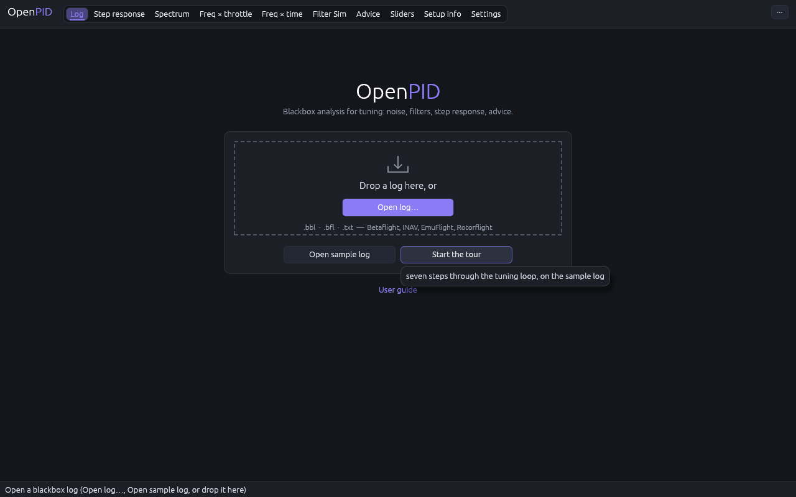
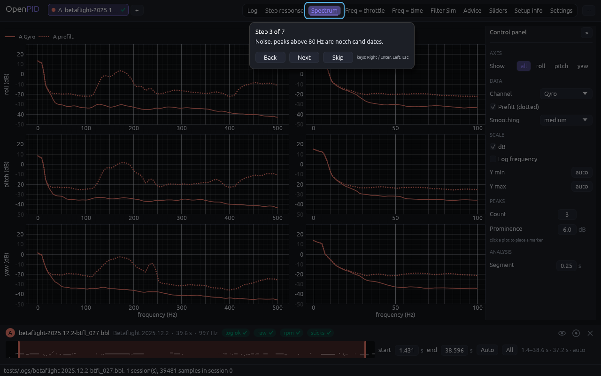
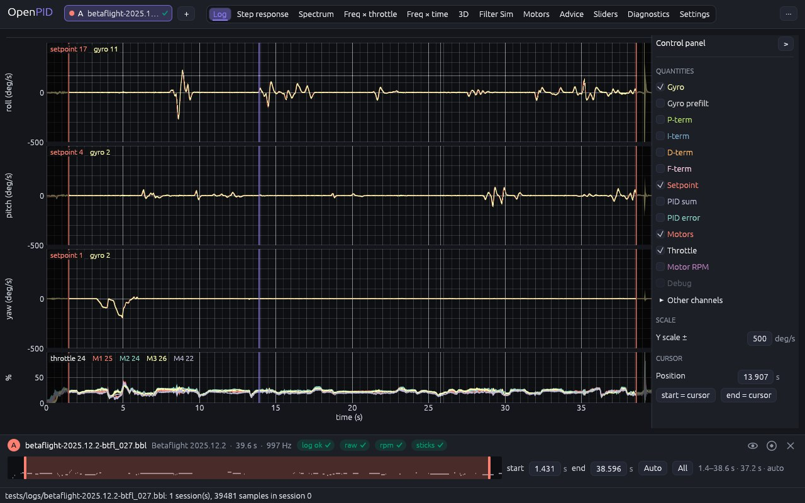

# OpenPID — user guide

OpenPID reads blackbox logs (Betaflight, EmuFlight, Rotorflight, INAV,
ArduPilot DataFlash, `blackbox_decode` CSV) and shows what PID and filter
tuning needs: time plots, step response, spectra, frequency × throttle and
frequency × time heatmaps, a filter simulation and the Betaflight
PID sliders. Everything the GUI does has a CLI equivalent (`openpid run …`),
so a result can be reproduced by a script.

The workflow (DESIGN §7.3): **open a log → pick the session and the epoch →
look at a tool → change its parameters → compare with log B → save the project
or export.**

## 1. Starting and opening logs

```sh
cargo run --release -p openpid-app                      # or ./target/release/openpid-gui
./target/release/openpid-gui logA.bbl logB.bbl --tab step   # two logs and a tab at once
./target/release/openpid-gui flight.openpid.json          # a project (section 12)
```

- **Start screen.** While no log is open, the tab is replaced by a card:
  **Open log…**, **Open sample log** (a synthetic 30 s flight with an
  underdamped response, no file needed, to look around), **Start the tour**,
  the **Recent files** list (up to 8 logs with their date; a click opens one)
  and a link to this guide.

  

- **Tour.** The first opened log (or the sample) starts a seven-step tour: a
  dimmed screen with a window on the relevant widget and a card with the text:
  slots → analysis window → Spectrum → Freq × throttle → Filter Sim → Step
  response → Advice with its CLI commands. Buttons **Back / Next / Skip**,
  keys `→`/`Enter`, `←`, `Esc`. The tour shows once; again from **··· → Help → Show
  tour**; the autostart can be switched off, and the state reset, in Settings.

  

- **Open log…** on the start screen or in the **···** menu at the right of the
  top bar (`Ctrl+O`), or drop files into the window: one file takes the free
  slot (A first), two take A and B. Shortcuts: section 13a.
- Every open log is a chip in the top bar: its colour, letter, file name and
  log-check mark. The **timeline dock** at the bottom shows one log: its name,
  firmware, length and rate, the session, the log check, the show / solo /
  close icons and the epoch strip. It shows the log opened last; click a chip
  to dock another one. The tabs never move as logs are added.
- A log with several sessions (several arms) opens on the longest one; another
  is picked in the **session** list in the dock. Switching the session resets
  the epoch.
- The status bar at the bottom says what is loaded, how many sessions and
  samples, and the outcome of a save or export.
- **Log check.** The dock carries the badges `raw`, `rpm`, `sticks` and an
  overall one (`log ok`, `log usable`, `log unfit`), each with a tick (fine),
  "!" (a warning) or a cross (the data for this tab or analysis is missing);
  the chip in the top bar shows the overall mark. Hover for the explanation and the
  CLI command that fixes it (for example `set blackbox_disable_gyrounfilt = OFF`).
  The full list of checks is on the Diagnostics tab (section 11).
- **Touch mode** (in the **···** menu and in Settings) enlarges the controls; it switches
  itself on at the first touch.
- **One axis at full height.** The tabs with roll, pitch and yaw rows (Log
  viewer, Step response, Spectrum, Freq × throttle, Freq × time, Motors)
  show the three axes by default; **Show** at the top of the control panel
  (`all` / `roll` / `pitch` / `yaw`) or the keys `R`, `P`, `Y` keep one axis
  and give it the full height, and the same key again brings the three
  back. The choice holds on every tab, and the chosen axis is the one the
  export uses.


## 2. Log viewer — epoch and channels



- **Rows**: roll, pitch and yaw of the docked log (the one in the timeline
  dock at the bottom) at one scale, **Y scale ±** in the panel (500 deg/s by
  default), and under them a row for the throttle and the motors (0–100 %).
  Motor speeds, debug values and other channels get rows of their own when
  chosen. Every row shares the time axis: zoom and pan move time only.
- **Quantities** (panel): Gyro, Gyro prefilt, P-term, I-term, D-term, F-term,
  Setpoint, PID sum, PID error (on every axis), Motors, Throttle, Motor RPM,
  Debug. Their names are drawn in their line colours; one the log does not
  have is greyed. The default is Gyro, Setpoint, Motors and Throttle.
- **At the top left of each row** the names of its lines in their colours,
  with the values at the cursor once you place it.
- **The sticks** at the bottom right of the throttle / motors row: the left
  box throttle (up) and yaw (across), the right box pitch (up) and roll
  (across), as on a mode-2 transmitter. They follow the pointer while it is
  over the plots, else the cursor (from the log's RC commands). **Sticks**
  at the end of the panel hides them.
- **The flight modes** of the same moment on that card, over the sticks
  ("ARM · ANGLE", "ARM · POSHOLD"…), as the log records them: the mode
  switches of Betaflight, INAV and Rotorflight by firmware version
  (EmuFlight: ARM, the other switches by number), the modes and arming of
  `ArduPilot`, the names of a `blackbox_decode` CSV. **Flight modes** at the
  end of the panel hides them.
- **Mode changes** (panel, off by default) marks where the modes change on
  the throttle / motors row: a dashed line with the modes from then on.
- **Other channels** (panel, folded): checkboxes of every channel of the log;
  the **filter** field narrows the list (`gyro`, `pid.d`, `motor`…). Channel
  names are the same for every firmware: `gyro.filtered.roll`,
  `gyro.raw.pitch`, `setpoint.yaw`, `pid.p.roll`, `motor.0`, `motor_rpm.0`,
  `throttle`, `rc.3`, `debug.0`, `custom:…`.
- **Epoch**: the time window every tool analyses. Under each slot row, on every
  tab, sits a **timeline strip**: the grey throttle envelope (or |gyro| when
  there is no throttle) over the whole session, with the chosen window in the
  slot colour and two handles. Drag a handle to move a bound; drag inside the
  window to shift it; double-click for the whole log. Next to it the
  **start** / **end** fields (0.1 s steps, clamped to the session), the
  **Auto** menu and the **All** button (`Shift+A` for every slot), and the
  label "1.8–16.0 s · 14.2 s".
- **Auto**: "Trim take-off and landing" cuts the ground time: it keeps the
  span from the first to the last airborne moment (throttle ≥ 5 % and, when
  eRPM is logged, motors ≥ 1000 rpm for at least 1 s) minus 1 s on each side;
  under 5 s it says "log too short to trim" and leaves the epoch alone. "Most
  active 20 s" takes the 20 s with the most |setpoint| energy on roll and
  pitch, which gives the step response the most windows.
- **A log opens on its Auto trim** (the "auto" badge in the label) when that is
  possible; otherwise the whole log is analysed. A project keeps its own epoch.
- **Cursor**: click or tap a row (or rest a finger on it in touch mode). The
  panel shows its **Position**; **start = cursor** / **end = cursor** set an
  epoch bound of the docked log from it.
- **Epoch bounds** can also be dragged on any row (the parts outside the
  epoch are dimmed; 8 px handles, 22 px in touch mode); dragging away from a
  handle pans.
- Zoom with the wheel or a pinch, pan by dragging, double-click resets the view.
- The angular-rate unit (deg/s or rad/s) and the acceleration unit (g or m/s²)
  are chosen in Settings and apply to the traces of this tab only.

The epoch is part of the cache key: every combination of session, epoch and
parameters is computed once on the worker thread, so switching tabs is instant.

## 3. Step response

Roll, pitch and yaw are stacked, each with its Peak and Latency plots; the
controls are in the panel on the right. Under the plots, one line: **Details**,
a pill per log ("A 3/3 axes" with its worst mark; hover for the axes without
enough data) and the Advice line. **Details** opens the **verdict table** (closed
by default, so it does not push the plots down as logs are added): one row per
axis (roll / pitch / yaw) of every slot, columns windows · rise · delay · latency · overshoot · settling
· final. A cell is the value plus a mark: green `ok`, yellow `!`, red `x`, grey
`?` (not measured, or too few windows). Hover for the threshold and the
explanation. A click on a row shows that axis alone at full height. All three axes are
computed at once (cached), so the switch is instant.

The thresholds (**Settings → Targets**, presets Freestyle / Racing / Cinematic
or custom): overshoot warn 15 % / fail 30 %, rise ≤ 60 ms, settling ≤ 120 ms,
final 1 ± 0.10, windows ≥ 10 (5–9 "weak", < 5 "unreliable", the other verdicts
become `?`). The Advice D rule uses the same overshoot threshold. Changing the
thresholds changes the marks without recomputing anything.

On the plot: the green **target band** 1 ± tol from the settling threshold to
the end of the response, and dashed overshoot warn (yellow) and fail (red)
lines. When Advice has a PID proposal for this axis, a line "Advice: A roll D
40 -> 44 (…)" with a **Go to Advice** button appears in the line under the plots.


The response to a unit step, setpoint → gyro, by Wiener deconvolution (DESIGN
§6.2): the epoch is cut into windows, windows with little stick input are
dropped, the rest are averaged with the input amplitude as the weight,
separately for **low** (< `high input`) and **high** inputs. The histogram
below shows the spread of the individual windows.

The control panel on the right (hover any field for its explanation):

| Field | What it does | Default |
|---|---|---|
| Smoothing | moving average over the mean response: off / low / medium / high (0 / 10 / 20 / 40 ms) | off |
| Latency | what the Latency plots show: SR latency (time to 50 %) or SP-gyro delay (xcorr) | SR latency |
| Y max | upper end of the response axis | 1.5 |
| Y correction | normalise every window on its settled tail | off |
| Raw responses | the individual windows behind the mean, as a density | off |
| Window | window length, s | 2 |
| Cut-off | deconvolution cut-off, Hz (higher = more noise) | 25 |
| Min input | minimum setpoint peak in a window, °/s | 80 |
| High input | boundary between the low and high groups, °/s | 500 |

The metrics: `rise` 10–90 %, `delay (50 %)` the first crossing of half the
settled value, `latency (xcorr)` the lag of the setpoint ↔ gyro
cross-correlation peak (the transport delay of the axis; with smooth stick
input it also carries part of the plant's lag, so read it next to delay),
`overshoot`, `settling` ±5 %, `final` the settled value (≈ 1; less means the
gyro does not reach the setpoint).

How to read it: a slow rise and `final` < 1 mean too little P/FF or too much
filtering; overshoot above 10–15 % and oscillation mean too much P or too
little D; a `latency` clearly above neighbouring logs means extra delay in the
filters.

## 4. Spectrum

Welch PSD (DESIGN §6.3) of roll, pitch and yaw at once, one row per axis, each
with two plots: the **full spectrum** (0 … Nyquist) on the left and **below
100 Hz** on the right, computed with 1 s segments (1 Hz bins) so the
propwash and frame range is readable. Every log is drawn in its colour; for the
gyro the unfiltered gyro (prefilt) is dotted beside the filtered one: the gap
between them is the work of the filters, what is left in the solid line reaches
the PIDs. The x axes of a column move together; a double click resets them.

The control panel on the right (hover any field for its explanation):

- **Channel**: Gyro (default), D-term, P-term, PID sum, PID error, Setpoint;
  **Prefilt (dotted)** (on by default; the gyro only).
- **Smoothing**: off / low / low-med / **medium** (default) / med-high / high,
  a moving average of the power over 0 / 2 / 4 / 8 / 16 / 32 Hz.
- **dB**, **Log frequency** (a logarithmic axis on the full spectrum),
  **Y min** / **Y max**: automatic by default (the drawn data above 2 Hz, the
  same for every plot so the rows compare); click **auto** to fix an end, the
  small **auto** next to a value returns to automatic.
- **Peaks: Count / Prominence**: automatic markers on the N most prominent
  peaks from 20 Hz up (below is the flying, not noise) on each solid line; the
  panel lists each log's top peak per axis ("A top peak: R 156 Hz · P 460 Hz").
- A click on any plot places a manual marker (snapped to the nearest bin); the
  panel lists the markers and the Δ between the last two, **Clear markers**
  removes them. Manual markers are mirrored as horizontal lines on both
  heatmaps, handy for matching a spectrum peak with a motor harmonic.
- **Segment**: the segment length of the full spectrum (longer = finer
  frequency grid, less averaging).

## 5. Freq × throttle


Heatmaps of the spectrum amplitude against throttle (DESIGN §6.4), roll, pitch
and yaw stacked. Every log gets two columns: the unfiltered gyro (**prefilt**)
and the chosen quantity, on one colour scale, so the work of the filters reads
as a darker map; the colour bar on the right of each log has ticks (relative
values: the amplitude of noise depends on the segment length, so no unit is
shown). The epoch is cut into segments, each gets a spectrum and a mean
throttle; for every throttle bin the segments within **Throttle window ±** %
are averaged. The throttle axis is 0–100 %; **Zoom to the flown range**
narrows it to the bins the logs sampled. All maps move and
zoom together; a double click resets them. Under the maps: per log how many
throttle bins have too few segments, and the value under the pointer
("23 %, 128 Hz: 0.13"). With more than two logs the columns scroll
sideways.

The control panel on the right (hover any field for its explanation):

- **Channel**: Gyro (default), D-term, P-term, PID sum, PID error, Setpoint;
  **Prefilt beside it** (the gyro only).
- **Colour max**: auto (the 99th percentile without the rows below 20 Hz) or a
  fixed ceiling; **Link scales** (on by default with several logs) gives every
  log the same ceiling, the largest of the automatic ones, so the same colour
  means the same value. The same on Freq × time.
- **RPM overlay** (off by default; when the log has eRPM): one thin line per harmonic
  `k·rpm/60` at the mean speed of the motors (**Harmonics** = how many to
  draw, 0 = as many as the RPM filter removes); **Per motor** draws a
  coloured line per motor instead, with M1…Mn toggles; **Notches** (off by
  default) adds the static notch bands, the dynamic notch band and the RPM
  filter minimum. The noise
  ridge should sit on the fundamental line; if it is above or below,
  `motor_poles` or `rpm_min` is set wrong.
- **Segment**, **Throttle window ±**, **Max frequency**, **Min segments**:
  throttle bins with fewer segments than the minimum are dimmed towards
  black: there is no data there, not silence.

## 6. Freq × time

Spectrograms (STFT) of roll, pitch and yaw of the **docked log** (the one in
the dock at the bottom; click another log's chip to show it): time across,
frequency up. By default the unfiltered gyro (**Prefilt**), where the motor
noise shows as lines that follow the throttle, and the colour in **dB**, as
the reference tool, so weak and strong lines show together. Beside each row,
the spectrum at the player's position; under the rows, the throttle on the
same time axis, so a burst of noise can be matched with what the throttle
did. It shows how the noise changes over the flight (motor spin-up, propwash,
resonances during certain manoeuvres). Manual markers from the Spectrum tab
show here too.


The control panel on the right (hover any field for its explanation):

- **Channel** and **Prefilt** (the gyro only; off: the filtered gyro).
- **Scale**: dB (default) or linear. In dB, **Z min** / **Z max** are the
  values drawn black and brightest (automatic: the background noise and the
  strongest lines of the maps); in linear, **Colour max**. The colour bars
  show relative values, without a unit.
- **Player**: **Play / Pause** advances the position in real time
  (× **Speed**, looping at the end), **< step / step >** move one column,
  **To start** rewinds; the **Position** slider and a click on a map (a
  finger drag in touch mode) scrub. The position is the Log viewer cursor: a
  cursor placed there moves the player and the player moves the cursor, so
  the epoch can be set from the place where the spectrum "lights up".
- **Segment** and **Max frequency**.

## 7. Filter Sim


The unfiltered gyro (`gyro.raw`) is run through a model of the filter chain
built from the log's settings (DESIGN §6.6): LPF1 (static or throttle-dependent),
LPF2, static notches, the RPM notch on the motor harmonics, the dynamic notch
that tracks the peaks. It needs a log with the unfiltered gyro: Betaflight ≥ 4.5
writes `gyroUnfilt`, older versions need `debug_mode = GYRO_SCALED`; ArduPilot
the batch sampler.

- **The filter chain** (left): magnitude, delay and phase against frequency
  for each part of the chain (each low-pass, the RPM notches, static and
  dynamic notches) and for the whole chain (thick line), at a typical moment
  of the flight: the mean throttle (for a throttle-driven LPF1), the mean
  speed of each motor (RPM notches), the median centre of each dynamic notch.
  The delay is the phase delay: how many milliseconds a sine of that
  frequency comes out late; the line above it gives it at 100 Hz. A notch
  delays the frequencies below its centre and leads those above it.
- **On the log** (right): the spectrum and the time trace of the unfiltered
  gyro, the filtered gyro the log carries and the simulation. The **fit**
  line gives the residual `gyro.sim − gyro.filtered` in % of the filtered RMS
  (how well the model reproduces the firmware; 5–15 % is normal, the model
  runs at the log rate) and the delay of the simulation against the log; the
  panel's **Model** section has the same with the residual without any filter
  for comparison.
- **What-if** (panel): every field shows the log's value; a changed field
  becomes an override (its label turns the accent colour), recomputes the
  simulation and the curves, and the chain as flown stays as a dashed line.
  0 switches a stage off. **Reset to log** restores everything.
- The tab shows the docked log (the one in the timeline dock); the axis is
  chosen in the panel.

A typical use: remove LPF2 or raise LPF1 and see how much noise reaches the
PIDs (sim what-if against logged) before touching the firmware.

## 8. Motor noise (command line only)

`openpid run motor-noise <log>` prints, per motor, the gyro amplitude at the
motor's harmonics and its ratio to the mean of the motors (DESIGN §6.6); a
bent prop or a worn bearing shows as a motor with a ratio well above 1. The
speeds come from eRPM; without telemetry the estimate of section 9 is used
and there is one row for all motors.

There is no tab for it: the reference tool has no such screen, and the owner
removed the tab on 2026-11-10 (docs/design/motors-tab).

## 9. Motor speed without eRPM

`openpid run rpm <log>` estimates the motor speed from the peaks of the
`gyro.raw` spectrum (DESIGN §6.6): the candidates are the strongest peaks in
`rpm_min..rpm_max` and their harmonics, dynamic programming picks a continuous
path; the output carries the `confidence` of every frame and, when eRPM is
logged, a `median_error` for control. The filtered gyro is no use for this:
the RPM filter has already removed the peaks.

## 10. PID sliders


A track per slider, for the docked log:

- **The dots under a track** are the positions the visible logs flew with,
  each in its log's colour: two tunes are compared by where their dots sit.
  Hover a track for the numbers.
- **The handle** is a what-if for the docked log. Move it (or type the number
  beside it) and the table "from the sliders" shows the gains it gives, with
  the changed ones highlighted, next to the gains as logged; the filter
  cut-offs the filter sliders give are under the tables.
- **The panel**: the slider model and the firmware, the PID mode (off / RP /
  RPY) and the D-term filter switch, **Reset to log**, **Firmware defaults**
  (when they differ from the log), and the list of sliders you changed.
- **The commands** under the tracks are ready for the firmware's CLI
  (select all, copy).

Which sliders: a Betaflight 4.3+ log has the firmware's own simplified
tuning, reproduced exactly. Any other log with PID gains (Betaflight 4.2,
INAV, Rotorflight, ArduPilot) has **ratio sliders** over the gains it flew
with: master (everything), P:D (D), P:I (I of roll and pitch), roll:pitch
(pitch) and yaw. At 100 % the gains are as flown; the result keeps the
firmware's precision (whole numbers on Betaflight, four decimals on
ArduPilot). They come without commands: type the gains into the firmware's
configurator.

The same in the terminal: `openpid sliders <log> --set simplified_master_multiplier=110`,
or `--set master_multiplier=110,pd_ratio=120` for the ratio sliders.

## 11. Diagnostics and Settings

- **Diagnostics**: firmware, profile, rates, frames (valid / corrupt / resync),
  gaps, unmapped fields, every log header (for ArduPilot every `PARM`), decoder
  notes (batch sampler, the tail of another file, and so on).
- **Log check** (the card above the Diagnostics table): whether the log is fit
  for each analysis. The checks and thresholds:

  | Check | Ok | Warning `[!]` | Failure `[x]` |
  |---|---|---|---|
  | rate — log rate | ≥ 1 kHz (≥ 950 Hz) | 500–950 Hz | < 500 Hz |
  | duration — session length | ≥ 20 s | 5–20 s | < 5 s |
  | raw — unfiltered gyro | present | — | missing: Filter Sim and the peak rule are unavailable |
  | rpm — motor eRPM | present | missing (the overlay uses the rpm estimate) | — |
  | frames — corrupt frames | < 0.5 % | 0.5–5 % | > 5 % |
  | gaps — timebase gaps | 0 | ≤ 3 | > 3 |
  | sticks — step windows on roll and pitch | ≥ 10 | 5–9 | < 5: the step response is unreliable |
  | throttle — throttle range coverage | ≥ 30 % | 10–30 % | < 10 %: Freq × throttle is incomplete |
  | debug — `debug_mode` | informational | | |

  The overall mark is the worst of rate, duration and frames; the rest only
  warn. Next to every fix is a **Copy** button: the command goes to the
  clipboard, ready for the configurator CLI. The Filter Sim tab shows the
  same fix when the raw gyro is missing. A log with several
  sessions is checked per session; the card shows the selected one.
- **Settings**: theme (dark/light), the **interface language** (English /
  Ukrainian, switched instantly; units and numbers do not change), touch mode
  at start, the deg/s ↔ rad/s and g ↔ m/s² units, **Targets** (the step
  response verdict thresholds: a preset or custom, section 3), **first run**
  (show the tour on the first log, reset the state, show the tour now). Saved
  in `prefs.json` of the configuration directory (`~/.config/openpid`,
  `~/Library/Application Support/openpid`, `%APPDATA%\openpid`;
  `OPENPID_CONFIG_DIR` overrides it).

## 12. Comparing logs, projects, export

- **Several logs** (up to 8): **Open log…**, **+** in the top bar or dropping files
  into the window opens every log in its own slot A…H with its own colour (Blackbox
  Explorer's palette by default; Settings → Appearance → **Plot colours** →
  **Colour-blind safe** switches to the Okabe–Ito palette and viridis
  heatmaps). Line tabs (Log
  viewer, Step response, Spectrum, Filter Sim) overlay every slot on one plot;
  panel tabs (the heatmaps, Advice, Diagnostics) put
  the panels side by side: two across the full width, more in a scroll. In the
  dock, for the docked log: the eye (show / hide), solo (this slot only;
  pressing it again shows every slot) and the cross (close; the other letters do
  not change). Every slot has its own epoch: dock the log to set it. The first loaded slot is the reference for the
  channel list, the PID sliders and the export file names.
- **··· → Project → Save as…** writes `.openpid.json`: the logs (paths relative to
  the project file), sessions, epochs, the tab, touch mode and every tool
  parameter; **Open…**, dropping the file or a command-line argument restores
  the view. `openpid run step --project flight.openpid.json` takes the first
  log of the project, its session, epoch and parameters. A project keeps every
  slot with its letter and visibility (schema v2; v1 files are read).
- **··· → Export → Plot as PNG…** saves the tab area; **<slot> result as JSON…** the
  analysis result exactly as `openpid run …` prints it. For the heatmaps
  `openpid run thr-heatmap <log> --png out.png` writes the grid as an image.

## 12a. Advice — recommendations with evidence


The **Advice** tab (and `openpid run recommend <log> [--epoch A..B]`) runs
three conservative rules and shows the proposals (`path`, `from`, `to`,
`rationale`, `confidence`) together with the evidence of every rule, the ones
that proposed nothing included:

- **overshoot**: a step-response overshoot above 15 % on an axis with
  non-zero D, when the D-term is not noisy (the PSD level of `pid.d` at
  150–400 Hz against 5–30 Hz below −15 dB) → `pid.<axis>.d` +10 %; a noisy
  D-term gets the advice to lower the D-term filter first; yaw without D is
  left alone.
- **peak**: the most prominent raw-gyro peak above 80 Hz (≥ 8 dB) that no
  static notch, dynamic-notch range or RPM filter covers → widen the dynamic
  notch range or put a static notch on the peak.
- **gyro-lpf**: when the raw-gyro noise in the "cutoff…2×cutoff" band is 10 dB
  below the low band (10…cutoff/2) → static LPF1 cutoff ×1.25 (less phase
  delay; the explanation gives the milliseconds before and after).

On the tab: the rule thresholds (**overshoot limit**, **D step**, **peak
prominence**, **LPF headroom**) are saved in the project; the **Proposals**
table (path, from → to, confidence, rationale), the **Evidence** table (● the
rule fired, ○ it did not) and ready text for the Betaflight CLI; Export → JSON
gives the same result. In the CLI, `--cli` prints the evidence as comments and
the `set … / save` commands for the Betaflight CLI instead of JSON (the same
name table as `openpid diff --cli`). The commands are written by the firmware
profile of the log: Betaflight logs get them; for INAV, Rotorflight, EmuFlight
and ArduPilot logs the tab shows the proposals in the firmware's own numbers
and says that there are no ready commands, and `--cli` ends with an error
instead of printing Betaflight commands for another firmware. The rules are
hints with evidence, not an autotune: apply one change at a time and check it
with a new log.

## 13. CLI equivalents

| Tab | Command |
|---|---|
| Log viewer | `openpid info <log>`, `openpid decode <log> --scaled` |
| Log check | `openpid info <log>`: the `fitness` block (the `fitness` field with `--json`) |
| Step response | `openpid run step <log> --axis pitch --epoch 2..12` (`--json` carries `verdicts` against the project's targets, or the defaults) |
| Spectrum | `openpid run psd <log> --channel gyro.raw.roll` |
| Freq × throttle | `openpid run thr-heatmap <log> [--png out.png]` |
| Freq × time | `openpid run stft <log> --channel motor.0` |
| Filter Sim | `openpid run filter-sim <log> --set lpf1_hz=100,lpf1_type=1` |
| Motor noise (no tab) | `openpid run motor-noise <log>` |
| Motor speed without eRPM | `openpid run rpm <log>` |
| PID sliders | `openpid sliders <log> --set …` |
| Settings diff of two logs | `openpid diff <logA> <logB> [--session N --session-b M] [--cli \| --json]` |
| Advice | `openpid run recommend <log> [--epoch A..B] [--cli]` |
| Synthetic log | `openpid gen --example > spec.json; openpid gen spec.json --out synthetic.csv` |

`--session N` picks the session, `--epoch A..B` the seconds, `--epoch auto`
trims the take-off and landing, `--epoch active` takes the most active 20 s
(the chosen window is printed to stderr), `--out` writes to a file.

## 13a. Keyboard shortcuts

The reference is `?` (or `Ctrl+/`, `F1`, the **Help → Keyboard shortcuts**
menu); every button with a key shows it in its tooltip. `Cmd` on macOS, `Ctrl`
on Windows/Linux. Single keys (`1`…`=`, `?`, `Space`, `,`, `.`, `Home`,
`R`, `P`, `Y`, `Shift+A`, `Esc`) work only while no text field has the keyboard: in a field,
`2` types a digit and `Esc` leaves the field.

| Action | Key |
|---|---|
| Tabs in order (Log viewer … Settings) | `1`…`9`, `0` (10th, Settings) |
| Next / previous tab (wrapping) | `Ctrl+Tab` / `Ctrl+Shift+Tab` |
| Open a log into the first empty slot | `Ctrl+O` |
| Open a log to compare (into the slot after the last loaded one) | `Ctrl+Shift+O` |
| Close the last opened slot | `Ctrl+W` |
| Project: save as… / open… | `Ctrl+S` / `Ctrl+Shift+S` |
| Export the tab as PNG | `Ctrl+E` |
| Keyboard reference (show/hide) | `?`, `Ctrl+/`, `F1` |
| Close the reference | `Esc` |
| Player on Freq × time: play/pause, column back/forward, to start | `Space`, `,` / `.`, `Home` |
| Epoch: whole log for every slot | `Shift+A` |
| Touch mode | `Ctrl+T` |
| One axis at full height (again: all three) | `R`, `P`, `Y` |

The digits follow the order of the tabs in the top bar; when a tab is added,
the table is updated with it.

## 14. When something is off

| Symptom | Cause and what to do |
|---|---|
| "no unfiltered gyro in this log" | Enable `gyroUnfilt` in the blackbox fields (BF 4.5+) or `debug_mode = GYRO_SCALED`; on ArduPilot `INS_LOG_BAT_MASK`. |
| No RPM overlay | The log has no eRPM (DShot telemetry off). The speed can be estimated (`run rpm`). |
| Step response: "none of N windows had stick input" | The epoch has no manoeuvres, or `Min input` is too high; pick a span with stick movement. |
| Freq × throttle almost empty | A short flight or a narrow throttle range: look at the segments-per-bin strip. |
| The log opened with "corrupt frames" in Diagnostics | Corrupt frames are skipped; many of them point at the card or the log rate (see docs/BLACKBOX-VERSIONS.md). |
| ArduPilot: a stair-stepped setpoint | `RATE`/`PIDR` are written at 10 Hz; enable `ATTITUDE_FAST` and `PID` in `LOG_BITMASK`. |

The screenshots are refreshed by `tools/screenshots.sh` (Xvfb + ImageMagick)
on the Betaflight 2025.12 fixture.
