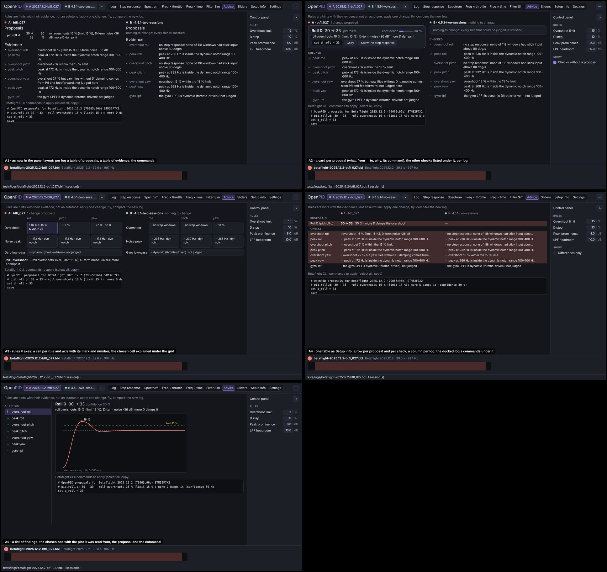
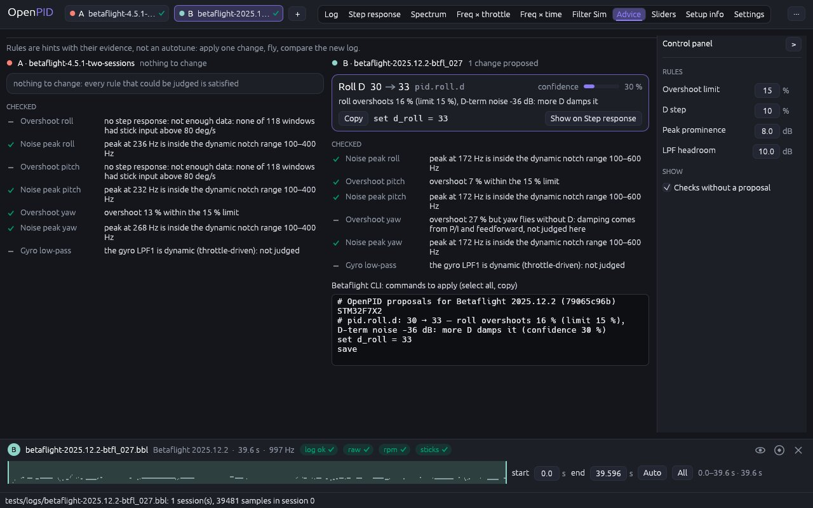
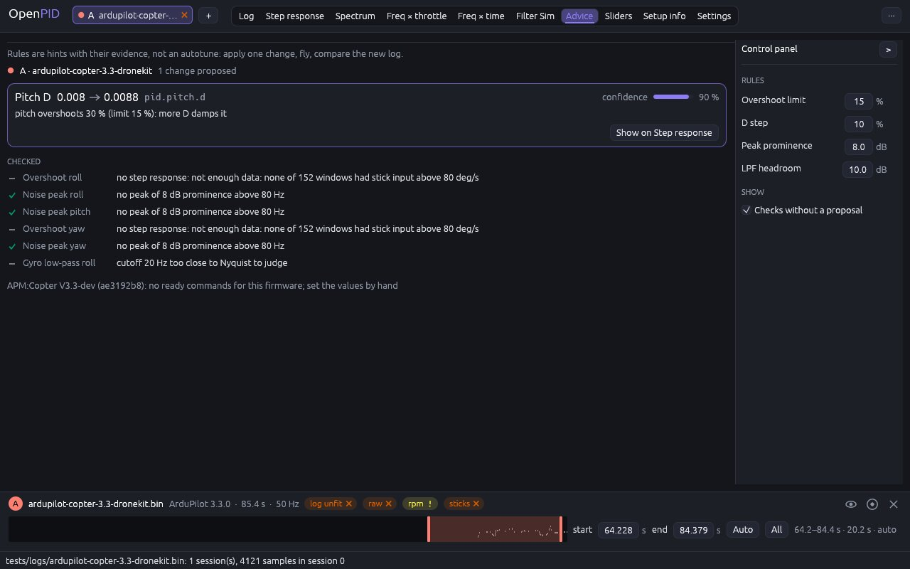

# Advice: a card per proposal, the other checks under it

The owner's remark (2026-11-10, #33): finish the rework of the remaining
tabs by the same scenario as the others.

## Cause

Looked at on real logs (`betaflight-2025.12.2-btfl_027.bbl`,
`betaflight-4.5.1-two-sessions.bbl`, `betaflight-4.2.0.BFL`,
`ardupilot-copter-3.3-dronekit.bin`):

- The tab was still in the old layout: the four thresholds in a row above
  the content, no control panel; under two logs the evidence table was cut
  by a scroll bar across its last row.
- A proposal was one table row: `pid.roll.d`, `30 -> 33`, `30 %` and the
  reason in four unlabelled cells. What to type into the configurator was
  only in the box of commands at the bottom, mixed with comments.
- The evidence said "*" for a rule that proposed and "-" for everything
  else, so "the rule is satisfied", "the rule could not judge (no step
  windows)" and "overshoot, but the D-term is too noisy to raise D" looked
  the same.
- A finding still sent the reader to "Motor noise", a tab that no longer
  exists.
- The reference tool has no advice of its own; this tab is our extension,
  so the convention it is measured against is a report of checks (a
  linter's problems, an audit's cards).

## Options

Five layouts on the same data (A = btfl_027 over the whole log: roll
overshoots 16 %, so D 30 → 33; B = 4.5.1):

| | Design | Pros | Cons | Eff | Disc | Conv | Kbd | Touch | Cost | Score |
|---|---|---|---|---|---|---|---|---|---|---|
| A1 | As now in the panel layout: per log a table of proposals, a table of evidence, the commands | cheapest | a proposal is still a row of bare cells | 3 | 3 | 3 | 4 | 3 | 5 | 37 |
| **A2** | **A card per proposal: the setting in words, from → to, how sure, why, its command with Copy, the tab with the evidence; the other checks listed under the cards with their marks; per log** | **what to change is the first thing read, with its command beside it; a satisfied rule and a rule that could not judge read differently** | **taller than a table with many proposals** | **5** | **5** | **4** | **4** | **4** | **3** | **48** |
| A3 | Rules × axes: a cell per rule and axis with its mark and number, the chosen cell explained under the grid | the whole state at a glance | every finding needs a short form; a click to read why | 4 | 4 | 3 | 4 | 3 | 2 | 39 |
| A4 | One table as Setup info: a row per proposal and per check, a column per log | two flights compared row by row | the reasons are cut in the cells; commands of one log only | 4 | 4 | 4 | 4 | 3 | 3 | 42 |
| A5 | A list of findings; the chosen one with the plot it was read from, the proposal and the command | the evidence is on the same screen | a click per finding; repeats the Step and Spectrum tabs | 4 | 4 | 4 | 3 | 3 | 1 | 38 |

## Decision (2026-11-10)

**A2**, by the score. Waiting for the owner's approval.

## Implementation requirements

- `advice_tab.rs`, with `control_panel`. A column per visible log (two
  across the width, more in a scroll, as before), titled with the log's
  colour, letter and file and "N changes proposed" / "nothing to change".
- **A card per proposal**: the setting in words (`Proposal::title`: "Roll
  D", "Gyro low-pass 1 cut-off"; the path for a setting without a name),
  the change with a drawn arrow (the font has none; read out as
  "30 -> 33") and the unit for a frequency, the path, how sure the rule is
  (a bar and the percent), the reason; under them the firmware's one
  command (`Exporter::command`) with **Copy**, and **Show on Step response**
  / **Show on Spectrum**, which opens the tab the proposal was read from.
  A firmware without an exporter has no command and no Copy.
- **Checked**: every finding that proposed nothing: its mark, the rule in
  words with the axis ("Overshoot pitch", "Noise peak roll", "Gyro
  low-pass"), what the rule saw. The marks come from
  `Finding::status` (`openpid_analysis::FindingStatus`, which replaces the
  `proposed` flag): a tick for **fine** (the rule is satisfied), a dash for
  **not judged** (no data, or the rule does not apply), "!" for
  **attention** (something is off but there is no setting to propose: an
  overshoot with a noisy D-term, an overshoot in a log without gains). They
  are read out as "A Overshoot pitch [!]".
- Under them the commands of all the proposals together, as before (the
  tour points at the box), or, for a firmware without an exporter, the line
  that says so.
- **Panel** — Rules: Overshoot limit, D step, Peak prominence, LPF headroom,
  each with what it changes on hover. Show: "Checks without a proposal".
- The finding about a motor harmonic points at the RPM overlay on Freq ×
  throttle.

## Tests

`proposals_name_their_setting_in_words` (`openpid-core`);
`exporter_writes_set_lines_and_rejects_unknown_paths`
(`openpid-fmt-blackbox`); `advice_tab_lists_proposals_evidence_and_cli`
(4.2.0 on its trim: one card with the title, the change, the reason, the
command and Copy, the confidence; the three marks of the other checks, a
warning without a proposal among them; the whole log: two cards and both
commands in the box; the checks hidden; a looser limit recomputes and
leaves nothing to change; the project keeps it; the card opens Step
response); `advice_is_in_the_firmwares_own_terms` (ArduPilot: gains at its
step, no command, no box); `advice_has_a_column_per_log`.

## Implementation

4.5.1 beside btfl_027 over its whole log:

ArduPilot, a firmware without ready commands:

