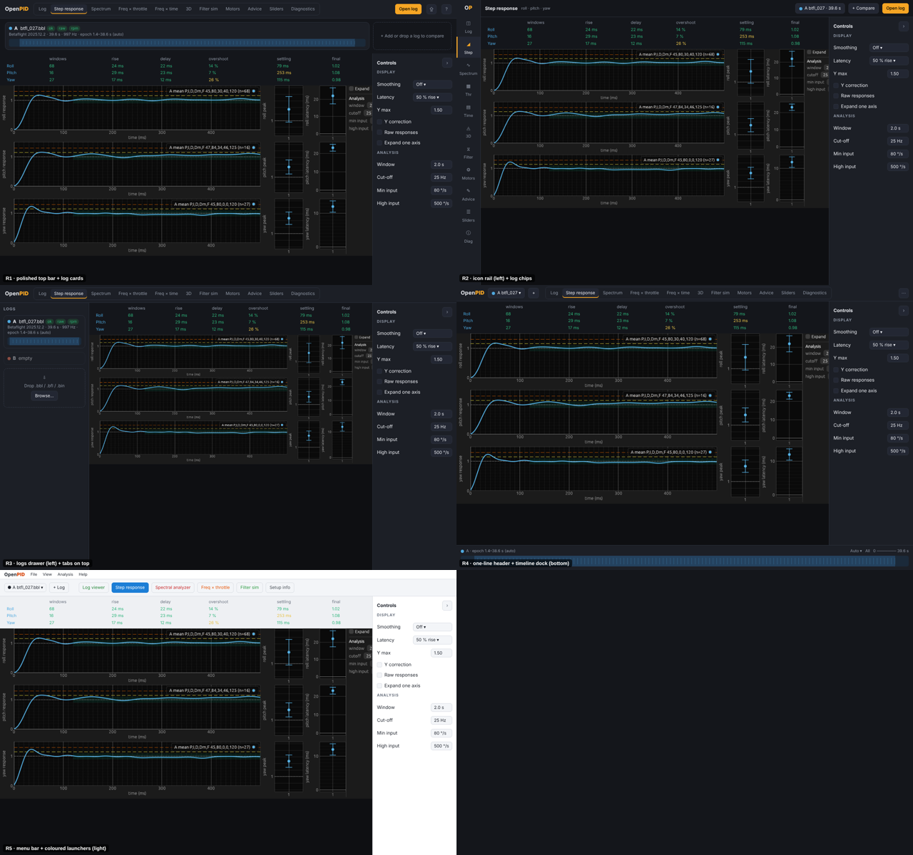
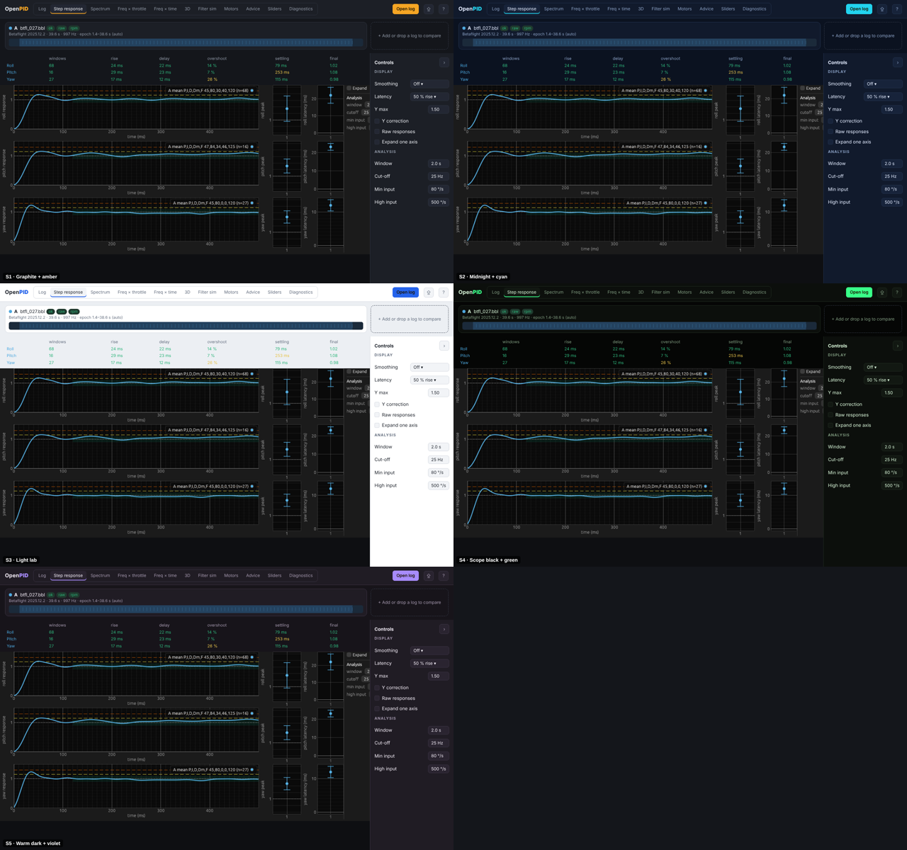
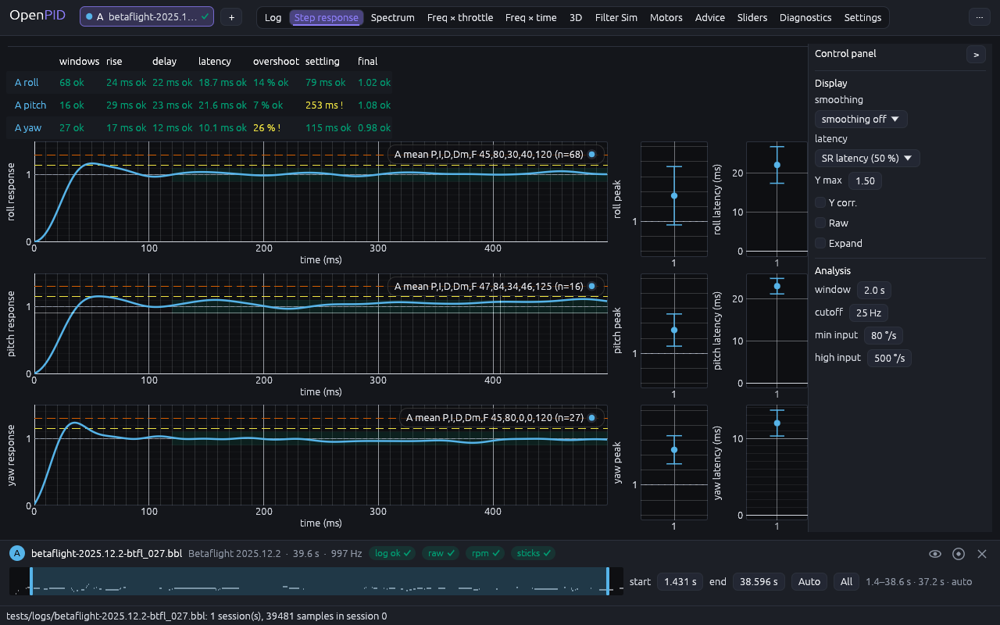
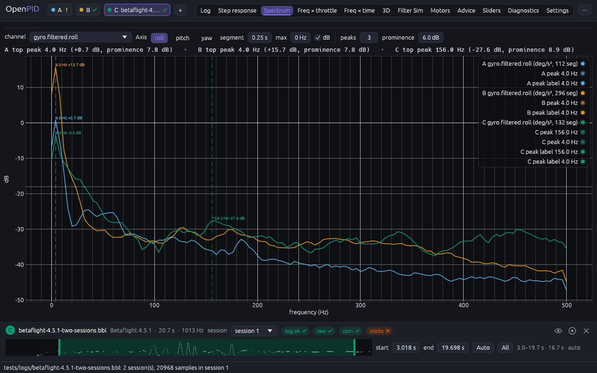
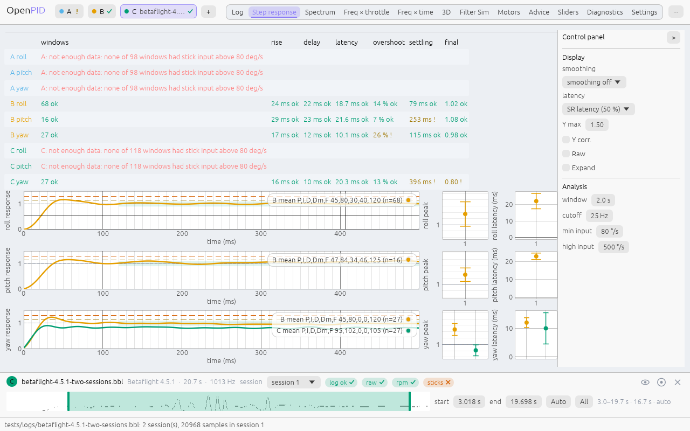
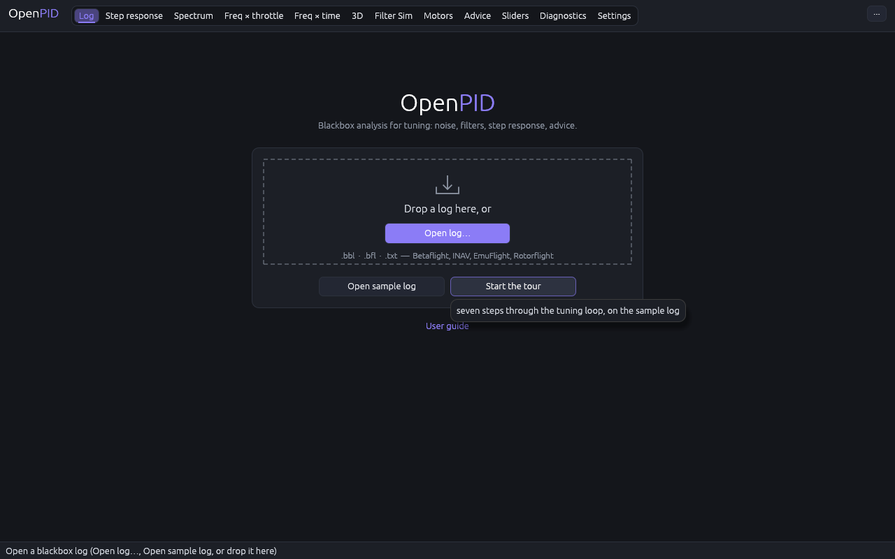

# App shell: top bar, logs and the look

The owner's remark (2026-11-09, #33, PR #143): "don't forget the global design
of the title bar and how files are loaded: right now it looks very bad. Where
possible make five conceptually different iterations for every change and pick
the best. The UI is rough text and the like; I'd like it more like PIDtoolbox or
Gyroflow, with a good-looking design."

## Cause

Measured at 1280 × 800 on `betaflight-2025.12.2-btfl_027.bbl` before this change:

- **Top bar.** Plain text: the 12 tabs as bare selectable labels, then
  "Open log…", "Project", "Export", "Help" and a "Touch mode" checkbox in the
  same wrapping row. No mark of the app, no visual grouping.
- **Logs.** Every slot was a full-width row of plain labels above the tab
  (`Slot A`, a checkbox, `S`, `x`, the file name, firmware, length, rate,
  `[ok]` badges) with its timeline strip under it: ≈ 70 px per log. With N logs
  (up to 8, docs/design/multi-slot) the tab moved down by ≈ 70 px for every log
  added and an empty slot still took a line ("Slot B: empty").
- **Start screen.** A heading, a line of text and four default buttons; nothing
  showed that a file can be dropped.
- **Look.** egui's default dark theme: the old accent was the colour of slot D,
  flat grey surfaces, 4 px rounding, tight spacing.

## Options

Five layouts of the shell were mocked up on the real step tab (same data, HTML
at 1280 × 800), and five colour styles on the chosen layout.

Scores on the matrix of [the design README](../README.md) (55 at most):
task efficiency ×3, discoverability ×2, convention ×2, keyboard ×2, touch ×1,
cost ×1.

| | Layout | Pros | Cons | Eff | Disc | Conv | Kbd | Touch | Cost | Score |
|---|---|---|---|---|---|---|---|---|---|---|
| R1 | Polished top bar + a card per log above the tab, dashed "add" card beside | everything about a log visible at once | each log adds a card: the tab moves down ≈ 70 px per log | 3 | 5 | 4 | 4 | 4 | 4 | 44 |
| R2 | Icon rail on the left + log chips | most room for plots | icons need learning; far from PIDtoolbox | 4 | 3 | 3 | 4 | 4 | 3 | 41 |
| R3 | Logs drawer on the left + tabs on top | logs out of the way | a drawer to open for every epoch change | 3 | 3 | 4 | 4 | 3 | 3 | 39 |
| **R4** | **One-line header with log chips + a timeline dock at the bottom** | **fixed layout for 1…8 logs; the epoch strip is where a timeline is expected (video editors, Gyroflow)** | **details of one log at a time** | **5** | **4** | **4** | **4** | **4** | **3** | **48** |
| R5 | Menu bar + coloured launchers (light) | familiar desktop look | two rows of chrome; far from the tools of the hobby | 3 | 4 | 3 | 4 | 3 | 4 | 40 |

The first scoring put R1 and R4 level at 46 and picked R1 as the cheaper one.
The owner corrected it: with N logs supported, cards on top push the whole
interface down every time a log is added, which is clearly worse for UX. The
table above is the re-score with that cost counted in R1's task efficiency and
R4's fixed layout in its own.

| | Style | Note |
|---|---|---|
| S1 | Graphite + amber | calm, close to PIDtoolbox / Gyroflow; amber is the colour of slot B |
| S2 | Midnight + cyan | cyan is the colour of slot A |
| S3 | Light lab | fine on paper, glare in a dim field tent |
| S4 | Scope black + green | green is slot C and the "ok" verdict |
| S5 | Warm dark + violet | violet surfaces tint the heatmaps |

## The owner's decision (2026-11-09)

**R4**, in style **S1 with an indigo accent** (S1'): graphite surfaces as S1,
but the accent is an indigo-violet (`#8B7CF6`) that no slot colour and no
verdict colour uses, so a highlighted control is never mistaken for a log.

## Implementation requirements

- **Theme** (`theme.rs`): `visuals(dark)` with graphite surfaces, the accent for
  selection, hovered and active strokes, 6 px rounding of controls and 10 px of
  cards and windows; `style()` with roomier spacing; `card()`,
  `dashed_outline()`, `word_mark()` ("Open" + "PID" in the accent). The light
  theme shares the accent and the shapes; the warning yellow turns dark amber
  there (`theme::warn()`), as yellow on white is unreadable.
- **Top bar, one line** (`app.rs`): word mark, log chips and "+", the tabs as
  one pill group with an accent underline on the active one, and a "···" menu
  (Open log…, Project, Export, Help, Touch mode). Long tab titles are shortened
  in the bar (Log, 3D, Motors, Sliders); each tab is still read out by its full
  title and shows it in its tooltip. The tabs scroll sideways rather than wrap
  when the window is too narrow.
- **Log chips** (`views::log_chips`): the slot's colour dot (dimmed when hidden),
  its letter, the file stem (≤ 18 characters; with more than two logs only the
  active chip shows it, ≤ 14) and the log check drawn as a tick, "!" or cross.
  Read out as "Slot A: file.bbl". Empty slots get no chip. A click puts the log
  in the dock; "+" opens another log (Ctrl+Shift+O), and a file dropped on the
  window does the same.
- **Timeline dock** (`views::timeline_dock`): a bottom panel of fixed height
  (84 px) on every tab but Settings: the slot disc, file name, firmware ·
  length · rate in muted text, the session picker, the log-check pills (read
  out as "raw [ok]"), eye / solo / close icons (read out as "hide A",
  "solo A", "close A"), and the timeline strip with start, end, Auto and All.
  It shows the log opened last until a chip is clicked; when that log closes
  it falls back to the first one left.
- **Start screen**: the word mark, a card with a dashed drop zone (tray icon,
  "Drop a log here, or", the accent "Open log…" button, the accepted formats),
  lit in the accent while a file is dragged over the window; "Open sample log"
  and "Start the tour" under it; recent files as rows (name, date on the right).

## Acceptance criteria

- The tab area keeps its position and size from one log to three and after a
  log is closed.
- At 1280 × 800 the top bar is one line with up to three logs.
- Every control keeps an accessible name; the kittest accessibility check stays on.

## Tests

`the_shell_keeps_its_height_as_logs_are_added` (central rect unchanged with
1 → 3 logs and after closing one; chips; the dock follows a chip click; hide /
show / close from the dock). The existing tests reach Open log, Project,
Export, Help and Touch mode through the "···" menu (`open_menu`).

## Implementation

One log, step tab:

Three logs on the spectrum tab, the third in the dock:

Light theme:

Start screen:

