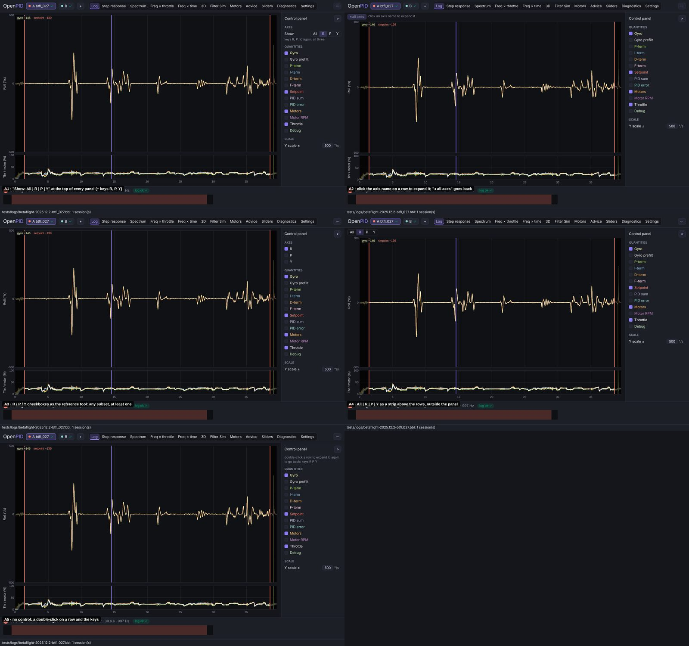
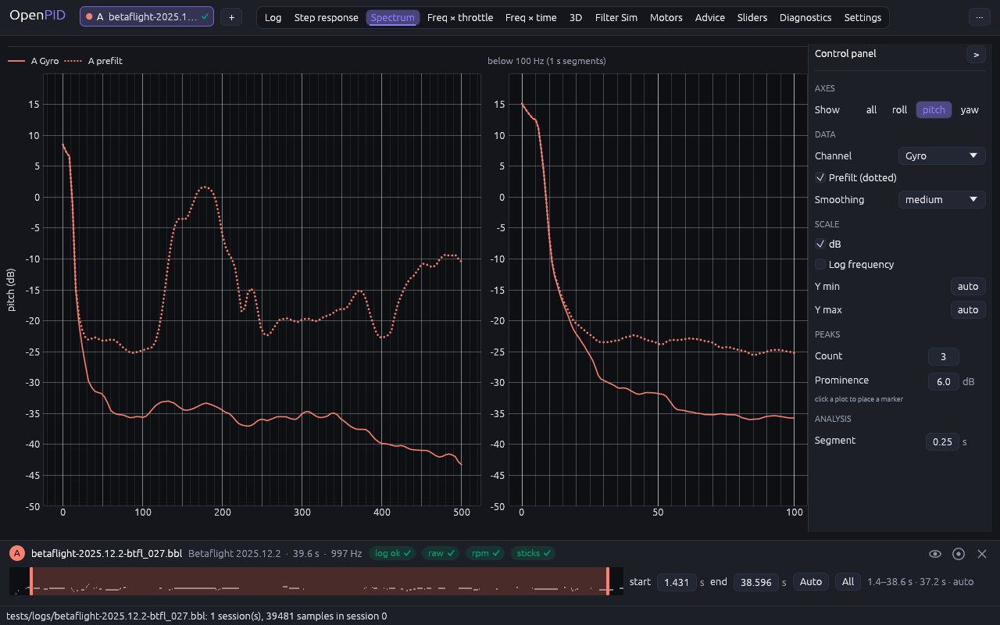
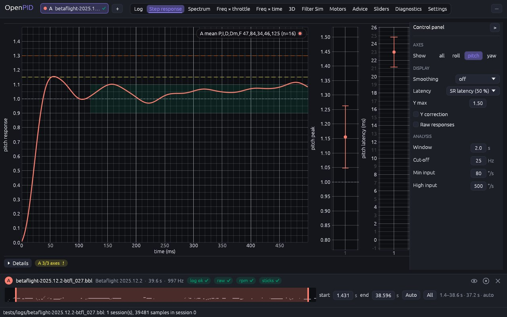

# One axis at full height

The owner's remark (2026-11-10, #33, PR #143): the reference tool lets the
screens with roll, pitch and yaw show one axis only, for a closer look; add
that, the chosen axis taking the space of the other two, three axes by
default.

## Cause

Every axis-row tab (Log viewer, Step response, Spectrum, Freq × throttle,
Freq × time, Motors) splits its height into three rows: at 1280 × 800 a
row is 150–190 px high. Only the Step tab had a way to one axis (an "Expand
one axis" check box and an axis selector under it), the others none.

## Options

Five ways to choose, mocked up on the Log viewer (btfl_027, roll alone):

| | Design | Pros | Cons | Eff | Disc | Conv | Kbd | Touch | Cost | Score |
|---|---|---|---|---|---|---|---|---|---|---|
| **A1** | **"Show: all \| roll \| pitch \| yaw" at the top of every panel, and the keys R, P, Y (again: all)** | **one place on every tab; one click or key** | **with the panel folded only the keys** | **4** | **4** | **4** | **5** | **4** | **4** | **46** |
| A2 | Click the axis name on a row; "◂ all axes" goes back | the click lands where the eye is | a hidden affordance; no keyboard | 5 | 2 | 3 | 2 | 4 | 3 | 36 |
| A3 | R / P / Y check boxes as the reference tool: any subset | the reference tool's control | two axes is a third layout to test on every tab; more state | 4 | 4 | 5 | 4 | 4 | 3 | 45 |
| A4 | "all \| R \| P \| Y" as a strip above the rows | visible with the panel folded | a control outside the panel, against the owner's panel rule; 28 px of plot height on every tab | 5 | 5 | 2 | 5 | 4 | 4 | 47 |
| A5 | No control: a double-click on a row and the keys | no space at all | the double-click already resets a plot's zoom; undiscoverable | 3 | 1 | 2 | 4 | 2 | 4 | 28 |

## Decision (2026-11-10)

**A1.** A4 scores a point more, but the owner's rule of 2026-11-09 puts
every control of a tab in its panel; the owner's decision beats the score.

## Implementation requirements

- `Tools::axis_focus: Option<Axis>` (`None` = the three axes), shared by
  every axis-row tab; `axis_layout::shown_axes` gives the rows,
  `focus_axis` sets it and makes the chosen axis the selected one
  (`Tools::axis`, `StepParams::axis`: the export and the project).
- `axis_layout::axes_row`: section "Axes", row "Show" with `all`, `roll`,
  `pitch`, `yaw` (each its own accessible name), first in the panels of the
  Log viewer, Step response, Spectrum, Freq × throttle, Freq × time and
  Motors. Filter Sim keeps its own axis choice (one axis by design).
- `Action::FocusAxis(axis)` on the keys `R`, `P`, `Y` (single keys, not in
  text fields): the axis alone, or all three when it is the one shown.
- Every tab sizes its rows by the number shown and computes only the shown
  axes' jobs; the plot the export and the tests read is the first shown
  row's. The Step tab's "Expand one axis" and its selector are gone; a click
  on an axis in its verdict table focuses that axis.

## Tests

`one_axis_takes_the_full_height_on_every_axis_tab` (three by default; P
alone with the motors row, more than twice as tall; P again; the yaw
button carries over to Freq × time with one spectrogram job; Spectrum
taller with one axis; "all"; R on the Step tab sets the step axis).

## Implementation

Spectrum, pitch alone:

Step response, pitch alone:

