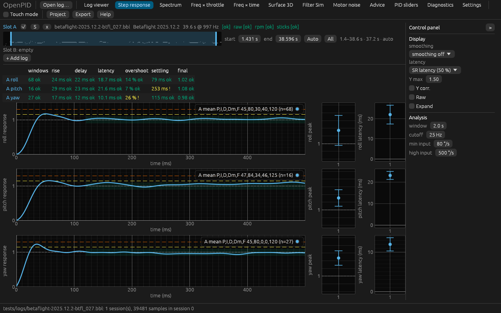

# PIDtoolbox layout for the analysis tabs

The owner's remark (2026-11-09, #33): rework the interface of the analysis tabs
so it follows PIDtoolbox and is convenient, in the same PR as the step-response
calibration (#143), for every analysis tab: log viewer, step response,
spectrum, freq × throttle, freq × time.

## Cause

Measured on `betaflight-2025.12.2-btfl_027.bbl` at 1280 × 800 against the
owner's PIDtoolbox Pro v0.9 screenshots (#33):

- **One axis at a time.** Step, spectrum and both heatmaps draw one axis. Seeing
  roll, pitch and yaw takes three clicks on the axis switch and three looks at
  plots that never stand side by side; PTB draws the three stacked in every view.
- **Controls above the plot.** The controls form a toolbar of 1–3 wrapped lines
  above the plot (step: 8 controls, spectrum: 7, freq × throttle: 12). They take
  60–90 px of the 800 px height and move when the window narrows; PTB keeps
  them in a fixed column on the right.
- **Log viewer.** 70 channel chips in a wrapping block (≈ 90 px) and one plot for
  everything selected: gyro, setpoint and throttle share one y axis
  (−800 … 300 °/s and 0–100 %). PTB stacks roll / pitch / yaw at ±500 °/s with
  throttle and motors in a panel of their own, and picks quantities (Gyro,
  Set point, Motor…) from a checklist that applies to every axis.
- **Spectrum.** One channel; the unfiltered gyro has to be chosen instead of
  shown with the filtered one. PTB overlays gyro (solid) and gyro prefilt
  (dotted), with a second "Sub 100Hz" panel per axis and smoothing (default
  medium).
- **Step.** The response histogram of slot A is always drawn (PTB: "Raw", off by
  default); there are no per-log Peak / Latency plots; the axis is 0 … 1.5 by
  `include_y` but grows with the histogram.

## Options

Scores on the matrix of [the design README](../README.md) (55 at most).

| | Option | Pros | Cons | Score |
|---|---|---|---|---|
| R0 | As is | nothing to learn | one axis at a time; toolbars eat height | 30 |
| R1 | PTB clone: R/P/Y stacked, fixed right panel | most familiar to a PTB user | the panel always takes ≈ 220 of 1280 px | 46 |
| R2 | R/P/Y stacked, controls stay in a top toolbar | full plot width | toolbar wraps on busy tabs; less like PTB | 44 |
| R3 | One axis plus an "R/P/Y" toggle | cheapest | the PTB default view needs a click | 37 |
| **R4** | **R/P/Y stacked, right panel that collapses (button and Ctrl+.)** | **PTB layout; full width when wanted; touch friendly** | **one more control to learn** | **49** |

## The owner's decision (2026-11-09)

R4, for every analysis tab.

## Implementation requirements

**Shared.**
- `views::control_panel(app, ui, id, body)`: an `egui::SidePanel::right` inside
  the tab, 230 px, not resizable, shown when `Prefs::panel_open` (default true,
  persisted). A "Panel >" / "<" button at its top (accessible name
  "Control panel") and Ctrl+. toggle it; collapsed, a "<" button stays at the
  right edge. Every control of the tab lives in the panel; the logs are chips in the
  top bar and the timeline sits in a dock at the bottom
  ([app-shell](../app-shell/README.md)).
- `views::axis_rows(ui, n)`: splits the remaining height into roll / pitch / yaw
  rows (plus an optional fourth row for throttle / motors), each with its axis
  name on the left; the plots of one tab share a linked x axis and cursor.
- Every new label through `tr(…)` with a Ukrainian translation; accessible names
  on every widget; parameters in `Tools`/`Project` with `#[serde(default)]`.

**Step response.** Three rows. Each row: the response plot (mean per log in the
log's colour; the target band and overshoot lines; 0 … `y_max`, default 1.5,
fixed), and to its right two narrow plots, Peak and Latency, one point per log
with the spread over the windows (± one standard deviation). Above each plot the
verdict line of that axis (the `step-verdicts` badges, unchanged data), and per
log "A: P,I,D,Dm,F = 45,80,30,40,120 (n=65)" as in PTB. Panel: smoothing
off / low / medium / high (0 / 10 / 20 / 40 ms), latency shown as "SR latency"
(time to 50 %, default) or "SP-gyro delay" (cross-correlation), Y max, Y corr.
(Y-offset), Raw (the response histogram, default off), expand (one axis at full
height), then the analysis parameters (window, cutoff, min input, high input).
The Advice line stays under the rows.

**Spectrum.** Three rows × two columns: full spectrum (0 … Nyquist) and
sub-100 Hz. Per log the chosen channel solid and, when the log has it, its
unfiltered counterpart dotted (gyro → gyro prefilt, D-term → D-term prefilt;
"show prefilt", default on). Panel: channel, smoothing off / low / low-med /
medium / med-high / high (default medium, a moving average over 0 / 2 / 4 / 8 /
16 / 32 Hz of the power), Y min / Y max (empty = automatic, default automatic:
our PSD is in (°/s)²/Hz and does not share PTB's dB level, #33), the peaks and
markers controls, segment length.

**Freq × throttle.** Three rows × columns: the chosen channel and, when the log
has it, its unfiltered counterpart (two columns, as PTB's preset 1 has gyro
prefilt | gyro); per panel "mean" and "peak" of the amplitude. Panel: channel,
colour max per tab (default automatic; "link scales" as now), the colour-scale
rules of [colour-scale](../colour-scale/README.md) stay, overlays (RPM, notches),
segment and throttle window. The full preset list is #142.

**Freq × time.** Three rows (roll / pitch / yaw) of the chosen channel, the
existing player under them. Panel: channel, colour max, segment, overlays.

**Log viewer.** Rows roll / pitch / yaw at a shared y scale (default ± 500 °/s,
"y scale" in the panel) plus a fourth row for throttle and motors (0–100 %).
A checklist of quantities on the left (Gyro, Gyro prefilt, P, I, D, D prefilt,
F, Set point, PID sum, PID error, Motors, eRPM, Throttle, Debug), each applying
to every axis where it exists; default Gyro, Set point, Motors, Throttle, as PTB.
The free channel picker stays as "Other channels" for the rest. The epoch and
cursor controls move to the panel.

## Acceptance

- At 1280 × 800 with `btfl_027`: every analysis tab shows roll, pitch and yaw
  without a click; with the panel collapsed the plots take the full width.
- Ctrl+. and the panel button toggle the panel on every analysis tab; the state
  survives a restart.
- Step: Peak and Latency per log on `btfl_027` show the values of the step
  table (1.14 / 22 ms roll …); Raw off by default.
- Spectrum: gyro and gyro prefilt overlaid on `btfl_027`; smoothing medium.
- Headless kittest tests per tab; coverage ≥ 90 %; screenshots regenerated.

## Implementation

Each tab lands as its own commit and is shown to the owner for approval
before the next one starts.

- **Shared** (`crates/openpid-app/src/axis_layout.rs`): `control_panel` (drawn
  first, so it keeps the right edge at full height), `row_height`,
  `Prefs::panel_open`, `Action::TogglePanel` (Ctrl+.). The timeline row no
  longer runs past the window (the epoch summary truncates); before, it
  stretched every tab and pushed right-hand panels off screen.
- **Step response**: three rows with the response and per-log Peak / Latency
  plots (`StepSpread` in `openpid-analysis`: mean and standard deviation of each
  window's peak and time to 50 %); the legend lists the logs only. Test:
  `step_tab_stacks_the_axes_and_the_panel_collapses`.

