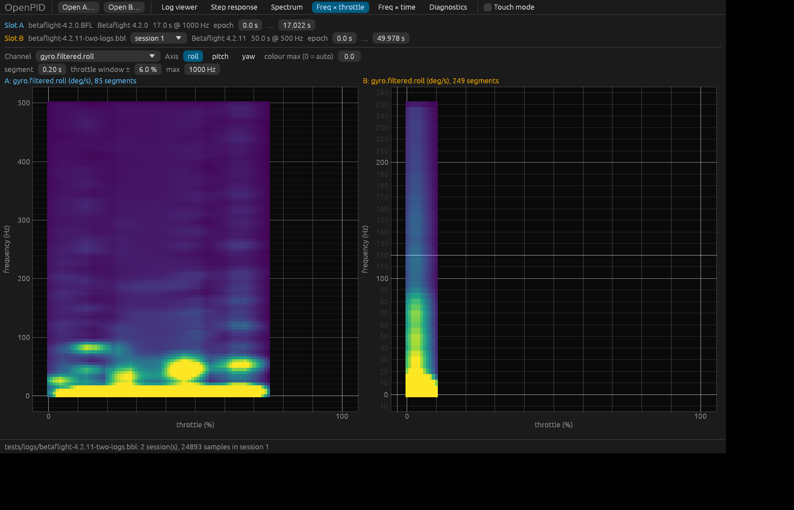

# Heatmap colour scale

The owner's remark (2026-11-05): add a colour scale.

## Cause

Freq × throttle, Freq × time and Surface 3D colour the amplitude with the
viridis palette and a "colour max" (0 = the 99th percentile), but nowhere say
which value in deg/s a colour stands for. Two slots with different auto-max
cannot be compared: yellow on A and yellow on B are different numbers.

## Options

| | Option | Pros | Cons | Score |
|---|---|---|---|---|
| R0 | As is | — | the values are unknown | 20 |
| R1 | **A vertical bar** right of every panel: gradient, 5 ticks, the unit, the colour max field above it | the convention (MATLAB/PTB, matplotlib); does not disturb the plot | −20 px of panel width | **50** |
| R2 | A horizontal bar under the plot | wider | the segment strip is already under the heatmap; confused with the X axis | 38 |
| R3 | Text only in the legend, "0–12 deg/s" | cheap | shows neither non-linearity nor intermediate values | 32 |
| R4 | A bar plus the value under the pointer in a corner | the most precise | hover already exists on Surface; the same for the heatmaps | 48 |
| R5 | A shared scale over every slot plus a "link scales" toggle | an honest A/B comparison | nothing to link without R1 | 44 |

Recommendation: **R1 + the hover of R4 + "link scales" of R5**.

## The owner's decision (2026-11-05)

R1 with the hover value and the shared scale.

Since 2026-11-10 the heatmaps default to Blackbox Explorer's black → red →
white ramp; viridis is the "Colour-blind safe" plot colours
([plot-colours](../plot-colours/README.md)). The bar follows the colour map.

## Implementation requirements

- `views::colour_bar(ui, max: f64, unit: &str, height: f32) -> Response`: a
  14 px wide bar, the `render::VIRIDIS` gradient from the bottom (0) to the top
  (max) as a `Mesh` with 8 coloured vertices; 5 ticks with labels (`0`, `¼`,
  `½`, `¾`, `max`) formatted `{:.2}` up to 10 and `{:.0}` above; the unit under
  the bar ("deg/s"); above the bar the `colour max` DragValue (0 = auto); the
  field moves here from the parameter row so the scale and its ceiling sit together.
- Placement: `ui.horizontal` → [plot][bar]; the bar height is the plot height.
  Freq × throttle: not between the plot and the segment strip; the bar next to
  the plot. Freq × time: the bar next to the heatmap, the column spectrum without
  a bar. Surface 3D: the bar at the right edge of the panel (height = the relief).
- The hover value: on Freq × throttle / Freq × time, hovering shows a label in
  the corner, "37 %, 172 Hz: 0.45 deg/s" (the nearest `Grid2D` cell, as on Surface).
- "Link scales" (a checkbox in the parameter row, on by default when there is
  more than one slot): auto-max = the maximum of every slot's auto-max; one
  scale per panel, but the same one.
- PNG export includes the scale (the export captures the tab area, already so).
- A parameter in `Tools` (`heatmap_link_scales: bool`) and in `Project`.

## Acceptance criteria

- Each of the three tabs has a scale with 5 labels and the unit; the value under
  the pointer matches `Grid2D` (a test through an `app.hover`-like field).
- With two logs and link on, both panels have the same max; off, different ones.
- Headless tests on the throttle and time tabs; the user-guide screenshots refreshed.

## Size

S (≈ 1 day).

## Implementation (2026-11-05)

- **`views.rs`:** `colour_bar(ui, max, unit, height)`: a 14 px bar (an 8-vertex
  mesh of `render::VIRIDIS`), 5 ticks, the unit, the accessible name "colour
  scale 0 to … unit"; `effective_max` (an explicit ceiling, or the robust
  maximum above 20 Hz) and `linked_scales` (the shared ceiling = the largest of
  the automatic ones when `Tools.heatmap_link` is on); `heatmap_hover` /
  `hover_label`, the cell under the pointer (`surface::value_at`) under the
  map; `app.colour_scales` and `app.heatmap_hover` for the tests (the frames of the maps are in `app.probes`).
- **Placement:** Freq × throttle and Freq × time are `[plot][bar]` in
  `ui.horizontal`, the plot `BAR_W = 56 px` narrower, the segment strip the
  same width; Surface 3D has the bar right of the relief, the ceiling passed to
  `draw_surface`.
- **Deviation:** the "colour max" field stayed in the parameter row (one per
  tab) rather than above every bar: with several logs it would be duplicated.
- **Project:** `heatmap_link` in `Tools` and `Project` (default `true`).
- **Test:** `heatmaps_show_a_colour_scale_with_linked_maxima_and_a_hover_value`
  (two logs: a shared ceiling, own ceilings, an explicit ceiling, hover matches
  the grid, the same on Freq × time and Surface 3D, the project keeps the link).

**Verified.** The screenshots `throttle.png`, `time.png`, `surface.png` were
retaken from the 2025.12 log.

