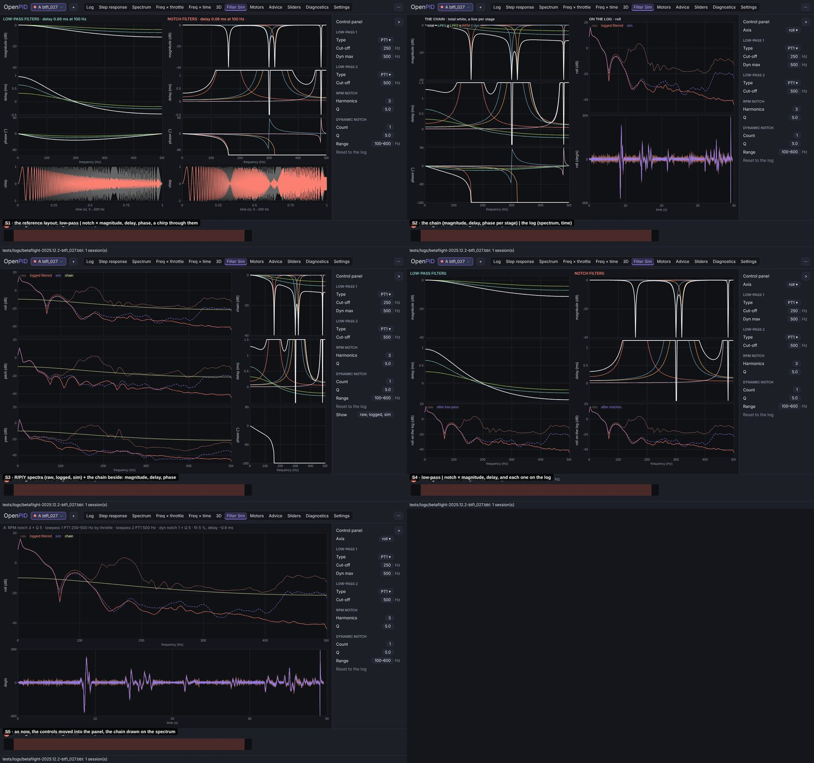
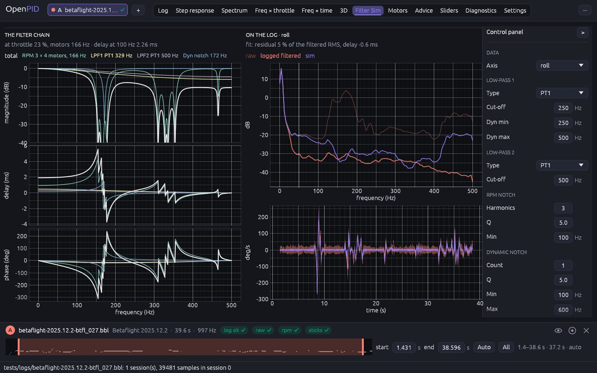
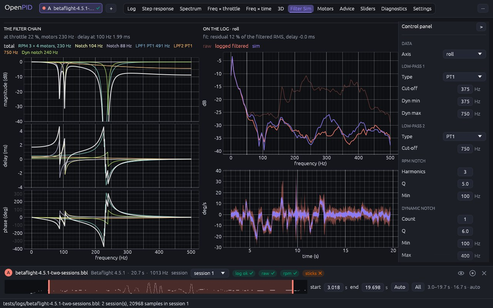

# Filter Sim tab

The owner's remark (2026-11-09, #33, PR #143): rework the analysis tabs in the
right-panel layout ([axis-layout](../axis-layout/README.md)), one tab at a
time with the owner's approval; five conceptually different designs per
change; check every screen against the reference tool's tutorial video.

## Cause

Measured at 1280 × 800 on `betaflight-2025.12.2-btfl_027.bbl` before this change:

- **Three wrapped lines of fields above the plots** (axis, segment, max,
  LPF1, LPF2, RPM notch, dynamic notch, static notch: 22 fields), then two
  lines of description and fit; the plots got 60 % of the height.
- **The filters themselves were not on screen**: only their effect on the
  log (spectra and time traces of raw, logged and simulated gyro), and a
  what-if change showed only as a moved spectrum.

The reference video (its Filter Simulation screen, 19:10–20:20) shows the
filters themselves: a column for the low-pass filters and one for the notch
filters, each with magnitude, filter delay (ms) and phase against frequency
and a chirp through the filters, the controls in a column on the right. It
has no log in it; ours runs the log's own gyro through the chain, which the
reference tool does not.

## Options

Five designs on the same data (btfl_027, roll), mocked up in the shell with
the control panel on the right:

| | Design | Pros | Cons | Eff | Disc | Conv | Kbd | Touch | Cost | Score |
|---|---|---|---|---|---|---|---|---|---|---|
| S1 | The reference layout: low-pass \| notch × magnitude, delay, phase, a chirp through them | the reference tool's screen | drops the log, the tab's reason to exist (the fit and the what-if on real noise) | 3 | 4 | 5 | 4 | 4 | 3 | 42 |
| **S2** | **The chain (magnitude, delay, phase per part, the total) \| the log (spectrum, time)** | **the filters and their effect on this log side by side; a what-if moves both** | **one axis at a time; dense at 1280 px** | **5** | **4** | **4** | **4** | **3** | **3** | **45** |
| S3 | R/P/Y spectra of raw, logged and sim with the chain beside them | every axis at once | three simulations per change; the chain squeezed into a narrow column | 4 | 3 | 3 | 4 | 3 | 3 | 38 |
| S4 | Low-pass \| notch × magnitude, delay, and each group on the log | separates what the low-passes and the notches do | two more simulations per change; the whole chain never shown | 4 | 4 | 4 | 4 | 3 | 2 | 41 |
| S5 | As before, the controls moved into the panel, the chain drawn on the spectrum | cheapest | the filters still not on screen | 3 | 3 | 2 | 4 | 4 | 5 | 36 |

## Decision (2026-11-10)

**S2**: the reference tool's filter curves next to what only we can show,
the log's own gyro through those filters.

## Implementation requirements

- **Analysis** (`openpid-sim`, `openpid-analysis`): `ChainModel::parts_at`
  gives the chain's parts at an `OperatingPoint` (RPM notches per motor and
  harmonic with their fade and weights, static notches, the low-passes with
  a dynamic one at the cutoff for the throttle, dynamic notches). Filter Sim
  takes the flight's typical moment (mean throttle, mean speed of each
  motor, median centre of each tracked dynamic notch over the epoch) and
  returns `FilterSimOutput::response`: per part and for the whole chain the
  magnitude (dB), the unwrapped phase and the phase delay `−φ / (2π f)` (ms,
  as the reference tool's "filter delay"), the delay at 100 Hz, and the
  chain as flown when there are what-if changes. No mathematics in the app.
- `filter_tab.rs`: `control_panel`; the docked log only. Left: "The filter
  chain", the operating point and the delay at 100 Hz, the parts' names in
  their colours (the legend), three plots sharing the frequency axis
  (magnitude −40…3 dB, delay, phase), a line per part and the total thick
  in the text colour, the chain as flown dashed. Right: "On the log", the fit
  line, the spectrum and the time trace of raw, logged filtered and sim (as
  flown dashed when changed).
- **Panel**: Data (Axis), Reset to log (with changes only), Low-pass 1
  (Type, Cut-off, Dyn min, Dyn max), Low-pass 2 (Type, Cut-off), RPM notch
  (Harmonics, Q, Min), Dynamic notch (Count, Q, Min, Max), Static notch
  (Centre, Cut-off), Model (the chain as described, Residual, Unfiltered,
  Delay, Throttle, Motors), Analysis (Segment, Max frequency). A field shows
  the log's value; an edited one turns the accent colour and becomes an
  override; the hint names the log's value.

## Tests

`parts_at_an_operating_point` (`openpid-sim`: labels, the weighted RPM
harmonics, the dynamic low-pass at half throttle, a notch out of reach left
out); `chain_response_has_delay_and_notch_depth` (`openpid-analysis`: notch
depth, PT1 delay, the notch's lead above its centre, the total's phase);
`filter_sim_tab_validates_the_model_and_applies_what_if_changes` (four
motors, the parts, the legend, the what-if label and the as-flown line,
Reset to log).

## Implementation

btfl_027 (RPM notches on four motors around 166 Hz, both low-passes, the
dynamic notch):

Betaflight 4.5.1 (two static notches as well):

## Revision: the curves at the craft's loop rate, the delays printed (2026-11-16, decision D-007)

The owner decided (#166) that the curves of the chain are computed at the
rate the craft filters at, not at the rate of its log, and that the delays
are printed as the reference tool prints them (DESIGN §6.6). The layout S2
stays; what changed on this tab:

- **The curves** (left column) are the craft's filters, each part at the
  rate of the loop it runs in on the craft, from the log's headers: on
  Betaflight 4.2 and later the second low-pass at the gyro rate and every
  other filter at the PID loop rate; on older Betaflight and the other
  firmwares every filter at the gyro rate (taken to be so, not known).
  Without a usable rate in the headers a part is computed at the rate of the
  log. The frequency axis is as before, to half the rate of the log.
- **The simulation** (right column) is unchanged: it runs the same filters
  on the samples of the log, at the rate of the log.
- **Each column says its rate.** Under the operating point: "the craft's
  filters, computed at 4 kHz (its PID loop rate), 8 kHz (its gyro rate)",
  or "… at 1 kHz (the rate of the log: the headers give no loop rate)".
  Under the fit: "sim: the same filters at the rate of the log, 1 kHz". The
  hints of the two lines say why the columns part towards half the log rate.
- **The printed delays** (at 25 Hz since the next revision): a line "delay
  at 1 Hz: low-pass 0.803 ms + notch 1.567 ms = 2.369 ms" (the sum of the low-pass parts, of the notch parts,
  and both), and each part's own delay beside its name in the legend ("LPF2
  PT1 500 Hz: 0.318 ms"), whose hint names the rate the part was computed
  at. A legend entry no longer breaks in the middle. "Delay at 100 Hz" stays
  on the line of the operating point.
- **Not taken over** from the reference tool's filter screen: the step
  response of a single filter, the chirp, the magnitude as a ratio.
- No mathematics in the app: the rates, their reasons and the delays come in
  `FilterSimOutput::response` (`PartResponse::rate`, `delay_1hz_ms`, the
  three sums); `filter_tab.rs` puts them in words (`i18n.rs`, English and
  Ukrainian).

Tests: `a_gyro_filter_runs_in_the_loop_its_firmware_puts_it_in`
(`openpid-core`), `the_gyro_filter_layout_follows_the_firmware_and_its_version`
(`openpid-fmt-blackbox`), `parts_at_the_rates_of_the_craft` (`openpid-sim`),
`the_formulas_give_the_figures_the_reference_tool_prints`,
`printed_delays_at_8_khz_are_the_reference_figures`,
`printed_delays_of_the_other_types_and_of_a_4_khz_loop`,
`curves_at_the_loop_rate_part_from_those_at_the_log_rate_towards_its_half`,
`the_curve_rate_is_the_loop_rate_or_falls_back_to_the_log_rate` and
`filter_curves_follow_the_loop_rate_and_the_simulation_the_log_rate`
(`openpid-analysis`), `filter_sim_tab_prints_the_delays_and_says_which_rate_is_which`
(`openpid-app`), `filter_sim_command` (`openpid-cli`). The pictures above show
the tab before this revision; `docs/screenshots/filter.png` shows it after.

## Revision: the delays at 25 Hz and the RPM fade (2026-11-27, decision D-015)

The owner decided that OpenPID follows the reference tool's web edition 1.0
(D-015). Its filter simulator has the filters of version 0.94 at the chosen
loop rate; what it prints and how it fades the RPM notches changed, and
this tab follows (DESIGN §6.6):

- **"Delay at"** in the panel's Analysis section: 25 Hz (as it comes up) or
  1 Hz. The line under the operating point reads "delay at 25 Hz: low-pass
  0.9517 ms · 8.565° + notch 1.641 ms · 14.77° = 2.593 ms · 23.33°", each
  delay with its phase lag at that frequency, to four significant digits as
  the reference tool prints them; each part's own in the legend ("LPF1 PT1
  250 Hz: 0.6339 ms · 5.705°").
- **The RPM notches per harmonic**: a line under the legend, in the RPM
  part's colour, "per motor: H1 150 Hz · 100 % 0.2179 ms · 1.961°, H2 …",
  the notch of one motor (the mean over the motors). The notch column counts
  it once per motor.
- **The fade** of the RPM notches in the curves: every harmonic by the motor
  frequency, `min(1, (f1 − min) / fade)` times its own weight, none below the
  minimum. The simulation keeps the firmware's fade (each harmonic by its
  own frequency): the column on the right is checked against the log.
- `FilterSimParams::delay_at_hz`; `PartResponse::printed` and `harmonics`;
  `ChainResponse::delay_at_hz`, `printed_lowpass`, `printed_notch`,
  `printed_total`; `ChainPart::harmonics` and `rpm_curve_weight`
  (`openpid-sim`). The CLI reads the frequency from `--set delay_at_hz=…`.

Tests: `a_first_order_low_pass_delays_by_its_phase_at_the_chosen_frequency`,
`printed_delays_at_25_and_1_hz_as_the_reference_tool_prints_them`,
`the_rpm_notches_fade_with_the_motor_frequency` (`openpid-analysis`),
`the_curves_fade_every_harmonic_with_the_motor_the_firmware_each_with_its_own`
(`openpid-sim`), and the tests of the previous revision with the new fields.
