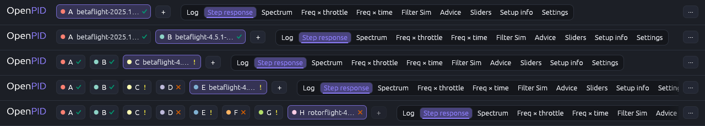
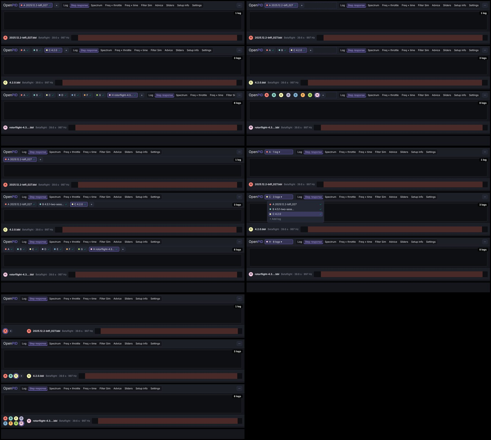
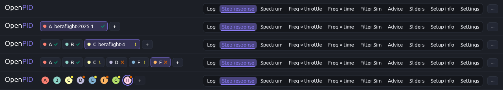
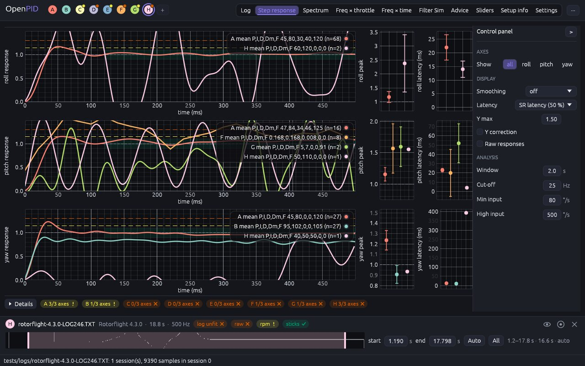

# Log chips: a zone of fixed width, so the tabs never move

The owner's remark (2026-11-10, #162): with three or more logs open, the
log chips push the other elements of the top bar to the right; the
interface should not shift with the number of open logs.

## Cause

Measured at 1280 × 800 on the fixtures of `tests/logs`. The top bar laid
the chips out first and gave the tabs what was left:

| Logs open | Tab group starts at | Tabs in view |
|---:|---:|---|
| 1 | 330 px | all ten |
| 2 | 500 px | all ten |
| 3 | 420 px | all ten |
| 5 | 540 px | "Settings" cut |
| 8 | 720 px | six; Advice, Sliders, Setup info and Settings out of view |

Every log added or closed moved every tab (from two logs to three they
even jumped back to the left, as the names were dropped), and from five
logs on the tab group no longer fitted and scrolled. The tab area under
the bar already kept its place (the timeline dock,
[app-shell](../app-shell/README.md) R4); the bar itself did not.

## Options

Five designs on the real bar, each with 1, 3 and 8 logs:

| | Design | Pros | Cons | Eff | Disc | Conv | Kbd | Touch | Cost | Score |
|---|---|---|---|---|---|---|---|---|---|---|
| K1 | As now: the chips grow, the tabs take the rest | names while there are few logs | the tabs move with every log and are cut from five on | 2 | 4 | 3 | 4 | 3 | 5 | 36 |
| **K2** | **A log zone of fixed width; the chips take the richest form that fits it (names, the docked log's name, letters, discs); the tabs keep their own width beside the menu** | **nothing moves; every log one click away; names while there is room** | **with many logs the names are in the tooltip and the dock only** | **5** | **4** | **4** | **4** | **3** | **4** | **46** |
| K3 | A row of its own for the logs under the top bar, always there | nothing moves; names fit up to five logs | 32 px less for the plots on every tab, with one log too | 3 | 5 | 4 | 4 | 4 | 4 | 43 |
| K4 | One "logs" button of fixed width; the list opens on a click | smallest footprint | two clicks to switch; which logs are open and their check are hidden | 3 | 3 | 4 | 4 | 4 | 3 | 38 |
| K5 | A grid of discs in the timeline dock, beside the timeline they switch | the top bar has the tabs only | far from where logs were; Settings has no dock; "Add log" leaves the bar | 4 | 3 | 3 | 4 | 3 | 3 | 38 |

## Decision (2026-11-10)

**K2**, by the score. Approved by the owner on 2026-11-10 ("Підтверджую").

## Implementation requirements

- **Top bar** (`App::top_bar`): the word mark, the log zone, the tab group,
  the menu. The tab group takes its natural width (measured from the frame
  before, `ShellState::tabs_w`) beside the menu; the log zone takes what is
  left, at least 150 px (`LOG_ZONE_MIN`: four discs and "+"). The widths do
  not depend on the logs, so neither do the positions. The zone is kept on
  the start screen too, empty, so the first log moves nothing either. On a
  window too narrow for the zone and the tabs, the tabs scroll, as before.
- **Chips** (`views::log_chips`, `ChipDetail`): the richest form whose
  chips and "+" fit the zone:
  1. **Names**: dot, letter, file name (≤ 18 characters), log-check mark;
  2. **ActiveName**: the name (≤ 14) on the docked log's chip only;
  3. **Letters**: dot, letter, mark;
  4. **Discs**: the letter on a disc in the log's colour, a ring in the
     accent around the docked one, a dimmed disc for a hidden log, and a
     dot on the corner in the warning or failure colour when the log check
     is not fine.
  At 1280 × 800 with the fixtures that is names for one and two logs, the
  docked name for three and four, letters for five and six, discs for
  seven and eight (the zone is 388 px there). A chip is
  laid out before it is drawn (`Chip::new`, `width`, `show`), so the form
  is chosen from real widths.
- When even the discs do not fit (a narrow window, touch mode) the chips
  scroll sideways inside the zone, and a change of the docked log brings
  its chip into view.
- Every chip keeps its accessible name and tooltip in every form ("Slot A:
  file.bbl"), and "Add log" follows the last chip.
- `App::shell` (`ShellState`) keeps the tab group's rectangle, the zone and
  the form of the chips, for the tests.

## Tests

`the_tabs_keep_their_place_as_logs_are_added`: on each of the four screens
of the driver (1280 × 800, 1024 × 640, 1920 × 1080, touch) the tab group's
rectangle is the same on the start screen, with 1 to 8 logs and after
closing one; every log has its chip by name; the chips never grow richer
as logs are added; a chip docks its log in any form; "Add log" is off at
eight. At the design size: names, names, the docked name, …, discs; the
ten tabs are inside the tab group's rectangle with eight logs; the chips
are inside their zone. `the_shell_keeps_its_height_as_logs_are_added`
(the tab area) is unchanged.

## Implementation

The top bar with 0, 1, 3, 6 and 8 logs: the tabs start at the same place in each (516 px here).

Eight logs:

