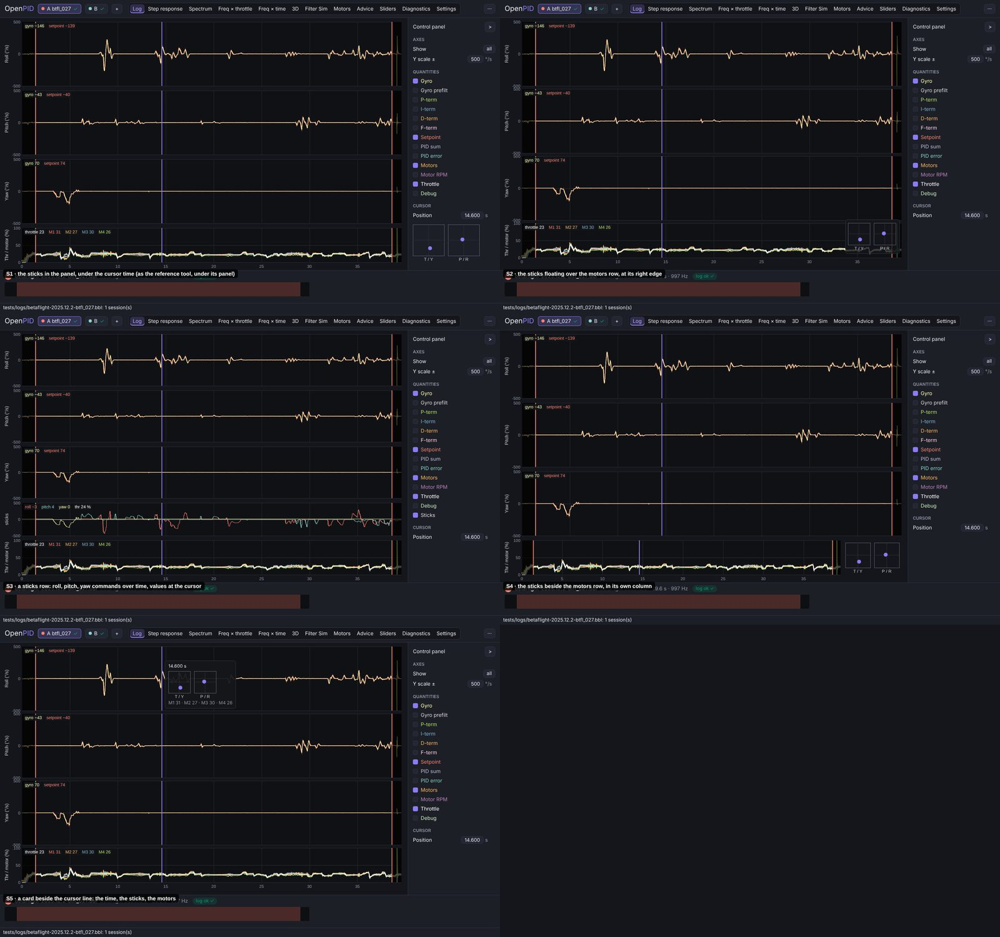
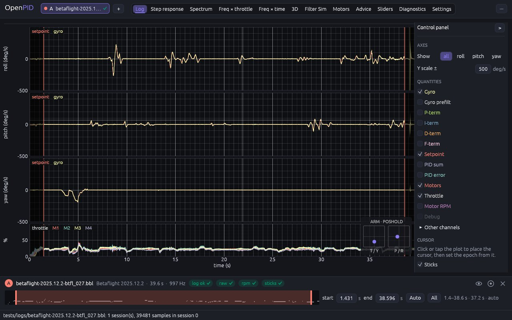
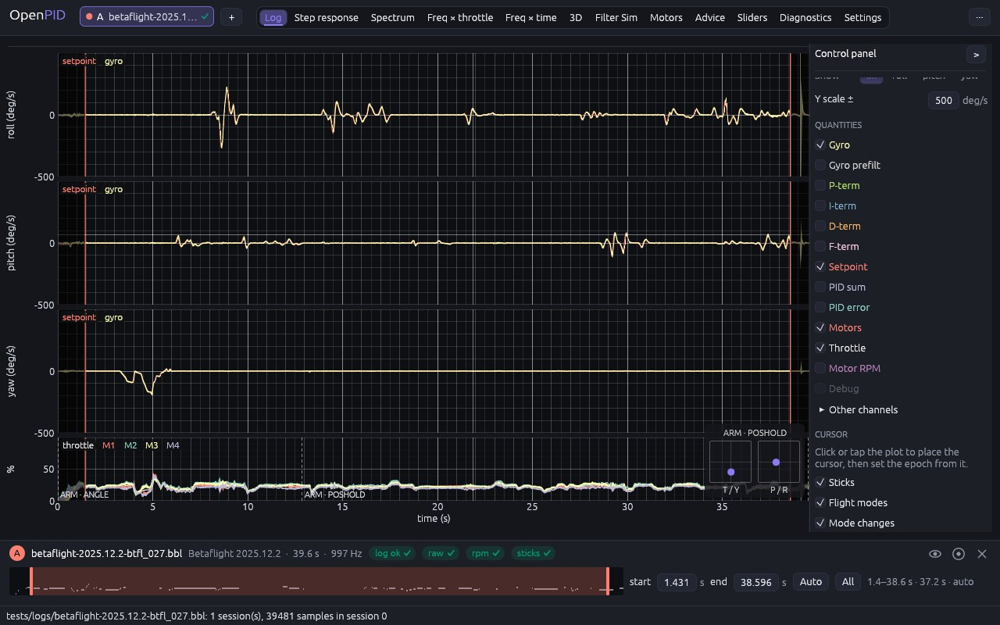

# Sticks and flight modes on the Log viewer

The owner's remark (2026-11-10, #33, PR #143): the Log viewer does not show
where the sticks were as the cursor moves; the reference tool does (the
owner's screenshot of it: two boxes, "T / Y" and "P / R", beside its plots,
with the motor outputs and the gyro at the cursor under them).

## Cause

The Log viewer showed the values of its lines at the cursor (gyro,
setpoint, throttle, motors) but not the RC commands; reading the stick
inputs took adding `rc.0`…`rc.3` as other channels, on a row of their own,
in raw units.

## Options

Five places for the sticks, mocked up on the Log viewer (btfl_027, cursor
at 14.6 s):

| | Design | Pros | Cons | Eff | Disc | Conv | Kbd | Touch | Cost | Score |
|---|---|---|---|---|---|---|---|---|---|---|
| S1 | In the panel, under the cursor time | where the reference tool has them, beside its panel | gone with the panel folded; far from the plots | 4 | 4 | 5 | 4 | 4 | 4 | 46 |
| **S2** | **A card floating at the right edge of the throttle / motors row** | **on the plots, with the panel folded too; next to the motors they drive** | **covers the last seconds of that row** | **4** | **4** | **3** | **3** | **3** | **4** | **39** |
| S3 | A sticks row: the commands over time, values at the cursor | the inputs over the whole flight | a row more; no stick picture | 4 | 4 | 3 | 4 | 4 | 4 | 42 |
| S4 | A column beside the motors row | never covers data | narrows the motors row only, misaligning its time axis | 4 | 4 | 4 | 3 | 4 | 3 | 41 |
| S5 | A card beside the cursor line | where the eye is | covers the data around the cursor | 5 | 4 | 2 | 3 | 2 | 3 | 38 |

## Decision (2026-11-10)

**S2**, the owner's choice ("Ні, варіант S2"): S1 scored higher, the
owner's decision beats the score.

## Implementation requirements

- **The sticks are canonical channels** (ADR-0015; owner, 2026-11-10: one
  internal structure, mapped by the parser of each log type, nothing
  format-specific in the analysis): `stick.roll`, `stick.pitch`,
  `stick.yaw` (−100 … 100 %: right, forward, right positive) and
  `stick.throttle` (0 … 100 %), derived by the firmware profile.
  Cleanflight family: `rcCommand` / 5, yaw negated (stored inverted; the
  Blackbox Explorers of Betaflight, INAV and Rotorflight negate it to draw
  the stick), throttle `(rcCommand[3] − 1000) / 10`, on Rotorflight the
  collective `(rcCommand[3] + 500) / 10`. `ArduPilot`: `RCIN` by `RCMAP_*`
  and `RCn_MIN / MAX / TRIM / REVERSED`, pitch negated (a stick pushed
  forward lowers the pulse width), a pulse width of 0 left missing.
  `FlightSession::sticks_at(t)` reads them back; `None` without them.
- `log_tab.rs`: the card at the bottom right of the throttle / motors row
  (the last row when it is hidden), two 54 px boxes in mode 2 (left:
  throttle up, yaw across; right: pitch up, roll across) with a dot in the
  accent colour, the labels "T / Y" and "P / R"; a translucent background
  in the theme. It follows the pointer while it is over the rows, else the
  placed cursor; with neither it is not drawn.
- **Sticks** (`LogDisplay::sticks`, on by default; owner, 2026-11-10: "a
  way to hide them"): a check box at the end of the panel, after the
  cursor rows, so the fields above it keep their place.
- **Flight modes** (owner, 2026-11-10: the flight-mode labels, following
  the cursor; `LogDisplay::modes`, on by default, a check box after
  Sticks): the modes active at the same moment, on a line over the sticks
  (owner: over the sticks, not beside them), "ARM · ANGLE"; a card taller
  than its row reaches up over the row above.
- **Decoded by the firmware profiles** (ADR-0015): `openpid_core::FlightMode`
  (Arm, Angle, Horizon, AirMode, AltHold, PosHold, Loiter, ReturnHome,
  GpsRescue, Rescue, Failsafe, Land, Auto, Manual, …, `Other(name)`) and
  `FlightSession::flight_modes`, a `ModeChange` per change, read with
  `flight_modes_at(t)` and `mode_changes()`. `BoundProfile::flight_modes`
  turns the firmware's mode word into them: on Blackbox logs the slow
  frames' `flightModeFlags`, the mode-box mask (bit `n` is box `n` of the
  firmware's list: Betaflight by version, the lists changed at 3.3, 3.4,
  3.5, 4.0, 2025.12 and 2026.6; Cleanflight and early Betaflight the old
  list; INAV its own box ids; Rotorflight 4.2, 4.3 and 4.6; EmuFlight and
  unknown firmware ARM, ANGLE, HORIZON, the other bits numbered, as
  EmuFlight's Explorer names none). On `ArduPilot` the `MODE` number by
  vehicle (Copter, Plane with its Q modes); its session builder adds ARM
  from `EV` 10 / 11. The CSV reader takes `blackbox_decode`'s names.
- **Mode changes** (owner, 2026-11-10: as the reference tool under its
  throttle row, off by default; `LogDisplay::mode_marks`): a dashed line
  where the modes change, with the modes from then on at its foot, on the
  throttle / motors row.
- `ViewerState::sticks` and `sticks_rect` keep what was drawn, for tests.

## Tests

`modes_and_sticks_are_read_by_time` (`openpid-core`: the session's
lookups); `mode_boxes_follow_the_version`, `flight_modes_are_decoded_per_firmware`
and `sticks_are_mapped_per_firmware` (`openpid-fmt-blackbox`: btfl_027 ARM ·
ANGLE → ARM · POSHOLD → POSHOLD, the yaw sign, INAV 9 ARM · ANGLE,
Rotorflight 4.3 ARM · BLACKBOX and its collective, EmuFlight ARM · bit 21);
`modes_follow_the_vehicle`, `rc_inputs_follow_their_calibration`,
`modes_follow_the_mode_and_arming_events`,
`flight_modes_come_from_the_mode_and_arming_messages` and
`sticks_come_from_the_rc_inputs` (`openpid-fmt-ardupilot`: Copter LOITER,
Plane ARM then ARM · RTL, QuadPlane QRTL); the CSV reader's
`opens_as_session`;
`log_tab_stacks_the_axes_with_the_motors_and_reads_the_cursor` (none
without a cursor, under the pointer on the last row's right edge, at the
cursor once the pointer leaves, the modes with ARM, both hidden with
Sticks and Flight modes, the marks off by default and on with Mode
changes).

## Implementation

btfl_027, the pointer at 22 s (ARM · POSHOLD):

With Mode changes on (ARM · ANGLE from the start, ARM · POSHOLD from 12.8 s):

