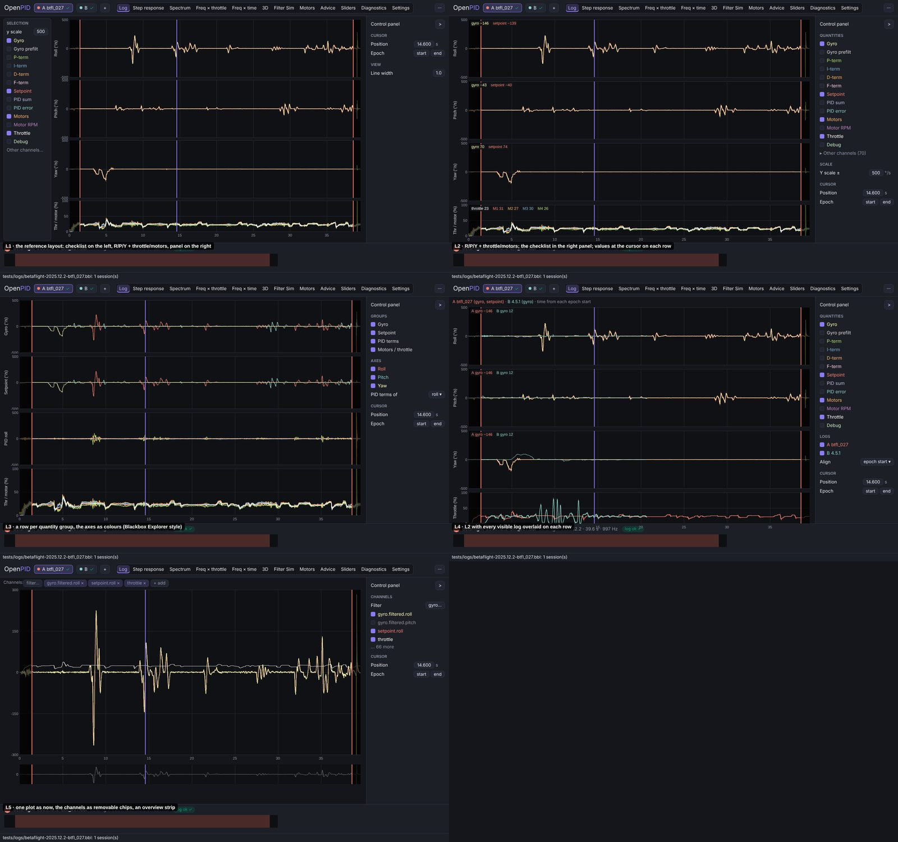
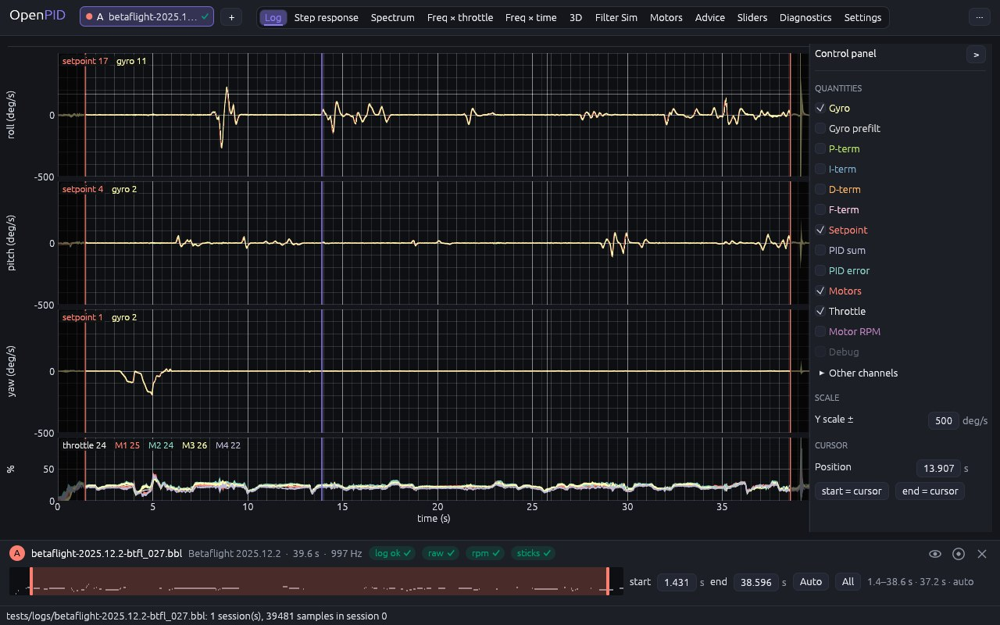
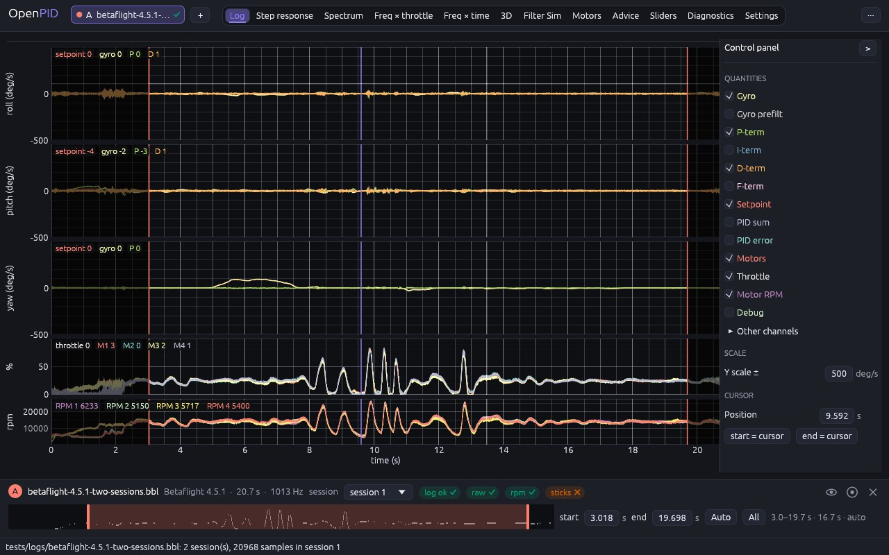

# Log viewer tab

The owner's remark (2026-11-09, #33, PR #143): rework every analysis tab in the
axis-row layout ([axis-layout](../axis-layout/README.md)), one tab at a time
with the owner's approval; five conceptually different designs per change;
check every screen against the reference tool's tutorial video.

## Cause

Measured at 1280 × 800 on `betaflight-2025.12.2-btfl_027.bbl` before this change:

- **Everything on one y axis.** Gyro, setpoint and throttle of roll shared
  one plot (−800 … 300 deg/s and 0–100 %); pitch and yaw took three more
  clicks among the channel chips and then sat on the same axis.
- **70 channel chips above the plot** in a wrapping block of five lines
  (≈ 150 px), the cursor buttons under them.
- **No values at the cursor**: the cursor only set the epoch.

The reference video (its log viewer, 1:00–4:20) shows roll, pitch and yaw
rows at one scale (the "y scale" field, ± 500 by default), a throttle /
motor row under them, a checklist of quantities (Gyro prefilt, Gyro, P, I, D
prefilt, D, F, Set point, PID sum, PID error, Motor 1–4, RPM 1–4, Throttle,
Test signal, Debug) whose names are drawn in their line colours, the
trimmed-off parts of the log greyed, and the values at the cursor.

## Options

Five designs on the same data (btfl_027; B = Betaflight 4.5.1, session 1),
mocked up in the shell:

| | Design | Pros | Cons | Eff | Disc | Conv | Kbd | Touch | Cost | Score |
|---|---|---|---|---|---|---|---|---|---|---|
| L1 | The reference layout: the checklist in a column on the left, R/P/Y + throttle/motors, the panel on the right | the reference tool's screen | two side columns narrow the plots; controls in two places, against the panel rule | 4 | 5 | 5 | 4 | 3 | 2 | 45 |
| **L2** | **R/P/Y + throttle/motors; the checklist in the right panel; the values at the cursor on each row** | **the reference content in the shell's layout; full width with the panel folded; legend and read-out in one** | **the checklist folds away with the panel** | **5** | **4** | **4** | **4** | **4** | **3** | **46** |
| L3 | A row per quantity group (gyro, setpoint, PID terms, motors), the axes as colours | Blackbox Explorer's way | the axes, the main reading, mix in one row; PID terms of one axis at a time | 3 | 3 | 3 | 4 | 4 | 3 | 36 |
| L4 | L2 with every visible log overlaid on each row | logs compared in one view | flights have their own time axes; lines of two logs tangle | 3 | 4 | 3 | 4 | 4 | 2 | 37 |
| L5 | One plot as before, the channels as removable chips, an overview strip | cheapest | one y axis for everything, the cause of the complaint | 2 | 3 | 2 | 4 | 4 | 5 | 33 |

## Decision (2026-11-10)

**L2**: the reference tool's rows and quantities, with every control in the
right panel as on the other reworked tabs.

## Implementation requirements

- `log_tab.rs`: `control_panel`; rows of the docked log: roll, pitch and yaw
  at ± `Y scale` (deg/s, 500 by default, in the chosen rate unit), then a
  row for the throttle and the motors (0–100 %), a row for the motor speeds,
  one for the debug values and one for "Other channels", each only when
  chosen and logged. Every row has the same y-axis width (`Y_AXIS_W`) and
  the rows link the time axis and the pointer; pan and zoom move time only.
- **Quantities** (`LogQuantity`, `LogDisplay::quantities`): Gyro, Gyro
  prefilt, P, I, D, F, Setpoint, PID sum, PID error on every axis; Motors,
  Throttle, Motor RPM, Debug in their rows. Default Gyro, Setpoint, Motors,
  Throttle, as the reference tool. The checkbox names carry the line colours
  (Blackbox Explorer's palette, or the colour-blind safe one); a quantity the
  log lacks is greyed with "not in this log". The setpoint is drawn under
  the gyro.
- **Read-out**: the names of a row's lines in their colours at its top left,
  with the value at the cursor once there is one (legend and read-out in
  one).
- **Other channels** (`Tools::viewer_channels`, empty by default): a folded
  list with a filter; channels a quantity already draws are not repeated.
- **Epoch**: the parts outside the docked log's epoch are dimmed, its
  bounds drag on any row; the cursor (click, tap, long press) gives
  **Position** in the panel and **start = cursor** / **end = cursor**.
- One log at a time, the docked one, as on Freq × time.

## Tests

`log_tab_stacks_the_axes_with_the_motors_and_reads_the_cursor` (rows and
their lines, the setpoint first, ± 500 by default, P-term and Motor RPM
added, Debug greyed, other channels without repeats, Y scale 250, a click
places the cursor); `channel_filter_and_toggles_edit_the_channel_list`
(folded list, filter); `cursor_buttons_set_the_epoch`,
`epoch_bounds_can_be_dragged_on_the_plot` and
`horizontal_pinch_zooms_time_only_and_a_long_press_places_the_cursor`
unchanged in behaviour.

## Implementation

btfl_027, the cursor at 14.2 s:

Betaflight 4.5.1 with P-term, D-term and Motor RPM:

