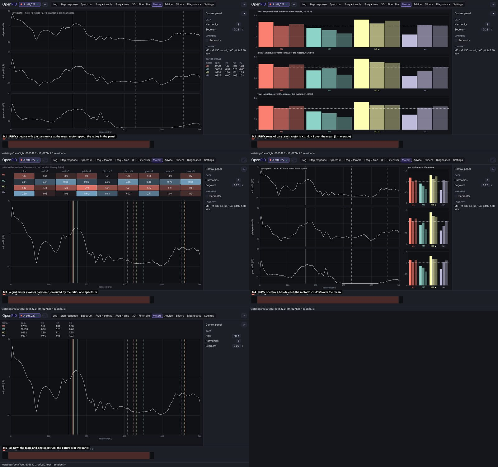
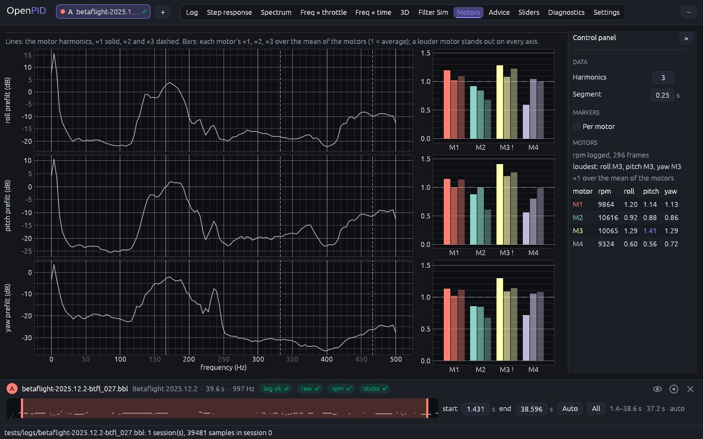
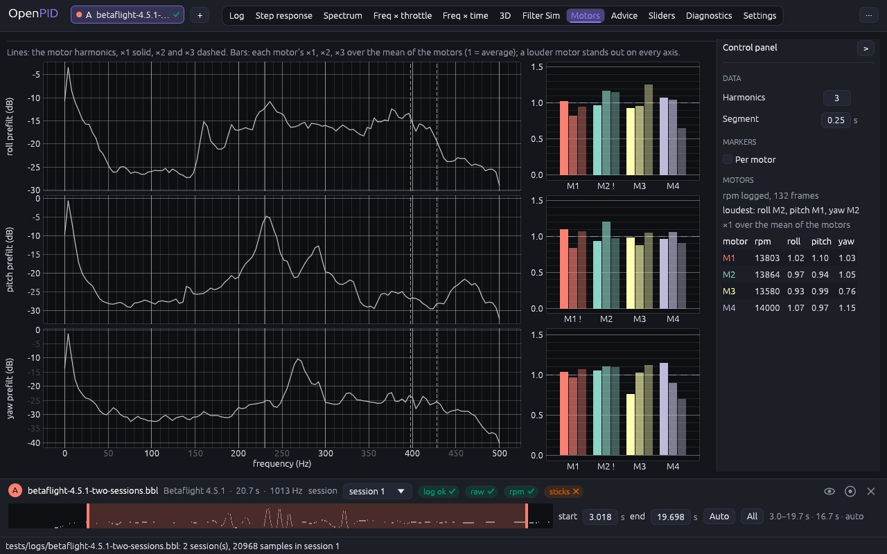

# Motors tab

The owner's remark (2026-11-09, #33, PR #143): rework the analysis tabs in the
axis-row layout ([axis-layout](../axis-layout/README.md)), one tab at a time
with the owner's approval; five conceptually different designs per change.
The reference tool's tutorial video has no motor-noise screen, so the tab
follows the other reworked tabs.

## Cause

Measured at 1280 × 800 on `betaflight-2025.12.2-btfl_027.bbl` before this change:

- **One axis at a time**, picked with the axis buttons above the table.
- **12 coloured marker lines and a 13-entry legend** on the spectrum (4
  motors × 3 harmonics), the clutter the owner had removed from Freq ×
  throttle.
- **The table carried the reading** (amplitude and ratio per harmonic): the
  loudest motor took reading 12 numbers; its row was in the accent colour
  while its plot lines were in the motor's colour, so the table and the plot
  did not match.

## Options

Five designs on the same data (btfl_027), mocked up in the shell:

| | Design | Pros | Cons | Eff | Disc | Conv | Kbd | Touch | Cost | Score |
|---|---|---|---|---|---|---|---|---|---|---|
| M1 | R/P/Y spectra with the harmonics at the mean motor speed; the ratios in the panel | the Spectrum tab's layout | which motor is loud takes reading the panel | 3 | 3 | 4 | 4 | 4 | 4 | 39 |
| M2 | R/P/Y rows of bars: each motor's ×1, ×2, ×3 over the mean | the loud motor at a glance | the spectrum, where the noise is, is gone | 4 | 4 | 2 | 4 | 4 | 4 | 40 |
| M3 | A grid motor × axis × harmonic coloured by the ratio, one spectrum | every number at once | colour-coded numbers to decode; one axis's spectrum | 4 | 3 | 3 | 4 | 3 | 3 | 38 |
| **M4** | **R/P/Y spectra with the harmonics, and beside each the motors' ×1 ×2 ×3 over the mean** | **where the noise is and which motor makes it, on every axis** | **the spectra lose 250 px of width** | **5** | **4** | **4** | **4** | **3** | **3** | **45** |
| M5 | As before, the controls in the panel | cheapest | one axis, the clutter stays | 2 | 3 | 2 | 4 | 4 | 5 | 33 |

## Decision (2026-11-10)

**M4.**

## Implementation requirements

- `motors_tab.rs`: `control_panel`; the docked log, one Motor-noise job per
  axis on the unfiltered gyro (`tools.motor_noise.channel` stays roll for
  the export and the project). Per row the spectrum (shared y-axis width,
  linked frequency axis) with one marker per harmonic at the mean motor
  speed (×1 solid, the others dashed, in the text colour); "Per motor" draws
  a marker per motor and harmonic in the motor's colour. Beside it a bar
  chart of each motor's harmonics over the mean of the motors (the motor's
  colour, lighter for higher harmonics, a dashed line at 1, the loudest
  marked "!"); a bar's hover gives its ratio and amplitude.
- **Motor colours**: `views::motor_color` takes the plot colours (Blackbox
  Explorer's palette or the colour-blind safe one) in motor order, as the
  Log viewer draws the motors, everywhere a motor has a colour.
- **Panel**: Data (Harmonics, Segment), Markers (Per motor), Motors (speed
  source and frames, the loudest motor per axis, a table of rpm and the ×1
  ratio per axis, ratios above 1.3 highlighted; narrow enough for the
  panel).

## Tests

`motor_noise_tab_lists_every_motor` (the motors, the loudest per axis,
three jobs, Per motor; the rpm estimate gives one motor; no unfiltered gyro
gives the hint and no job).

## Implementation

btfl_027 (M3 louder on every axis, M4 quieter):

Betaflight 4.5.1 (the motors within ±15 %, the loudest differs per axis):

