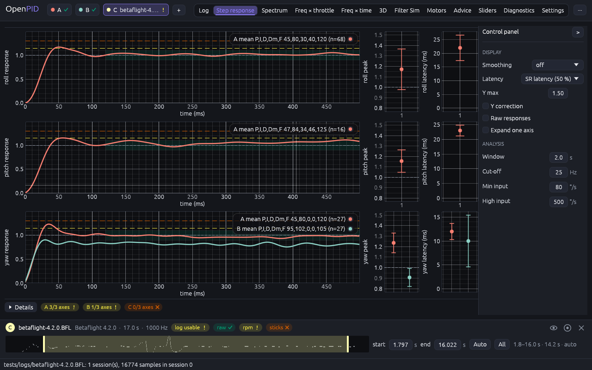

# N logs at once instead of the A/B slots

The owner's remark (2026-11-05): PIDtoolbox can compare several logs at once
(for example four flights with different D gains). We have only two slots, A/B.

## Cause

`Slot` is an enum with two variants (`worker.rs`), the colours `SLOT_A`/`SLOT_B`
are hard-coded in `colormap.rs`, and 28 places in `openpid-app` iterate over
`[Slot::A, Slot::B]` (21 in `views.rs`, 5 in `app.rs`, 2 in `surface.rs`). The
project stores `a`/`b` as separate fields. The result cache (`JobKey`) and the
worker do not limit the slots; the limit is in the presentation only.

## Options

| | Option | Pros | Cons | Score |
|---|---|---|---|---|
| R0 | As is: two slots A/B | nothing to do | does not meet the need | 24 |
| R1 | Four fixed slots A–D | minimal code changes | 4 is an arbitrary limit; empty slots take header space; PTB has more | 36 |
| R2 | **A dynamic slot list** ("+ Add log", up to 8), each with a colour, visibility and "solo" | scales naturally; the header shows only what is loaded; as in PTB and DAW software | 28 iteration sites and the project schema to rework | **49** |
| R3 | Reference plus candidates: the first slot is the reference, the rest are drawn as the difference to it | ideal for "what changed" | a difference is meaningless for heatmaps and diagnostics; a separate mode confuses | 38 |
| R4 | A tab per log, switching plus "overlay" | simple in code | comparison needs eye switching; against the PTB habit | 30 |
| R5 | Small multiples: a grid of panels per log on every tab | the heatmaps are panels anyway | line plots (step, PSD) get lost without overlay | 40 |

Recommendation: **R2**, with the layout rule for panel tabs from R5 and the
"reference" from R3 as the first slot in the list (it sets the order and the
colour of the base line).

## The owner's decision (2026-11-05)

Option R2 with the layout rules of R5. The limit is 8 logs.

## Implementation requirements

**Model.**
- `Slot` becomes `SlotId(u8)` (a newtype, `Copy`, `Hash`, `Serialize`);
  `App.slots: Vec<SlotEntry>` in the order of adding;
  `SlotEntry { id, state: SlotState, colour: Color32, visible: bool, label: String }`.
- The slot label is a letter by order (A…H) plus the file name; after a slot is
  removed the letters do not shift (A, C, D), so legends on screenshots stay clear.
- A palette of 8 Okabe–Ito colours (colour-blind safe; A/B stay blue and orange):
  `#56B4E9, #E69F00, #009E73, #CC79A7, #F0E442, #0072B2, #D55E00, #999999`.
- `JobKey.slot` → `SlotId`; the cache and the worker otherwise unchanged.
  `Loaded` (session, epoch) unchanged.
- Project: schema v2 with `slots: Vec<ProjectSlot>` carrying `id`, `label`,
  `colour`, `visible`; reading v1 (`a`/`b`) stays (migration in `Project::load`).

**The slot bar.** Instead of two "Slot A/B" rows, one row of chips:
`[● A btfl_027.bbl · session 1 · 39.6 s] [● B …] [+ Add log]`. A chip: click
makes it the active slot (for cursors, Advice, export), the eye hides it on the
plots, "S" is solo (show only this one), × closes. Dropping files into the
window adds slots one after another; `Open…` has no letters. The chip's context
menu: session, epoch (see analysis-window), rename the label, colour.

**Layout rules per tab.**
- Overlay (viewer, step, spectrum, Filter Sim PSD): every visible slot on one
  plot, in the slot colour, legend `A roll`, `B roll`.
- Panels (freq × throttle, freq × time, Surface 3D, motor noise, Advice,
  sliders, diagnostics): a 1×N grid up to 2 slots, 2×2 up to 4, beyond that a
  horizontal scroll of panels ≥ 480 px wide; "solo" shows one panel full width.
- The log-viewer cursor and the player position are shared by every slot (time
  from the session start).

**CLI.** No change (the analyses take one log); `openpid diff` already compares two.

**Limits.** 8 slots; the ninth gives a status message. Memory: 8 logs of 50 MB
is acceptable; the result cache is already bounded by its keys.

## Acceptance criteria

- Three logs open by drag-and-drop and show in three colours on step and
  spectrum; the heatmap shows three panels; "solo" leaves one.
- A project with three slots saves and opens; an old v1 project opens.
- Closing slot B does not change the letter of C.
- A headless test: 3 fixtures, checks of the legend colours, visibility, solo, the project.
- Every old test passes with two slots (A, B keep their letters and colours).

## Size

L (≈ 5 days): the model and the migration of 28 sites 2, the slot bar and the
layout 2, tests and documentation 1.

## Implementation (2026-11-05)

- **`worker.rs`:** the `Slot(u8)` newtype with the constants `A`, `B`,
  `MAX = 8` and the letters A…H.
- **`colormap.rs`:** `SLOT_PALETTE`, 8 Okabe–Ito colours.
- **`app.rs`:** `slots: Vec<SlotEntry { id, state, visible }>` in the order of
  adding; `slot_ids / loaded_slots / visible_slots / first_loaded`, `free_slot`
  (the first empty one, else the lowest free letter), `add_slot`, `close_slot`
  (the other letters do not move; an empty list leaves an empty A),
  `set_visible`, `solo`; dropped files and command-line arguments open every
  log in its own slot; one "Open log…" instead of "Open A/B".
- **`views.rs`:** `slot_headers` (a row per slot plus "+ Add log"); in the
  slot row a "show" checkbox, **S**, **x**; the analyses iterate over
  `visible_slots()`; the reference for the channel list, the sliders and the
  export is `first_loaded()`; `panel_width`: 2 panels share the width, more
  are ≥ 480 px in a row (Freq × time: a vertical scroll of panels ≥ 260 px).
  The "2×2 for 3–4" rule was replaced by a horizontal row: the panels keep the
  full plot height.
- **`project.rs`:** schema v2 with `ProjectSlot { id, visible }`; v1 is read
  (slots by position).
- **Tests:** `dropped_files_fill_free_slots_then_add_new_ones`,
  `many_slots_have_colours_visibility_solo_and_stable_letters`,
  `projects_keep_every_slot_and_read_version_1_files`; the old A/B tests
  unchanged in letters and colours.

**Verified.** Three fixtures (4.2.0, 2025.12, 4.5.1) on Step response and
Freq × throttle, 1280×800.

