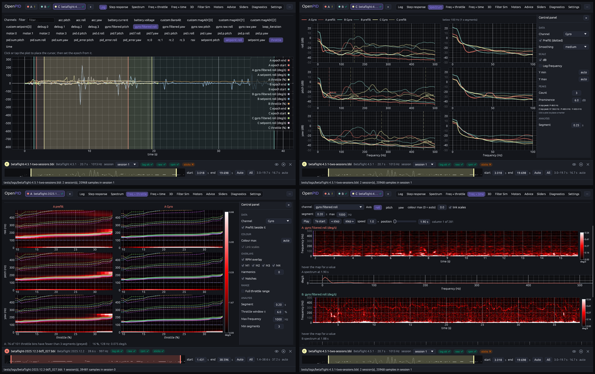

# Plot colours

The owner's remark (2026-11-10, #33, PR #143): "let's switch the colour scheme
to the one of Betaflight — I mean for the plots, as in Blackbox Explorer".

## Before

Lines in the colours of the logs, Okabe–Ito (sky blue, orange, green…;
[multi-slot](../multi-slot/README.md)); heatmaps in viridis
([colour-scale](../colour-scale/README.md)). Both were picked to stay readable
with colour-vision deficiencies; neither looks like the tool most pilots know.

## Blackbox Explorer's colours

Read from betaflight/blackbox-log-viewer (master, 2026-11-10):

- **Lines**: `GraphConfig.PALETTE` in `src/graph_config.js`, twelve colours
  given in order to the fields of a graph: `#fb8072` red, `#8dd3c7` cyan,
  `#ffffb3` yellow, `#bebada` purple, `#80b1d3` blue, `#fdb462` orange,
  `#b3de69` green, `#fccde5` pink, `#d9d9d9` grey, `#bc80bd` dark purple,
  `#ccebc5` light green, `#ffed6f` dark yellow.
- **Heatmaps** (freq × throttle, freq × RPM): `hsl(360, 100 %, L)` per cell in
  `src/graph_spectrum_plot.js`, the lightness following the value: black →
  red (half way) → white.
- Background black, white grid at 15–25 % opacity (`src/css/theme.css`),
  which our dark plots already are.

## Decision (2026-11-10)

The owner asked for this scheme, so there were no competing designs to score;
the question was how to keep what the old palettes were chosen for. Decision:

- **Blackbox Explorer by default** (`PlotColours::Explorer`): logs A…H take
  the first eight colours of its palette (A red, B cyan, C yellow…); the log
  viewer gives its channels the palette in order, each log starting three
  colours further along; heatmaps, their colour bars and the 3D surface use
  the black → red → white ramp (`render::Colormap::Explorer`).
- **"Colour-blind safe"** in Settings → Appearance → Plot colours brings back
  Okabe–Ito and viridis (`PlotColours::ColourBlindSafe`), saved in the
  preferences.
- Verdict and log-check colours (green / yellow / red with their marks) and
  the interface accent do not change. The CLI's `--png` stays viridis.

## Implementation

- `openpid-analysis/src/render.rs`: `Colormap { Explorer, Viridis }` with
  `rgba(t)` and `stops()`, `explorer(t)`, `grid_rgba_with(…, cmap)`.
- `openpid-app/src/colormap.rs`: `EXPLORER_PALETTE`, the scheme of the frame
  (`set_scheme`, set from `Prefs::plot_colours` every frame), `slot_palette()`,
  `heatmap()`, `heat(t)`. Heatmap textures are keyed by the colour map too.
- Tests: `plot_colours_follow_the_setting` (slot colours, the colour map, the
  textures and the saved preference); `render` unit tests of the ramp.

