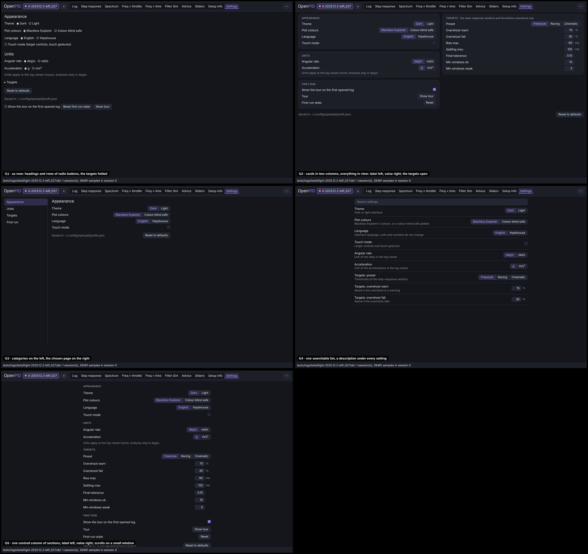
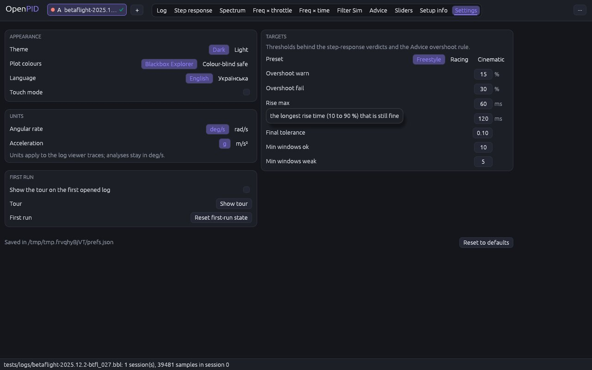

# Settings: four cards, everything in view

The owner's remark (2026-11-10, #33): finish the rework of the remaining
tabs by the same scenario as the others.

## Cause

- The tab was the last in the old layout: headings and rows of radio
  buttons from the left edge, values not aligned, most of the window empty.
- The **Targets** (the thresholds behind the step-response verdicts and the
  Advice overshoot rule) were folded under a collapsing header, so the one
  group of settings that changes what the analysis says was the one not in
  view.
- Only the two plot-colour options had a hint; the rule that every field
  explains itself on hover (the control panels) was not met here.
- "Reset to defaults" sat between the targets and the first-run buttons,
  and also emptied the list of recent files, which is not a setting.
- The reference tool has no settings screen (its options are on its control
  panel), so the convention is that of desktop settings pages.

## Options

| | Design | Pros | Cons | Eff | Disc | Conv | Kbd | Touch | Cost | Score |
|---|---|---|---|---|---|---|---|---|---|---|
| G1 | As now: headings and rows of radio buttons, the targets folded | cheapest | the targets are hidden; nothing aligned | 3 | 2 | 3 | 4 | 3 | 5 | 35 |
| **G2** | **Cards in two columns, everything in view: label left, value right, the targets open** | **no scroll and no click to see any setting; the rows of the control panels** | **two columns need 820 px (one column below it)** | **4** | **5** | **4** | **4** | **4** | **4** | **46** |
| G3 | Categories on the left, the chosen page on the right | the familiar settings window | a click per category for fourteen settings | 3 | 4 | 5 | 4 | 4 | 3 | 42 |
| G4 | One searchable list with a description under every setting | scales to many settings | a search for fourteen settings; long | 3 | 4 | 4 | 4 | 3 | 3 | 39 |
| G5 | One centred column of sections | simple | scrolls at 800 px of height | 4 | 4 | 4 | 4 | 4 | 4 | 44 |

## Decision (2026-11-10)

**G2**, by the score. Waiting for the owner's approval.

## Implementation requirements

- `settings_tab.rs`: four cards (`theme::card`) with a small upper-case
  title. Two columns from 820 px of width (Appearance, Units, First run |
  Targets), one column below it; the content grows to 1100 px.
- A row is `panel::row`: the label on the left, the value right-aligned,
  the hint on hover over both. A choice of two or three is a **segmented
  control** (the chosen option filled, every option a button named by its
  text); a switch is a check box named by its row; numbers have their unit
  beside them.
- **Appearance**: Theme, Plot colours, Language, Touch mode. **Units**:
  Angular rate, Acceleration, and the note that analyses stay in deg/s.
  **Targets**: Preset (Freestyle, Racing, Cinematic; "Custom" when the
  values match none), Overshoot warn / fail, Rise max, Settling max, Final
  tolerance, Min windows ok / weak, each with what it decides.
  **First run**: Show the tour on the first opened log, Show tour, Reset
  first-run state (`panel::action`: a row whose control is a button that
  keeps its own name).
- Under the cards: where the settings are saved (or that there is no
  configuration directory), and **Reset to defaults**, which resets the
  settings of the tab and keeps the list of recent files.
- Every change is applied and saved at once, as before.

## Tests

`settings_cards_show_every_option_and_explain_their_rows` (the four cards;
every option of every choice and the targets in view; the hint over a label
and over a value; the first-run rows; the reset restores theme and targets
and keeps the recent files); `settings_tab_persists_preferences`,
`language_switch_translates_labels_and_persists`,
`step_tab_judges_three_axes_and_targets_change_badges_without_new_jobs`
(the preset and a custom target), the colour test of `spectra.rs`. The
driver's `hover` now lets the pointer rest for the tooltip delay, which a
tab that settles in three frames did not reach.

## Implementation

The pointer on "Rise max":

