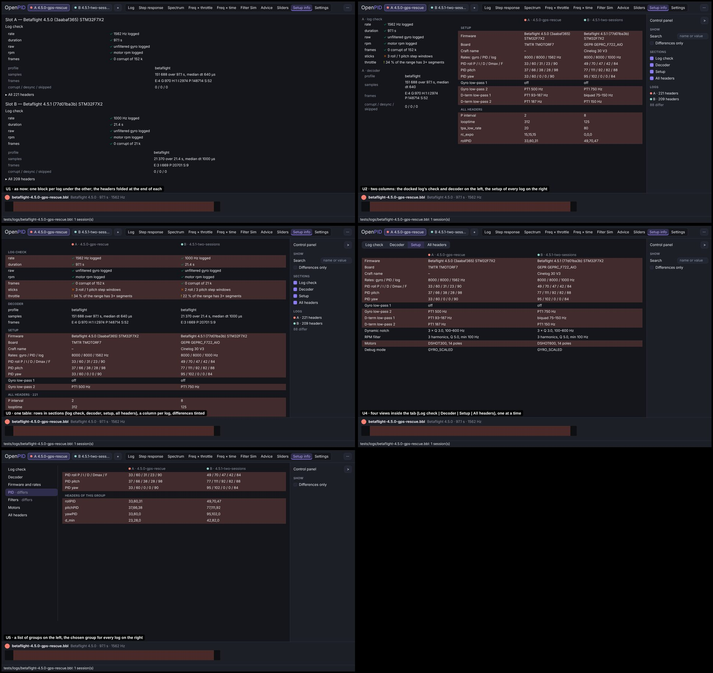
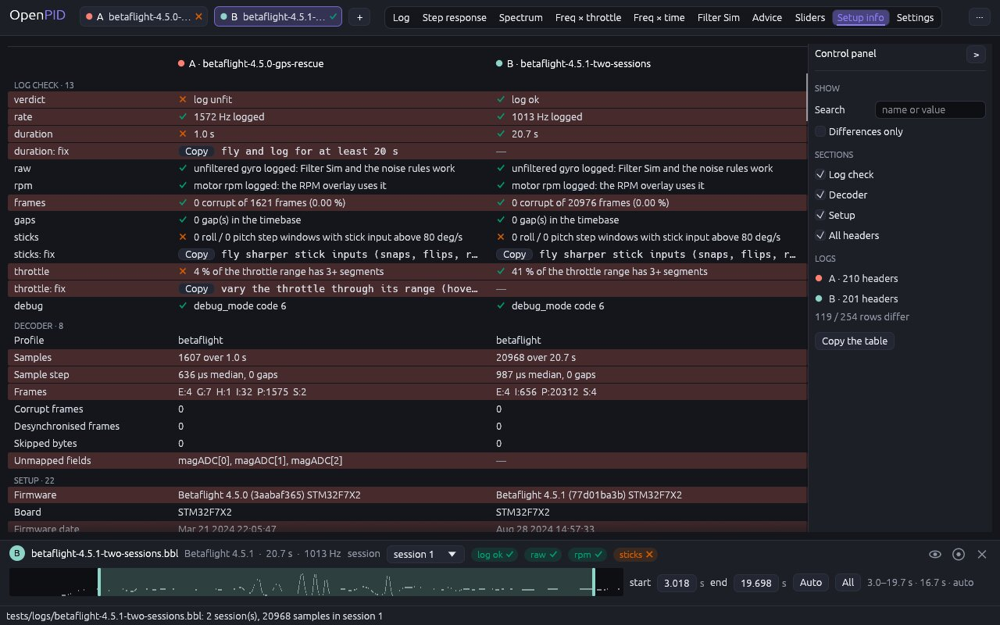
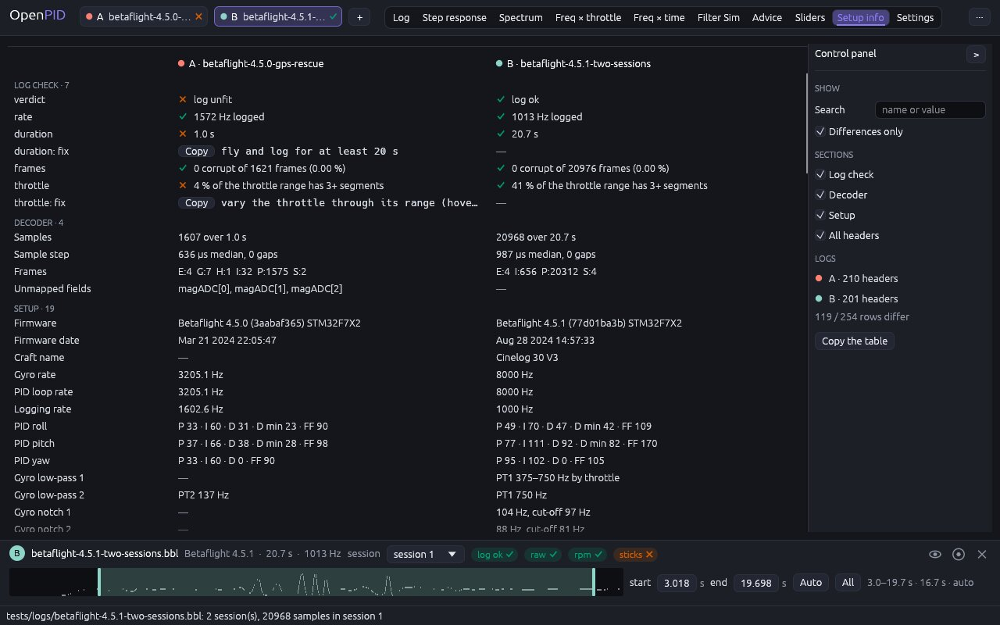

# Setup info: one table, a column per log, the differences marked

The owner's remarks (2026-11-10, #33, #140): finish the rework of the
remaining tabs by the same scenario; and, asked whether the comparison of
setups should be a tab of its own beside Diagnostics, "one Setup info tab;
why a separate tab only to compare".

## Cause

Looked at on real logs (`betaflight-4.5.0-gps-rescue.bbl`,
`betaflight-4.5.1-two-sessions.bbl`, `betaflight-4.2.0.BFL`,
`betaflight-2025.12.2-btfl_027.bbl`, `ardupilot-copter-3.3-dronekit.bin`):

- Diagnostics was still in the old layout: a block per log under the
  other, no control panel. Two logs were compared by scrolling between
  their blocks.
- The headers of a log (210 on Betaflight 4.5, 495 parameters on ArduPilot)
  were a folded list per log, with no search and nothing that said which of
  them differ between two logs.
- The setup in plain words was one line, the PID gains; the filters, the
  rates and the motors the profiles already decode into the typed settings
  were shown nowhere outside Filter Sim.
- The reference tool has a "Setup Info" window: the headers of the loaded
  files as `name:value` rows side by side, the rows that differ on a pink
  background, and "Show Differences Only". It has no search and no setup
  in plain words.

## Options

Five layouts of one tab on the same data (A = 4.5.0, B = 4.5.1):

| | Design | Pros | Cons | Eff | Disc | Conv | Kbd | Touch | Cost | Score |
|---|---|---|---|---|---|---|---|---|---|---|
| U1 | As now, a block per log under the other, the headers folded | cheapest | nothing is side by side; no search | 3 | 3 | 3 | 4 | 4 | 4 | 37 |
| U2 | Two columns: the docked log's check and decoder left, the setup of every log right | the check is always in view | the check of one log only; two scroll areas | 4 | 4 | 4 | 4 | 3 | 3 | 42 |
| **U3** | **One table: a row per fact in four sections (log check, decoder, setup, all headers), a column per log, differing rows tinted; search, "Differences only" and the sections in the panel** | **everything about every log side by side, as the reference tool's Setup Info; one scroll, one search** | **a long table; narrow columns with many logs** | **5** | **4** | **5** | **4** | **3** | **3** | **47** |
| U4 | Four views inside the tab (Log check, Decoder, Setup, All headers), one at a time | short pages | tabs inside a tab; a search stays in its view | 3 | 4 | 3 | 4 | 4 | 3 | 38 |
| U5 | A list of groups on the left, the chosen group for every log on the right | small pages by subject | a click per group; the groups must be invented per firmware | 3 | 3 | 3 | 4 | 4 | 2 | 35 |

## Decision (2026-11-10)

**U3**, by the score. One tab, as the owner asked. Waiting for the owner's
approval of the result.

## Implementation requirements

- The tab is **Setup info** (`Tab::Setup`, `--tab setup`); a project saved
  on `diagnostics` opens on it. It replaces Diagnostics.
- **The rows are pure logic in `openpid-core`** (`describe.rs`), from the
  typed model only, so they read the same for every firmware a profile
  exists for:
  - `describe::setup(session)`: Firmware, Board, Firmware date, Craft name,
    Gyro rate, PID loop rate, Logging rate, PID roll / pitch / yaw
    ("P 45 · I 80 · D 30 · D max 40 · FF 120", at the firmware's gain step),
    the low-passes of the gyro and the D-term ("PT1 500 Hz", "biquad
    75–150 Hz by throttle", "off"), the static notches, the dynamic notch,
    the RPM filter, ESC protocol, Motors, Motor poles, Motor KV, Motor
    output, Debug mode. A row the log does not say has no row.
  - `describe::decoder(session)`: Profile, Samples, Sample step (median and
    gaps), Frames by kind, Corrupt frames, Desynchronised frames, Skipped
    bytes, Unmapped fields, a Note per decoder note.
  - `describe::compare(logs)`: the rows of several logs side by side,
    matched by label (a repeated label by its turn), a row only a later log
    has placed where that log has it; `differs` when the logs do not all
    say the same, a missing row included.
- `setup_tab.rs`, four sections in one table:
  - **Log check**: the verdict (log ok / usable / unfit), then each check
    with its mark (tick, "!", cross; read out as "A rpm [!]") and its text;
    under a check, a "…: fix" row with the setting to change in monospace
    and a Copy button, for the logs that have one.
  - **Decoder** and **Setup**: the rows above, the labels translated.
  - **All headers**: every header as logged, in monospace, matched by name.
- A column per **visible** log of the session shown in it, titled with the
  log's colour, letter and file. The columns share the width; under 230 px
  each the table scrolls sideways. Rows are 22 px, drawn only when in view
  (`ScrollArea::show_rows`); a value that does not fit is cut and shown
  whole on hover; "—" where a log has no such row.
- A row the logs differ in is **tinted** (not in "Differences only", where
  every row would be).
- **Panel** — Show: **Search** (the rows whose name or value contains the
  text, any case), **Differences only** (needs two logs; greyed out with one,
  the hint says why). Sections: a check box each. Logs: the header count per
  log and "N / M rows differ". **Copy the table**: the rows shown as
  tab-separated text, a column per log.
- A section without rows to show has no title; an empty table says why (the
  search, the differences, the sections).
- The table is built when the logs, the sessions, the language or the
  options change, not per frame (`SetupState`).

## Tests

`setup_reads_the_typed_settings_in_plain_words`,
`decoder_rows_count_what_was_read_and_what_was_not`,
`compare_matches_rows_by_label_and_marks_the_differences` (`openpid-core`);
`setup_info_has_a_column_per_log_and_marks_what_differs` (4.5.0 beside
4.5.1: the columns, the verdict and a check's mark, a fix only the short log
has with its Copy button, decoder and setup rows that agree and that differ,
a row one log lacks, a header by name, the count of differing rows,
"Differences only", the search by name and by value, a search without a
match, the sections, the table as text, a hidden log);
`setup_info_follows_the_session_and_the_firmware` (the session picker
rebuilds the table; ArduPilot: gains at its step, its notes, no row for
what it does not log; no table without a log);
`log_check_badges_and_card_follow_the_session` (the verdict and the fix on
this tab, the badges on every tab).

## Implementation

4.5.0 beside 4.5.1:

"Differences only":

Against the reference tool's Setup Info (its tutorial video): the headers
side by side with the differing rows marked and "differences only" are the
same idea; here the same table also carries the log check, the decoder's
counts and the setup in plain words, has a search, follows the session
shown, and copies as text. The reference tool picks the files to show in a
list; here the logs are the visible ones, hidden with the eye as on every
tab.
