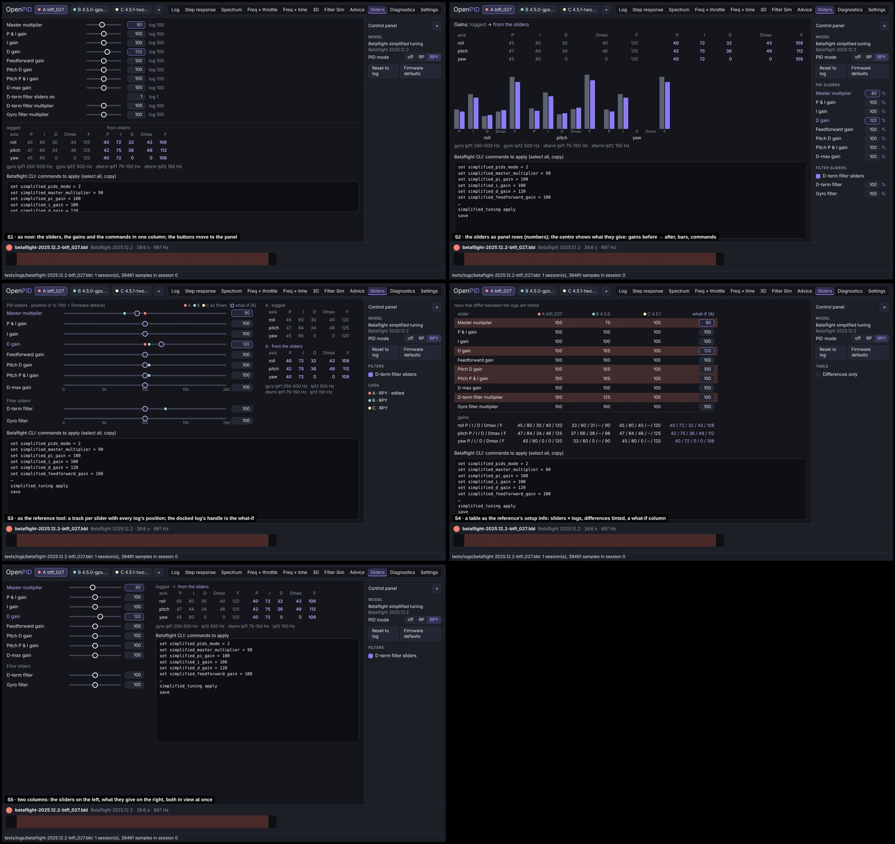
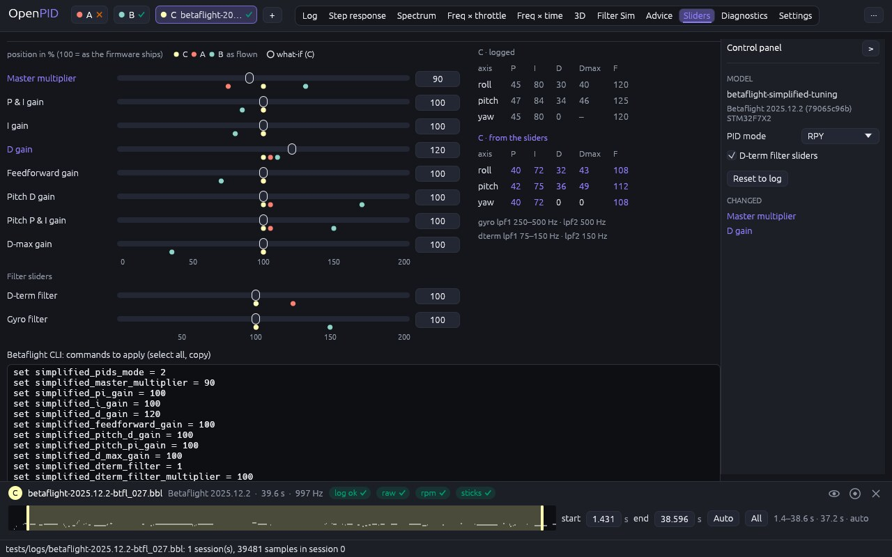
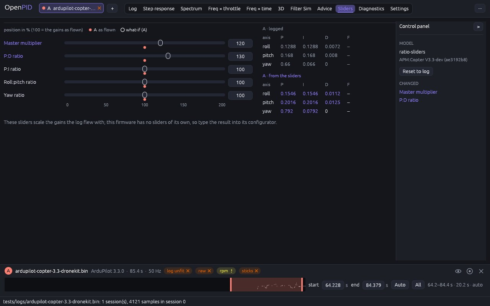

# PID sliders: a track per slider with every log's position

The owner's remark (2026-11-10, #33): finish the rework of the remaining
tabs by the same scenario as the others.

## Cause

Looked at on real logs (`betaflight-2025.12.2-btfl_027.bbl`,
`betaflight-4.5.0-gps-rescue.bbl`, `betaflight-4.5.1-two-sessions.bbl`,
`betaflight-4.2.0.BFL`, `ardupilot-copter-3.3-dronekit.bin`):

- The tab was still in the old layout: twelve sliders, the gain table and
  the commands in one column, the buttons above them, no control panel.
- It showed the first loaded log only. The reference tool's "Betaflight PID
  Sliders" plot shows the slider positions of **every** loaded log on one
  track per slider, which is how two tunes are compared.
- "PID sliders mode (0 off, 1 RP, 2 RPY)" and "D-term filter sliders on" were
  sliders, although one is a choice of three and the other a switch.
- A log without Betaflight's simplified tuning (Betaflight 4.2, INAV,
  Rotorflight, ArduPilot) got one line, "no simplified-tuning headers in
  this log". The reference tool's own slider tool is not tied to a firmware:
  start gains and five ratio sliders (P:D, P:I, roll:pitch, yaw, master).

## Options

Five layouts on the same data (A = btfl_027 docked, B = 4.5.0, C = 4.5.1; the
what-if is master 90 and D gain 120, computed by the real model):

| | Design | Pros | Cons | Eff | Disc | Conv | Kbd | Touch | Cost | Score |
|---|---|---|---|---|---|---|---|---|---|---|
| S1 | As now; the buttons move to the panel | cheapest | one log; the commands scroll out of view | 3 | 3 | 3 | 4 | 4 | 5 | 38 |
| S2 | The sliders as panel rows (numbers); the centre shows gains before → after, bars, commands | the result is always in view | sliders that are not sliders; small targets on touch | 4 | 3 | 2 | 4 | 2 | 3 | 35 |
| **S3** | **A track per slider with every log's as-flown position; the handle is the docked log's what-if; gains and commands beside and under** | **two tunes compared at a glance, as the reference tool; edit, result and commands in one view** | **a custom track; the widest layout** | **5** | **4** | **5** | **4** | **4** | **2** | **47** |
| S4 | A table sliders × logs, differences tinted, a what-if column | exact numbers of every log | no sliders; reads as a settings diff | 4 | 4 | 3 | 4 | 3 | 3 | 40 |
| S5 | Two columns: sliders left, result right | both in view | one log | 4 | 4 | 3 | 4 | 4 | 4 | 42 |

## Decision (2026-11-10)

**S3**, by the score. Waiting for the owner's approval.

## Implementation requirements

- `sliders_tab.rs`: `control_panel`; the **docked** log is edited (not the
  first loaded one). A track per quantity slider: label, `egui::Slider`
  without its number, the number beside it (both named by the label). Under
  each track a dot per visible log with the same slider model at the
  position the log flew with, in the log's colour, the docked log on top; a
  0…200 scale under the last track of a group; the label turns accent when
  the slider is off its logged position.
- Beside the tracks: the gains as logged and the gains from the sliders
  (`P I D Dmax F` per axis, at the firmware's gain step, changed cells
  accent), and the filter cut-offs the sliders give. Under them the
  firmware's commands in a box that takes the rest of the height.
- **Panel**: Model (its id and the firmware), the sliders that are choices
  (`SliderDef::options`: three names make a combo box, two a check box),
  "Reset to log", "Firmware defaults" (only when the defaults differ from the
  log), and "Changed": the sliders that are off their logged position.
- **Ratio sliders** (`openpid_core::RatioSliders`): for a log whose profile
  has no slider model, five sliders in percent over the logged gains:
  master (P, I, D of every axis), P:D (D), P:I (I of roll and pitch),
  roll:pitch (P, I, D of pitch), yaw (P, I, D of yaw). Feedforward stays,
  D-min / D-max follow D, results are rounded to the firmware's gain step.
  No commands: a note says to type the gains into the firmware's
  configurator. `FormatRegistry::slider_model` returns it as the fallback, so
  the app and `openpid sliders` behave alike. The formulas were read off the
  numbers the reference tool's slider tool shows in its tutorial video
  (start 4 / 0.05 / 15, ratios 1.35, 1.20, 1.30, 1.05, master 1.45), not from
  its code; the unit test pins those numbers.
- A log without PID gains says so; there is nothing to scale.

## Tests

`sliders_tab_tracks_every_log_and_gives_the_gains_and_commands` (ten
tracks; a track and its number by name; the mode choice and the filter
switch in the panel; both resets; the commands; a second log marks its
positions on the same tracks, the docked one first; a 4.2 log gets ratio
sliders, no commands, and whole-number gains);
`ratio_sliders_keep_the_firmwares_gain_step` (ArduPilot: 0.1288 × 1.2 =
0.1546); `ratio_sliders_scale_the_logged_gains` in `openpid-core`; the CLI
test `sliders_command`.

## Implementation

Three Betaflight logs, C docked, master 90 and D gain 120 (B is the longer
session of the 4.5.1 log, flown with other sliders):

An ArduCopter log, master 120 and P:D 130:

Against the reference tool: its plot has one line per slider with a dot per
log, positions 0…2; ours has the same lines in percent (the number the
header and the CLI use), plus the handle to try a change and the resulting
gains and commands, which the reference tool keeps in a separate window.
