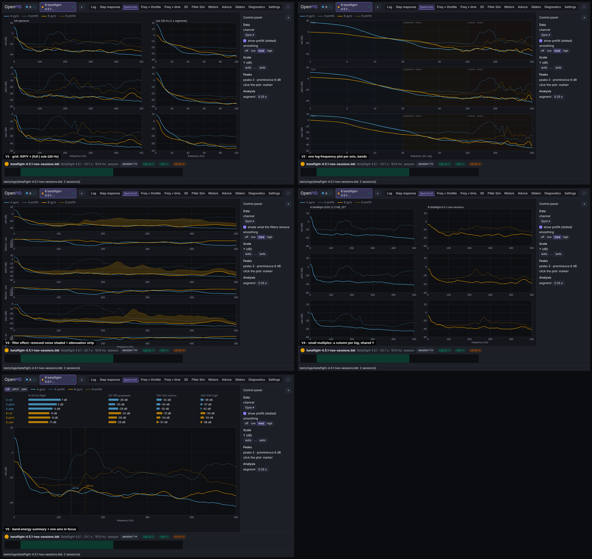
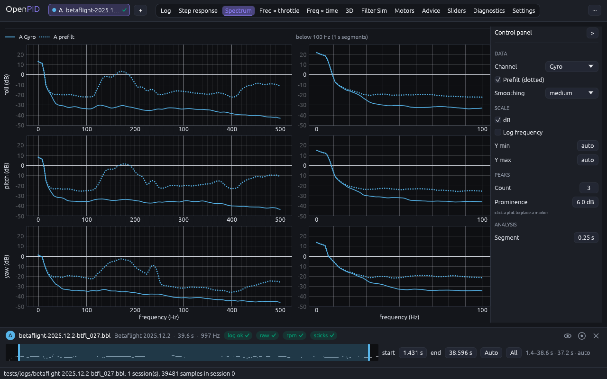
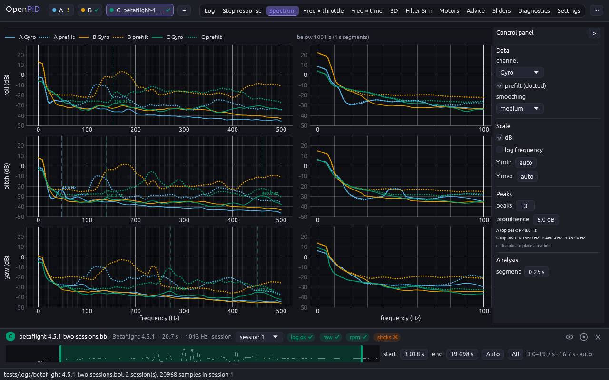

# Spectrum tab

The owner's remark (2026-11-09, #33, PR #143): rework every analysis tab in the
axis-row layout ([axis-layout](../axis-layout/README.md), R4), one tab at a
time with the owner's approval, and for every change try five conceptually
different designs and pick the best.

## Cause

Measured at 1280 × 800 on `betaflight-2025.12.2-btfl_027.bbl` before this change:

- **One axis, one channel.** The tab drew the PSD of one channel; roll, pitch
  and yaw took three clicks on the axis buttons, and the unfiltered gyro had to
  be picked instead of the filtered one, so the effect of the filters was never
  on screen.
- **Low frequencies squeezed.** With 0.25 s segments (4 Hz bins) the range
  below 100 Hz, where propwash and frame resonances live, is 25 points at the
  left edge of a 0–500 Hz axis.
- **Controls above the plot.** Channel, axis, segment, max, dB, peaks,
  prominence and the read-out took two wrapped lines over the plot.
- **No smoothing; peaks at 4 Hz.** The raw Welch estimate is ragged, and the
  "top peak" of every log was the stick input at 4 Hz.

## Options

Five designs on the same data (A = btfl_027, B = Betaflight 4.5.1, session 1),
mocked up in the new shell with the control panel on the right:

| | Design | Pros | Cons | Eff | Disc | Conv | Kbd | Touch | Cost | Score |
|---|---|---|---|---|---|---|---|---|---|---|
| **V1** | **Grid: R/P/Y rows × (full spectrum \| below 100 Hz, 1 s segments)**, gyro solid, prefilt dotted, logs overlaid | **every axis and the low range at once; what PIDtoolbox users expect** | **six smaller plots; the 0–100 Hz range is drawn twice** | **4** | **4** | **5** | **4** | **3** | **4** | **45** |
| V2 | One log-frequency plot per axis (2–500 Hz) with labelled bands (flight, propwash · frame, motors · props) | the whole range in one wide plot, the low end gets room | a log axis is unusual in this hobby; harmonics no longer evenly spaced | 4 | 3 | 3 | 4 | 4 | 4 | 40 |
| V3 | Filter effect: removed noise shaded between prefilt and gyro, attenuation strip under each axis | shows what the filters do | the strips are cramped; one log at a time reads well, two do not | 4 | 4 | 3 | 4 | 3 | 3 | 40 |
| V4 | Small multiples: a column per log, rows R/P/Y, shared Y | no overlap between logs | columns narrow with every log; comparing means eye jumps | 3 | 4 | 3 | 4 | 3 | 4 | 38 |
| V5 | Band-energy table per log and axis + one axis in focus | numbers to compare at a glance | back to one axis at a time, which #33 removes | 2 | 4 | 2 | 4 | 4 | 3 | 33 |

## Decision (2026-11-09)

**V1**, with V2's logarithmic frequency axis as a panel option ("log frequency",
off by default) for the full-spectrum column.

## Implementation requirements

- `spectrum_tab.rs`: the tab in the axis-row layout; `control_panel` on the
  right, then a legend line (per log: solid "A Gyro", dotted "A prefilt"; the
  title of the right column) and three rows. Each row: the full spectrum (60 %
  of the width) and the range below 100 Hz (40 %), both in `PsdParams` jobs of
  the worker, cached like every analysis: the full one with the panel's
  segment, the low one with `max(segment, 1 s)` and `max_hz = 100`. The x axes
  of a column are linked; the power axis is the same for all six plots.
- **Quantity** (`spectrum_tab::Quantity`): Gyro, D-term, P-term, PID sum, PID
  error, Setpoint, mapped to a channel per axis; only the gyro has a prefilt
  counterpart (`gyro.raw`). Projects keep `spectrum_channel` (the roll channel
  of the quantity); `psd.channel` follows the selected axis for the JSON export.
- **Spectrum** (added with decision D-001 of `docs/calibration/DECISIONS.md`,
  option A): **smoothed curve** (default) or **power density**, one list in
  the Data section under Prefilt. The curve is `PsdMethod::Curve`, the
  reference tool's curve; the density is the Welch estimate this tab was
  designed around. The choice is an analysis parameter (`psd.method`), kept
  by projects; a project saved before it opens as the density it was saved
  with.
- **Smoothing**: for the curve its five levels low / low-med / medium /
  med-high / high (`psd.smoothing`, part of the analysis: the curve comes
  smoothed and is not smoothed again for display). For the density off / low
  / low-med / medium / med-high / high: a moving average of the linear power
  over 0 / 2 / 4 / 8 / 16 / 32 Hz (`smooth_power`, which keeps the total
  power), default medium. The list is the same control in both cases.
- **Segment** is shown for the density only: the curve is one piece.
- **Power axis**: dB (default) or linear; automatic from the drawn data above
  2 Hz, padded 3 dB and rounded to 10 dB, unless the panel fixes Y min / Y max.
- **Peaks**: per solid full-range trace, the N most prominent from 20 Hz up
  (`PEAK_MIN_HZ`); dashed lines and frequency labels on the full column; the
  panel lists each log's top peak per axis. Manual markers: a click on any plot,
  snapped to the nearest bin, drawn on both columns and mirrored on the
  heatmaps as before.
- The last row is taller by the frequency label, so every plot area is the same
  height and the power ticks match across rows.

## Acceptance

- At 1280 × 800 with `btfl_027`: roll, pitch and yaw, full and below 100 Hz,
  gyro and prefilt, without a click; smoothing medium.
- With three logs, every log is in its colour on every plot and the panel lists
  the top peaks without repeats.

## Tests

`spectrum_draws_the_curve_by_default_and_the_density_on_request`: the curve
at "medium" with one segment and steps far below 1 Hz; a higher level is a
flatter curve; the density has segments and a Segment field, the curve has
none.

`spectrum_and_heatmap_controls_change_parameters`: 12 PSD jobs for one log
(3 axes × gyro / prefilt × full / low); the legend; dB; prefilt off; D-term
without prefilt; log frequency read back in Hz; Y min back to auto; automatic
peaks; manual markers by clicking the roll plot, the Δ read-out, Clear markers.
Unit tests: `smoothing_averages_over_the_width`,
`quantities_map_to_channels_and_back`, `log_grid_marks_one_two_five`.

## Implementation

One log:

Three logs (A = Betaflight 4.2.0, B = btfl_027, C = 4.5.1):

