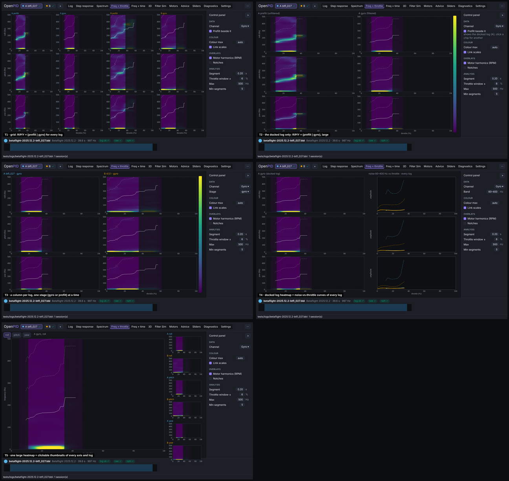
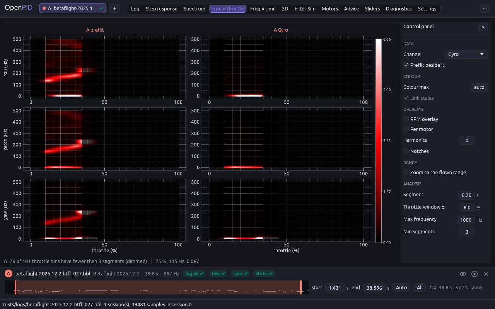
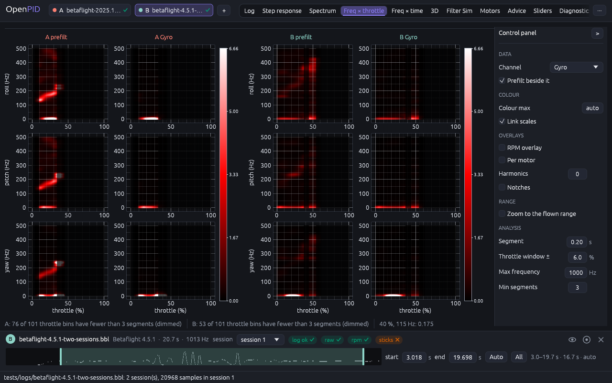

# Freq × throttle tab

The owner's remark (2026-11-09, #33, PR #143): rework every analysis tab in the
axis-row layout ([axis-layout](../axis-layout/README.md), R4), one tab at a
time with the owner's approval; for every change, five conceptually different
designs and the best one.

## Cause

Measured at 1280 × 800 on `betaflight-2025.12.2-btfl_027.bbl` before this change:

- **One axis, one channel.** One heatmap per log of the chosen channel; roll,
  pitch and yaw took the axis buttons, and the unfiltered gyro had to be picked
  instead of the filtered one, so the filters' effect was never on screen.
- **Empty throttle axis.** The log flew 10–34 % throttle; the axis is 0–100 %,
  so three quarters of every map is greyed "unsampled" bins.
- **Controls above the maps.** Channel, axis, colour max, link, segment,
  throttle window, max, min segments and the overlay toggles took two or three
  wrapped lines; a segments-per-bin strip took 56 px under every map.

## Options

Five designs on the same data (A = btfl_027, B = Betaflight 4.5.1, session 1),
mocked up in the new shell with the control panel on the right:

| | Design | Pros | Cons | Eff | Disc | Conv | Kbd | Touch | Cost | Score |
|---|---|---|---|---|---|---|---|---|---|---|
| **T1** | **Grid: R/P/Y rows × (prefilt \| gyro) for every log**, one colour scale per log | **the filters' work and every log at once; PIDtoolbox's first preset** | **cells narrow with two logs; more than two scroll sideways** | **4** | **4** | **5** | **4** | **2** | **4** | **44** |
| T2 | The docked log only: R/P/Y × (prefilt \| gyro), large | the largest maps | comparing logs means switching the dock; the tab depends on the dock | 3 | 3 | 4 | 4 | 4 | 5 | 40 |
| T3 | A column per log, one stage at a time (gyro or prefilt) | wide maps for two logs | prefilt against gyro, the main reading, takes a toggle | 3 | 4 | 3 | 4 | 3 | 5 | 39 |
| T4 | The docked log's heatmap + noise-vs-throttle curves (60–400 Hz) of every log | logs compared as numbers | the curves need explaining; prefilt and gyro maps not side by side | 4 | 3 | 2 | 4 | 4 | 3 | 37 |
| T5 | One large heatmap + thumbnails of every axis and log | the most detail | one map at a time, which #33 removes | 2 | 3 | 2 | 3 | 4 | 3 | 29 |

The mock-ups also showed that every design wastes most of the throttle axis
on this log, so the decision adds a throttle range that follows the data.

## Decision (2026-11-09)

**T1**, with the throttle axis on the range the logs flew.

## Implementation requirements

- `throttle_tab.rs`: `control_panel` on the right; per visible log a group of
  columns (prefilt when shown and logged, then the quantity) with a title in
  the log's colour, three rows (roll, pitch, yaw) and one colour bar for the
  group. Each cell is a `ThrottleHeatmapParams` job of the worker (6 per log),
  rasterised once per result and colour scale (`grid_image`; the texture cache
  holds 96). Groups take `full width / logs`, at least two 200 px cells and a
  colour bar; more logs than fit scroll sideways.
- **Colour scale per log**: the largest automatic maximum (99th percentile
  above 20 Hz) of its maps, so prefilt and gyro compare; "Link scales" shares
  the largest across logs; a fixed "Colour max" wins. `App::colour_scales`
  records one value per log.
- **Throttle range** (since the revision below: 0–100 % by default, this
  range behind "Zoom to the flown range"): from the first to the last bin with at least
  "Min segments" segments in any visible map, to the edges of those bins (a
  margin would only add greyed, unsampled bins at both edges: the owner saw
  them on a trimmed epoch), applied when it changes and on a double click;
  "Full throttle range" shows 0–100 %. All cells link x and y.
- **Grid labels on the 1–2–5 series** (`grid.rs`, shared by every plot of
  the reworked tabs): egui_plot's default spacer steps by powers of ten and
  left a 0–55 % axis with the single label "0".
- Overlays (RPM harmonics per motor, notches), manual spectrum markers and the
  hover read-out as before. The segments-per-bin strip is gone: the dimmed
  bins and the line "A: 76 of 101 throttle bins have fewer than 3 segments
  (greyed)" under the maps carry it.
- Panel per the control panel rules: Data (Channel, Prefilt beside it), Colour
  (Colour max, Link scales), Overlays (RPM overlay, M1…Mn, Harmonics,
  Notches; only with motor speeds), Range (Full throttle range), Analysis
  (Segment, Throttle window ±, Max frequency, Min segments).

## Tests

`throttle_tab_stacks_the_axes_with_prefilt_and_zooms_to_the_flown_range`
(6 jobs, titles, one scale per log, range 10–34 % ± a bin, full range, prefilt
off); `rpm_overlay_on_the_throttle_heatmap_has_per_motor_toggles`;
`heatmaps_show_a_colour_scale_with_linked_maxima_and_a_hover_value`; the
texture reuse in `spectrum_and_heatmap_controls_change_parameters`; unit test
`grid_steps_follow_one_two_five`.

## Implementation

One log (btfl_027, 10–34 % throttle):

Two logs (A = btfl_027, B = 4.5.1):

## Revision after the owner's comparison with the reference video (2026-11-10)

The owner compared the tab with the reference tool's tutorial video (its
Freq × throttle screen, 9:04–11:00) and found the maps and the motor overlay
"drawn wrong". The overlay data were right: on btfl_027 the prefilt noise peak
lies within the four motors' fundamentals in every sampled throttle bin
(140 Hz at 10 %, 180 Hz at 30 %). The drawing was not:

- **Overlay clutter**: 4 motors × 3 harmonics = 12 coloured lines plus the
  notch lines on each of the six maps hid the noise ridge they are meant to
  explain. Now one thin line per harmonic at the mean of the motors (the
  fundamental solid, the others dashed, in the text colour); "Per motor"
  brings back the coloured line per motor with the M1…Mn toggles; "Notches"
  is off by default.
- **Blocky maps**: the cells were drawn without interpolation; the textures
  are now interpolated (`TextureOptions::LINEAR`), as the video's maps.
- **Throttle axis**: zooming to the flown range stretched 25 bins into large
  blocks; the axis is 0–100 % again, as in the video, and "Zoom to the flown
  range" is an option.
- **Unsampled bins** are dimmed towards black (as Blackbox Explorer dims what
  is outside its marks) instead of a light grey block.

The colour map stays Blackbox Explorer's black → red → white
([plot-colours](../plot-colours/README.md)); the video's tool uses MATLAB's
"hot" (black → red → yellow → white).

Second pass the same day: the owner pointed out that the reference tool draws
no line from the data on this screen at all, only fixed guide lines (the
dashed 20 / 60 Hz band limits of its "<100Hz" view), and that our motor line
reads as part of the data. The RPM overlay is now **off by default**; the
maps show the data alone, and "RPM overlay" (mean of the motors, or "Per
motor") is an option for checking motor noise. The colour bar and the value
under the pointer carry **no unit** any more: the amplitude of broadband
noise depends on the segment length and the logging, so "deg/s" there read
as an exact rate it is not; the numbers compare maps.
