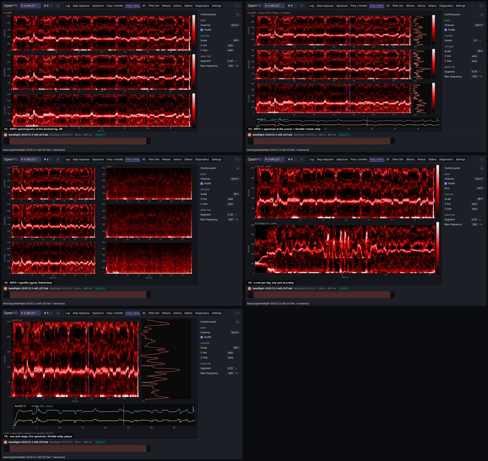
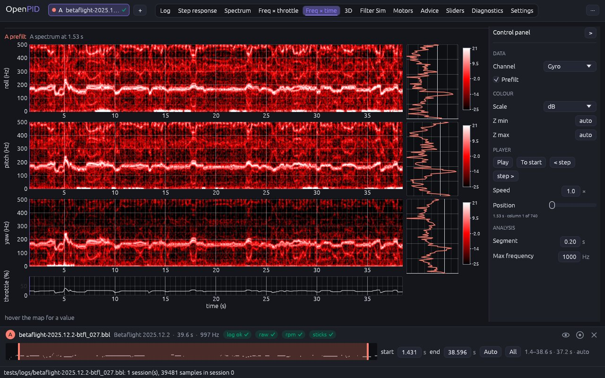
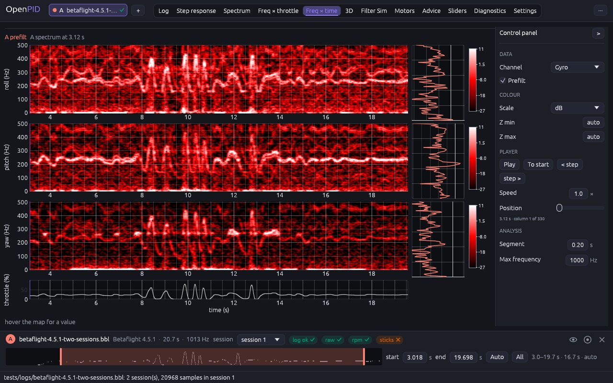

# Freq × time tab

The owner's remark (2026-11-09, #33, PR #143): rework every analysis tab in the
axis-row layout ([axis-layout](../axis-layout/README.md)), one tab at a time
with the owner's approval; five conceptually different designs per change;
and, after Freq × throttle, check every screen against the reference tool's
tutorial video.

## Cause

Measured at 1280 × 800 on `betaflight-2025.12.2-btfl_027.bbl` before this change:

- **One axis, filtered gyro, linear colour.** One spectrogram per log of the
  chosen channel (`gyro.filtered.roll` by default) with a linear amplitude
  colour scale: the motor-noise lines that the unfiltered gyro shows were
  barely visible, and pitch and yaw took the axis buttons.
- **Controls above the maps** (channel, axis, colour max, link, segment, max,
  the player with seven controls), two to three wrapped lines.
- **No time context**: nothing on screen said what the throttle did when the
  noise rose.

The reference video (its Freq × time screen, 11:40–13:50) shows roll, pitch
and yaw spectrograms stacked, the unfiltered gyro, the colour in dB with
Z min −30 / Z max 10, and the controls in a column on the right.

## Options

Five designs on the same data (btfl_027; B = Betaflight 4.5.1, session 1),
mocked up in the shell with the control panel on the right:

| | Design | Pros | Cons | Eff | Disc | Conv | Kbd | Touch | Cost | Score |
|---|---|---|---|---|---|---|---|---|---|---|
| F1 | R/P/Y spectrograms of the docked log, dB | the reference tool's screen | drops the player and the spectrum at the position, which exist and are tested | 4 | 4 | 5 | 4 | 4 | 4 | 46 |
| **F2** | **F1 + the spectrum at the position beside each row + the throttle under the rows; the player in the panel** | **the reference screen plus what the noise did when; keeps the player** | **narrower maps (the spectrum column)** | **5** | **4** | **4** | **4** | **3** | **3** | **45** |
| F3 | R/P/Y × (prefilt \| gyro) | shows the filters' work | the filtered gyro is nearly empty on most logs; maps half as wide | 3 | 4 | 3 | 4 | 3 | 4 | 38 |
| F4 | A row per log, one axis | compares flights | flights have different time axes; one axis at a time | 3 | 4 | 3 | 4 | 4 | 4 | 39 |
| F5 | One axis large, live spectrum, throttle strip | the most detail | one axis at a time, which #33 removes | 2 | 4 | 2 | 4 | 4 | 4 | 34 |

## Decision (2026-11-10)

**F2.** F1 scored a point higher, but only by dropping the spectrum player
(#30) that the tab already has and that its tests cover; F2 keeps it and adds
the throttle the noise depends on.

## Implementation requirements

- `time_tab.rs`: `control_panel`; the docked log's three STFT jobs (one per
  axis); per row the spectrogram (dB by default, interpolated texture keyed
  by result, colour range and colour map), the spectrum at the position's
  column (frequency up, on the same colour range) and one colour bar; the
  throttle strip under the rows. Every plot has the same y-axis width
  (`Y_AXIS_W`) and the spectrograms and the strip share and link the time
  axis, so the position line and the throttle line up with the maps.
- **Channel**: `Quantity` with **Prefilt** (default on: `gyro.raw`, the
  reference tool's default). `tools.stft.channel` follows the roll row for
  the export and the project.
- **Colour**: dB = `20·log10` of the amplitude. Automatic range: the 30th
  and 99.5th percentiles of the dB values above 20 Hz, shared by the three
  rows (cached per result); **Z min** / **Z max** fix the ends. Linear:
  0 … the colour max as before. The bars show numbers without a unit (owner,
  2026-11-10).
- **Player** in the panel: Play / Pause, To start, < step, step >, Speed,
  Position, "column i of n"; the rows apply the requests and advance the
  position each frame; the position stays the Log viewer cursor.
- One log at a time, the docked one: flights have their own time axes, and
  the dock already says which log the timeline belongs to.

## Tests

`time_tab_stacks_the_axes_in_db_with_the_throttle_under_them` (three jobs,
prefilt by default, the automatic dB range below 0, fixed Z min / Z max, the
filtered gyro); `time_heatmap_player_plays_scrubs_and_syncs_the_cursor`
(unchanged behaviour through the panel); the linear colour max in
`heatmaps_show_a_colour_scale_with_linked_maxima_and_a_hover_value`.

## Implementation

btfl_027:

Betaflight 4.5.1 (the throttle bursts line up with the noise):

## Revision: the map of the reference tool (2026-11-14, decision D-006)

The owner decided that the map is computed as the reference tool computes its
own, with one stated exception (DESIGN §6.5; #174). What that changed on this
tab:

- **The map**: a column per segment of 0.3 s, a power density in decibels
  (`10·log10(2·|X|² / (L·fs))`), rows to half the log rate, smoothed along
  the frequency. It is no longer an amplitude shown as `20·log10`.
- **No linear colour.** The map is decibels by definition and the reference
  tool has no linear colour here, so the "Scale" switch (dB / linear) and the
  linear "Colour max" left the panel.
- **Smooth frequency** and **Smooth time**: two lists of the four levels of
  the rule (off, low, medium, high; both "low" by default) in "Analysis";
  each level is a job of its own. "Segment" left the panel: the rule has one
  segment length.
- **Colour scale**: a list in "Colour": the reference tool's fixed
  −30 … 10 dB by default, "automatic" (the percentiles above, as before) or
  "typed in" with "Z min" and "Z max", which start from the scale on screen.
- **Max frequency**: auto is half the log rate; a value leaves out the rows
  above it.
- **A map wider than a texture**: at "high" a long log has more columns than
  a texture may be wide; several columns then share a pixel, drawn in the
  colour of the largest of them.
- **Not copied**: the reference tool draws a few of its first columns out of
  place; here every column is at the middle of its segment.
- Kept as they were: the three rows of the docked log, prefilt by default,
  the spectrum at the position beside each row (now in the new decibels, on
  the scale of the maps), the throttle strip, the player, the value under the
  pointer, the exports.

Tests: `time_tab_stacks_the_axes_in_db_with_the_throttle_under_them`,
`time_tab_lists_set_the_two_levels_of_the_map`,
`time_tab_colour_scale_is_fixed_automatic_or_typed`,
`time_tab_max_frequency_lowers_the_top_of_the_maps`,
`a_map_wider_than_a_texture_is_drawn_by_the_largest_cell_of_a_group`, and the
earlier ones adapted. The pictures above show the tab before this revision.
